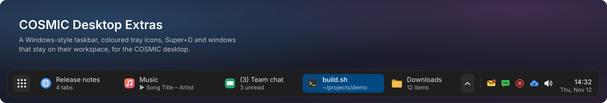
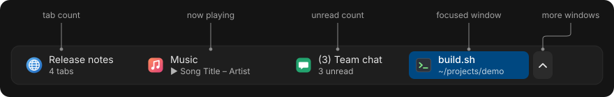
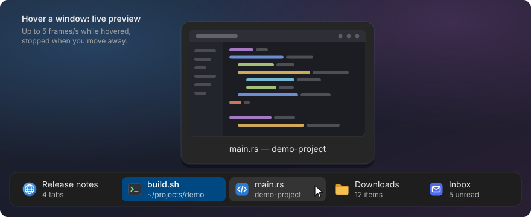
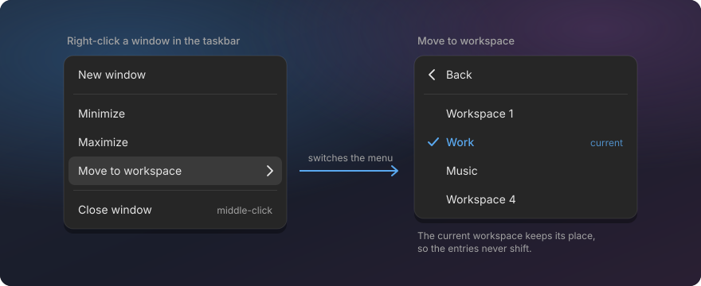
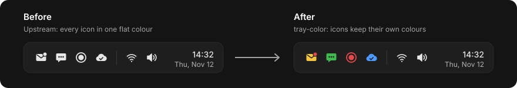
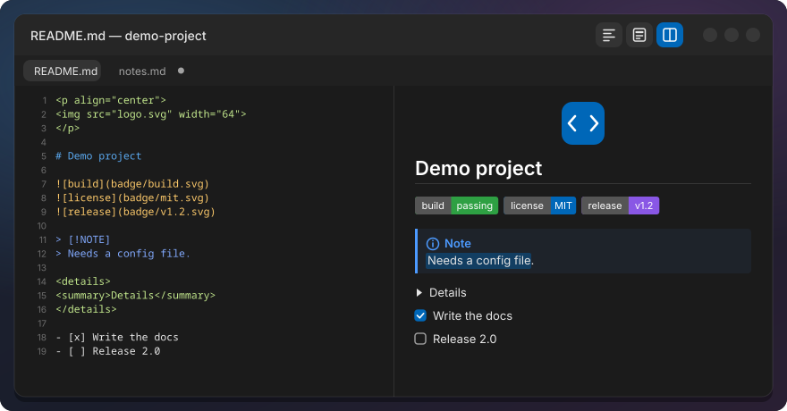
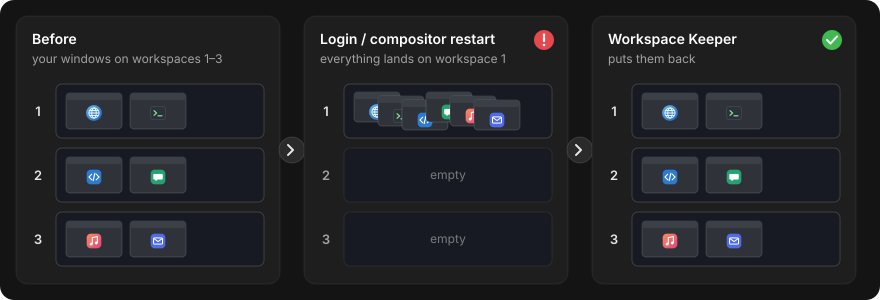
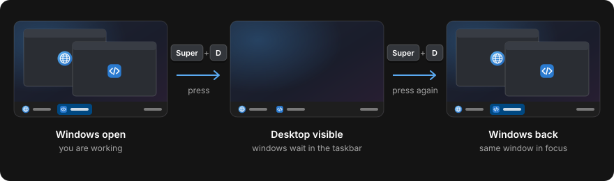

# COSMIC Desktop Extras

Website: [jwillmer.github.io/cosmic-desktop-extras](https://jwillmer.github.io/cosmic-desktop-extras/) ·
Blog posts: [why and how it was built](https://jwillmer.de/blog/projects/cosmic-desktop-extras.html) ·
[the Text Editor](https://jwillmer.de/blog/projects/cosmic-text-editor.html)

A Windows-style taskbar and a few small helpers for the COSMIC desktop on Pop!_OS: see every
window on your workspace at a glance with live previews, move windows between workspaces from a
right-click, keep windows on their workspaces across logins, show the desktop with Super+D, and a Text
Editor that renders Markdown and restores your session.



Pick the tools you want; each one installs on its own and uninstalls back to stock COSMIC.

## What you get

### Taskbar

One button per window on the current workspace, with icon, title and a second line that tells you
something: "3 tabs", the song that is playing, "4 unread". Live preview on hover, middle-click to
close, right-click to move a window to another workspace. The dock stops showing the same apps
twice.

[](taskbar/README.md)

**Live preview on hover.** Rest the pointer on a window and a live picture of it appears, so you
find the right one without switching to it. Minimized windows show their last picture.

[](taskbar/README.md)

**Move a window to another workspace.** Right-click it in the taskbar, pick "Move to workspace" and
choose the target by name or number. No dragging through the workspace overview.

[](taskbar/README.md)

Install: `./install.sh taskbar` · [More about the taskbar](taskbar/README.md)

### Terminal tab counts and Files tab counts (taskbar add-ons)

The taskbar shows "3 tabs" for COSMIC Terminal windows, and "2 tabs" or "14 items" for COSMIC Files
windows.

Install: `./install.sh terminal-tabs files-tabs` ·
[Terminal](terminal-tabs/README.md) · [Files](files-tabs/README.md)

### Tray colors

Tray icons keep their colours: a red unread badge stays red instead of turning into a flat
monochrome icon.

[](tray-colors/README.md)

Install: `./install.sh tray-colors` · [More about tray colors](tray-colors/README.md)

### Text Editor

COSMIC Text Editor with the comforts of Notepad++.

[](text-editor/README.md)

- **Markdown views:** Preview, Source or Split (type left, see the result right), with the HTML
  READMEs use: badges, centred logos, fold-out sections.
- **One window:** files open as tabs in the running editor.
- **Session restore:** every tab from last time comes back, unsaved drafts included; drafts are
  saved every few seconds.
- **Change history:** changed lines and changed words are marked until you save, and "Compare with
  saved" shows old against new.
- **Safe from outside changes:** when another program changes a file you are editing, the editor
  asks before anything is lost.
- **Markdown extras:** coloured code blocks, scroll sync in Split view, and a heading outline.
- **Editing tools:** JSON format and validate, visible whitespace and line endings, column
  selection, code folding.
- **Tabs and views:** close all, others or to the right with one prompt, and two views side by
  side with synchronized scrolling and a compare of any two open tabs.

Install: `./install.sh text-editor` · [More about the Text Editor](text-editor/README.md)

### Workspace Keeper

Remembers which workspace each window is on and moves the windows back after you log in again or
after the desktop crashes and restarts.

[](ws-keeper/README.md)

Install: `./install.sh ws-keeper` · [More about Workspace Keeper](ws-keeper/README.md)

### Show Desktop

Super+D minimizes the windows of the current workspace, like on Windows. Press it again and they
come back, with the window you were in on top.

[](show-desktop/README.md)

Install: `./install.sh show-desktop` · [More about Show Desktop](show-desktop/README.md)

## Quick install

Open a terminal and run:

```sh
curl -fsSL https://raw.githubusercontent.com/jwillmer/cosmic-desktop-extras/main/install.sh | bash
```

A menu lets you pick the tools; Taskbar, Workspace Keeper and Show Desktop are preselected. To skip the menu, name the
tools:

```sh
curl -fsSL https://raw.githubusercontent.com/jwillmer/cosmic-desktop-extras/main/install.sh | bash -s -- taskbar ws-keeper
```

The one-liner clones the repo to `~/.local/share/cosmic-desktop-extras`. The tools link into that
folder, so leave it in place.

Prefer to look before you run? Clone the repo and use the installer from there:

```sh
git clone https://github.com/jwillmer/cosmic-desktop-extras.git
cd cosmic-desktop-extras
./install.sh --dry-run all     # show what would happen
./install.sh                   # menu
```

All installer commands:

```text
./install.sh                         interactive menu, recommended tools preselected
./install.sh taskbar ws-keeper ...   install the named tools
./install.sh all                     install everything
./install.sh --list                  tools and whether they are installed
./install.sh --uninstall <tool...>   back to stock COSMIC (your settings files are kept)
./install.sh --update                git pull, then re-install/rebuild the installed tools
./install.sh --dry-run <...>         show what would happen
```

Tool names: `taskbar`, `terminal-tabs`, `files-tabs`, `tray-colors`, `text-editor`, `ws-keeper`,
`show-desktop`.

### What the build takes

The taskbar, the two tab-count add-ons, tray colors and the Text Editor are compiled from System76's source code,
for exactly the COSMIC version you have installed. That needs Rust and a few `-dev` packages; the
installer offers to install them and asks for your password only for that step. The first taskbar
build takes several minutes.

Workspace Keeper and Show Desktop need only Python 3, which Pop!_OS already has.

## Requirements

- **Tested on Pop!_OS 24.04 with COSMIC.**
- Other distributions with COSMIC are untested. The patched tools read the COSMIC version from
  the apt package (`cosmic-applets`, `cosmic-term`, `cosmic-files`, `cosmic-edit`), so they need a Debian-style
  COSMIC install.
- Disk space for System76's source code and the Rust build of the patched tools, kept under
  `~/.cache` so updates build faster.

## Uninstall

```sh
./install.sh --uninstall taskbar ws-keeper     # or any other tool names
```

Each tool goes back to stock COSMIC. Your settings files (for example `~/.config/minimize-ws/`)
are kept, so a reinstall picks them up again.

## FAQ

**Is it safe? Does it change system files?**
No system files are replaced. Everything installs for your user only, in `~/.local` and
`~/.config`. A patched app is a user copy that COSMIC picks up instead of the system one (a desktop
entry with the same id, or a link in `~/.local/bin`). Uninstall removes those copies and COSMIC
uses its own apps again. The only step that needs `sudo` is installing the build packages, and the
installer asks first.

**What happens when COSMIC updates?**
The patched tools keep running the version they were built for until you rebuild them. The taskbar
checks once a day and notifies you when COSMIC was updated (and whether the patches still fit the
new version). Then run `./install.sh --update`.

**Why patches instead of a separate app?**
COSMIC's "Minimized Windows" applet and App List already do most of the work: window tracking,
icons, previews, the panel look. Patching them keeps everything that already works and matches
the rest of the panel, instead of rebuilding it. Each patch is small and kept as its own commit, so
it can be moved to a new COSMIC version quickly. Terminal and Files
have no way to tell other programs how many tabs they have, so those need a small patch too, and
the Text Editor features are patches on the editor itself.

**Can I use just one tool?**
Yes. Every tool installs and uninstalls on its own. The only dependency: the terminal and Files tab
counts are shown by the taskbar, so they are only useful with it.

**Something broke. How do I go back?**
`./install.sh --uninstall <tool>` puts COSMIC's own version back. See the tool's page for logs and
known limits.

## Documentation

| Page | For |
|---|---|
| [taskbar/README.md](taskbar/README.md) | Taskbar features and settings |
| [terminal-tabs/README.md](terminal-tabs/README.md) | Terminal tab counts |
| [files-tabs/README.md](files-tabs/README.md) | Files tab counts |
| [tray-colors/README.md](tray-colors/README.md) | Tray colors |
| [text-editor/README.md](text-editor/README.md) | Text Editor |
| [ws-keeper/README.md](ws-keeper/README.md) | Workspace Keeper |
| [show-desktop/README.md](show-desktop/README.md) | Show Desktop |
| [docs/](docs/README.md) | Technical documentation: how each tool works, installed files, settings reference, patch maintenance, tests |
| [docs/launcher-entry.md](docs/launcher-entry.md) | For app developers: put your own text on the taskbar's second line |
| [AGENTS.md](AGENTS.md) | For AI coding agents installing or working on this repo |

Run the tests with `./test.sh` (`./test.sh --fast` skips the Rust builds). See
[docs/testing.md](docs/testing.md).

## Upstream requests

These features belong in COSMIC itself, and this repo is meant as a working example for that.
COSMIC does not accept pull requests with AI-generated content, so they are proposed as feature
requests instead. Add a 👍 or your use case if you want them too:

| Feature | Upstream |
|---|---|
| One item per window, with its title | [cosmic-applets #297](https://github.com/pop-os/cosmic-applets/issues/297) |
| Live preview on hover | [cosmic-applets #1405](https://github.com/pop-os/cosmic-applets/issues/1405) |
| Shrinking items and the overflow popup | [cosmic-applets #1399](https://github.com/pop-os/cosmic-applets/issues/1399) |
| Move to workspace from the right-click menu | [cosmic-applets #1623](https://github.com/pop-os/cosmic-applets/issues/1623) |
| Second line with tabs, media, unread or progress | [cosmic-applets #1624](https://github.com/pop-os/cosmic-applets/issues/1624) |
| Tray icons keep their colours | [cosmic-applets #1625](https://github.com/pop-os/cosmic-applets/issues/1625) |
| Windows back on their workspaces after login or a crash | [cosmic-comp #3060](https://github.com/pop-os/cosmic-comp/issues/3060) |
| Markdown preview in the Text Editor | [cosmic-edit #247](https://github.com/pop-os/cosmic-edit/issues/247) |
| Keep unsaved changes across restarts | [cosmic-edit #94](https://github.com/pop-os/cosmic-edit/issues/94) |
| Restore the last session | [cosmic-edit #134](https://github.com/pop-os/cosmic-edit/issues/134) |
| Compare with saved and with another file | [cosmic-edit #495](https://github.com/pop-os/cosmic-edit/issues/495) |
| Open files in the running window | [cosmic-edit #261](https://github.com/pop-os/cosmic-edit/issues/261) |
| Two views side by side | [cosmic-edit #136](https://github.com/pop-os/cosmic-edit/issues/136) |
| Format and minify JSON | [cosmic-edit #644](https://github.com/pop-os/cosmic-edit/issues/644) |
| Show and convert line endings | [cosmic-edit #542](https://github.com/pop-os/cosmic-edit/issues/542) |
| Ask before overwriting a file changed on disk | [cosmic-edit #660](https://github.com/pop-os/cosmic-edit/issues/660) |
| Column (block) selection | [cosmic-edit #661](https://github.com/pop-os/cosmic-edit/issues/661) |

Overview for the COSMIC community: [Show and tell discussion](https://github.com/pop-os/cosmic-epoch/discussions/4002).

## Credits and license

Built on System76's [COSMIC](https://github.com/pop-os/cosmic-epoch) desktop. The taskbar and tray
colors patch [pop-os/cosmic-applets](https://github.com/pop-os/cosmic-applets), the tab-count
add-ons patch [pop-os/cosmic-term](https://github.com/pop-os/cosmic-term) and
[pop-os/cosmic-files](https://github.com/pop-os/cosmic-files), and the Text Editor patches
[pop-os/cosmic-edit](https://github.com/pop-os/cosmic-edit). All of them are GPL-3.0, and so is
this project: see [LICENSE](LICENSE).

This project is not affiliated with or endorsed by System76.
