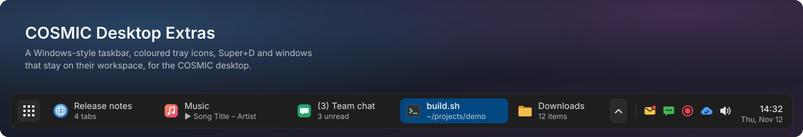
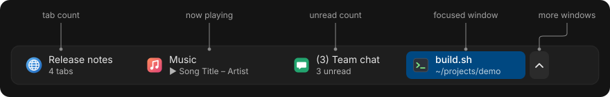
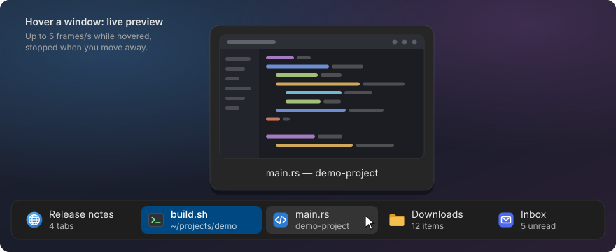
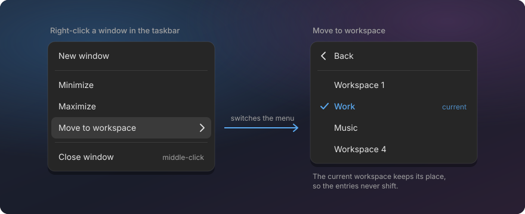
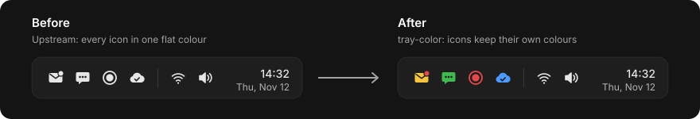
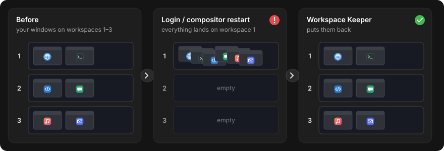
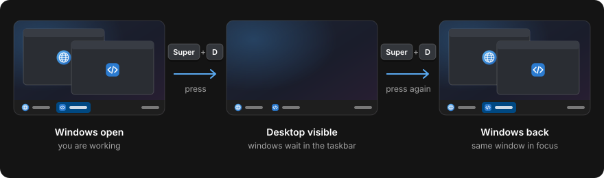

# A Windows-style taskbar for the COSMIC desktop

<p class="lead">See every window on your workspace at a glance with live previews, move windows
between workspaces from a right-click, keep windows on their workspaces across logins, and show
the desktop with Super+D. For COSMIC on Pop!_OS 24.04 (Wayland).</p>

<div class="hero"></div>

Pick the tools you want; each one installs on its own and uninstalls back to stock COSMIC.

<div class="buttons">
  <a class="primary" href="#install">Install</a>
  <a href="https://github.com/jwillmer/cosmic-desktop-extras">GitHub repository</a>
  <a href="technical.html">Technical docs</a>
</div>

## Taskbar

One button per window on the current workspace, with icon, title and a second line that tells you
something: "3 tabs", the song that is playing, "4 unread". Middle-click to close. The dock stops
showing the same apps twice.



**Live preview on hover.** Rest the pointer on a window and a live picture of it appears, so you
find the right one without switching to it. Minimized windows show their last picture.



**Move a window to another workspace.** Right-click it in the taskbar, pick "Move to workspace" and
choose the target by name or number. No dragging through the workspace overview.



[More about the taskbar](https://github.com/jwillmer/cosmic-desktop-extras/blob/main/taskbar/README.md)

### Terminal and Files tab counts

Add-ons for the taskbar: it shows "3 tabs" for COSMIC Terminal windows, and "2 tabs" or "14 items"
for COSMIC Files windows.
[Terminal](https://github.com/jwillmer/cosmic-desktop-extras/blob/main/terminal-tabs/README.md) ·
[Files](https://github.com/jwillmer/cosmic-desktop-extras/blob/main/files-tabs/README.md)

## Tray colors

Tray icons keep their colours: a red unread badge stays red instead of turning into a flat
monochrome icon.



[More about tray colors](https://github.com/jwillmer/cosmic-desktop-extras/blob/main/tray-colors/README.md)

## Workspace Keeper

Remembers which workspace each window is on and moves the windows back after you log in again or
after the desktop crashes and restarts.



[More about Workspace Keeper](https://github.com/jwillmer/cosmic-desktop-extras/blob/main/ws-keeper/README.md)

## Show Desktop

Super+D minimizes the windows of the current workspace, like on Windows. Press it again and they
come back, with the window you were in on top.



[More about Show Desktop](https://github.com/jwillmer/cosmic-desktop-extras/blob/main/show-desktop/README.md)

## Install

Open a terminal and run:

```sh
curl -fsSL https://raw.githubusercontent.com/jwillmer/cosmic-desktop-extras/main/install.sh | bash
```

A menu lets you pick the tools. Uninstall any tool with `./install.sh --uninstall <tool>`.
Everything installs for your user only; no system files are replaced. Tested on Pop!_OS 24.04
with COSMIC. Build steps, requirements and the FAQ:
[README on GitHub](https://github.com/jwillmer/cosmic-desktop-extras#quick-install).

## Learn more

- [Source code and issues on GitHub](https://github.com/jwillmer/cosmic-desktop-extras)
- [Technical documentation](technical.md): how each tool works, installed files, settings, patch maintenance, tests
- [For app developers](launcher-entry.md): put your own text on the taskbar's second line

Built on System76's [COSMIC](https://github.com/pop-os/cosmic-epoch) desktop. GPL-3.0. This
project is not affiliated with or endorsed by System76.
