# A Windows-style taskbar and a Markdown notes editor for the COSMIC™ desktop

<p><em>An unofficial, personal project for the COSMIC™ desktop. It is not affiliated with or endorsed by
System76. COSMIC is a trademark of System76; see its <a href="https://github.com/pop-os/cosmic-epoch/blob/master/TRADEMARK.md">trademark policy</a>.</em></p>

<p class="lead">See every window on your workspace at a glance with live previews and move windows
between workspaces from a right-click. Write Markdown like in Obsidian or Typora and see it
rendered live, in plain files and inside COSMIC's own editor. Plus windows that stay on their
workspaces across logins and Super+D to show the desktop. For COSMIC on Pop!_OS 24.04
(Wayland).</p>

<div class="hero">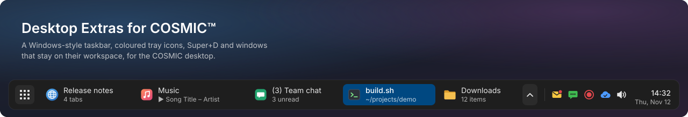</div>

<div class="hero"><a href="#text-editor">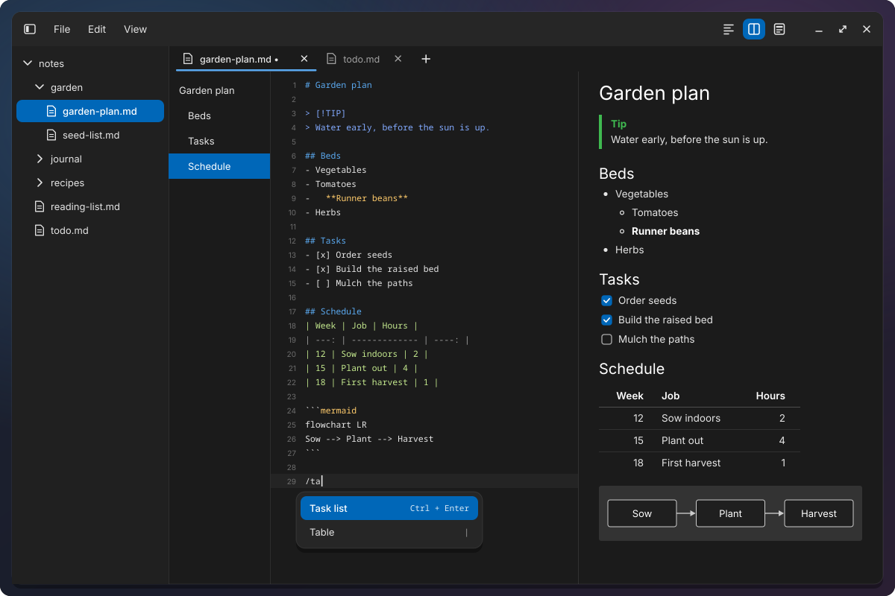</a></div>

Pick the tools you want; each one installs on its own and uninstalls back to stock COSMIC.

<div class="buttons">
  <a class="primary" href="#install">Install</a>
  <a href="https://github.com/jwillmer/cosmic-ext-desktop-extras">GitHub repository</a>
  <a href="technical.html">Technical docs</a>
</div>

## Taskbar

One button per window on the current workspace, with icon, title and a second line that tells you
something: "3 tabs", the song that is playing, "4 unread". Middle-click to close, right-click to
pin an app to a workspace. The dock stops showing the same apps twice.

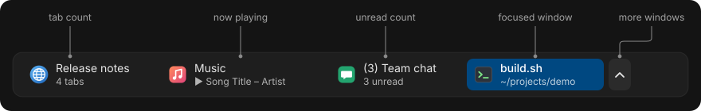

**Live preview on hover.** Rest the pointer on a window and a live picture of it appears, so you
find the right one without switching to it. Minimized windows show their last picture.

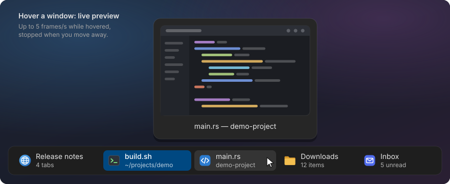

**Move a window to another workspace.** Right-click it in the taskbar, pick "Move to workspace" and
choose the target by name or number. No dragging through the workspace overview.

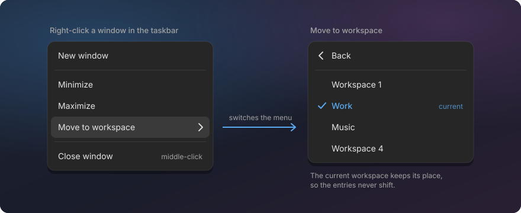

**Pin an app to a workspace.** Right-click it and pick "Always open on “Work”": its windows open
there, and starting it from anywhere takes you along. A small pin marks pinned apps. Needs
Workspace Keeper.

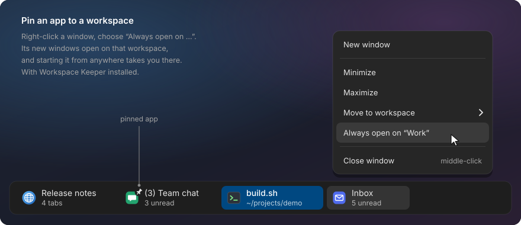

[More about the taskbar](https://github.com/jwillmer/cosmic-ext-desktop-extras/blob/main/taskbar/README.md)

### Terminal and Files tab counts

Add-ons for the taskbar: it shows "3 tabs" for COSMIC Terminal windows, and "2 tabs" or "14 items"
for COSMIC Files windows. The patched Files also gives a folder its own icon, with a code folder
icon for your projects.

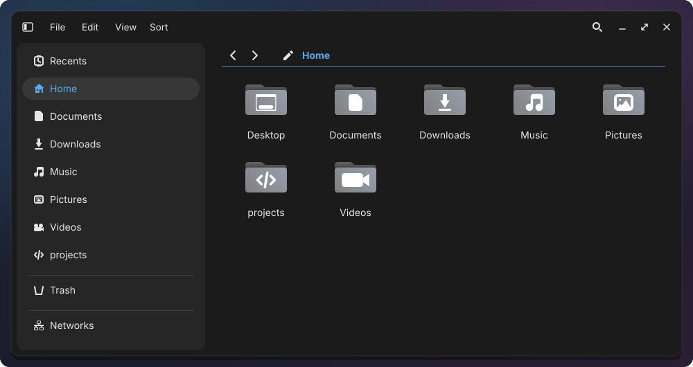

[Terminal](https://github.com/jwillmer/cosmic-ext-desktop-extras/blob/main/terminal-tabs/README.md) ·
[Files](https://github.com/jwillmer/cosmic-ext-desktop-extras/blob/main/files-tabs/README.md)

## Tray colors

Tray icons keep their colours: a red unread badge stays red instead of turning into a flat
monochrome icon.

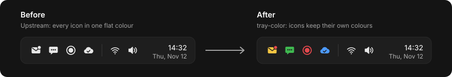

[More about tray colors](https://github.com/jwillmer/cosmic-ext-desktop-extras/blob/main/tray-colors/README.md)

## Text Editor

<p class="lead">A Markdown notes editor that keeps your files plain: write like in Obsidian or
Typora, inside COSMIC's own editor.</p>

- **Write Markdown fast.** Type `/` for a menu of blocks. Ctrl+B, Ctrl+K and Ctrl+Shift+1…6 make
  bold, links and headings; lists continue, tasks tick and tables align themselves as you type.
- **See it rendered live.** Preview, Source or Split (Ctrl+Alt+1 / 2 / 3), with tables, alerts,
  Mermaid diagrams, coloured code and an outline of the headings.
- **Never lose a tab.** Files open as tabs in one window, and every tab of your last session comes
  back, unsaved drafts included.
- **Fast, also with big files.** No built-in browser: the editor opens instantly, and large files
  and long notes stay quick.
- **The comforts of Notepad++.** Two views side by side, compare, column selection, folding and
  JSON tools.

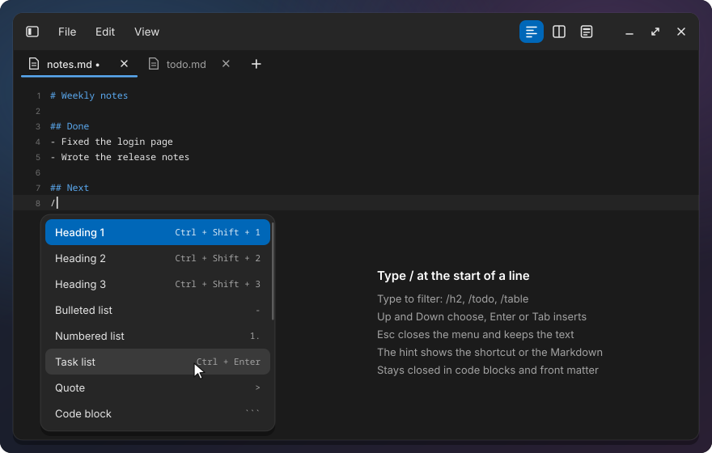

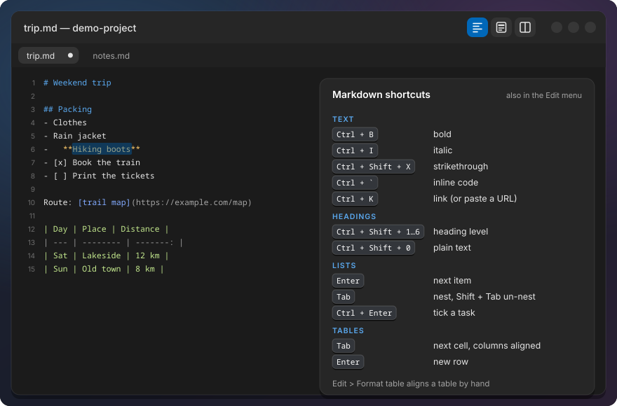

**Coming from Obsidian or Typora?**

| | Works the same | Not there |
|---|---|---|
| Writing | The `/` menu, Markdown shortcuts, lists and tables that format themselves | Spell check, pasting images, typing in the rendered page (typing in Preview switches to Source) |
| Reading | Live Split preview, heading outline, Mermaid, alerts, coloured code | Export to PDF or HTML |
| Your notes | Plain `.md` files in a folder, opened as a project and searchable | Wiki-links (`[[…]]`), backlinks, graph view, plugins |

**Never lose an edit.** Changed lines and words stay marked until you save. When another program
changes a file you are editing, a bar asks Reload, Keep mine or Compare instead of one version
silently winning.

**Tools for code and config files.** JSON format, minify and validate, visible whitespace and line
endings, column selection with Alt+drag, code folding, Close all tabs, and two views side by side
with synchronized scrolling, Notepad++-style clones and Compare.

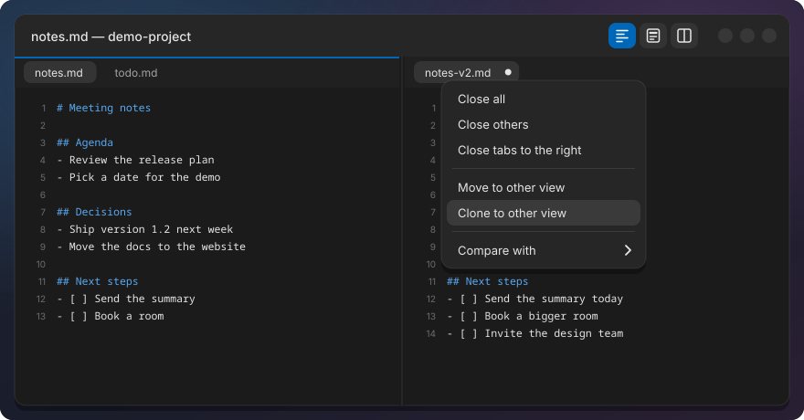

**Files and tabs.** Large files open fast. The Open dialog opens a path you type, or a copied one
with just Ctrl+V; the tab menu copies a file's path or opens its folder, and the sidebar can be
resized.

[More about the Text Editor](https://github.com/jwillmer/cosmic-ext-desktop-extras/blob/main/text-editor/README.md)

## Workspace Keeper

Remembers which workspace each window is on and moves the windows back after you log in again or
after the desktop crashes and restarts. Pin an app to a workspace and its windows always open
there: start a pinned chat app from anywhere and you land on your work workspace with it.

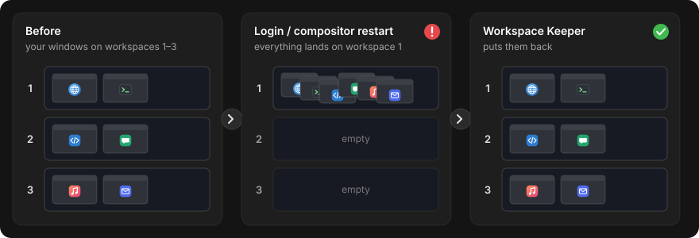

[More about Workspace Keeper](https://github.com/jwillmer/cosmic-ext-desktop-extras/blob/main/ws-keeper/README.md)

## Show Desktop

Super+D minimizes the windows of the current workspace, like on Windows. Press it again and they
come back, with the window you were in on top.

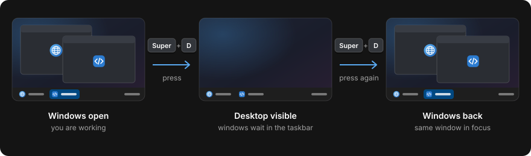

[More about Show Desktop](https://github.com/jwillmer/cosmic-ext-desktop-extras/blob/main/show-desktop/README.md)

## Install

Open a terminal and run:

```sh
curl -fsSL https://raw.githubusercontent.com/jwillmer/cosmic-ext-desktop-extras/main/install.sh | bash
```

A menu lets you pick the tools. Uninstall any tool with `./install.sh --uninstall <tool>`.
Everything installs for your user only; no system files are replaced. Tested on Pop!_OS 24.04
with COSMIC. Build steps, requirements and the FAQ:
[README on GitHub](https://github.com/jwillmer/cosmic-ext-desktop-extras#quick-install).

## Learn more

- [Source code and issues on GitHub](https://github.com/jwillmer/cosmic-ext-desktop-extras)
- [Blog post: why and how it was built](https://jwillmer.de/blog/projects/cosmic-desktop-extras.html)
- [Blog post: a Notepad++-style Text Editor for COSMIC](https://jwillmer.de/blog/projects/cosmic-text-editor.html)
- [Blog post: COSMIC Text Editor, from reading Markdown to writing it](https://jwillmer.de/blog/projects/cosmic-text-editor-writing-markdown.html)
- [Requests to COSMIC upstream](https://github.com/jwillmer/cosmic-ext-desktop-extras#upstream-requests): the features proposed for COSMIC itself, and the [Show and tell discussion](https://github.com/pop-os/cosmic-epoch/discussions/4002)
- [Technical documentation](technical.md): how each tool works, installed files, settings, patch maintenance, tests
- [For app developers](launcher-entry.md): put your own text on the taskbar's second line

Built on System76's [COSMIC](https://github.com/pop-os/cosmic-epoch) desktop. GPL-3.0. This
project is not affiliated with or endorsed by System76. COSMIC is a trademark of System76.
