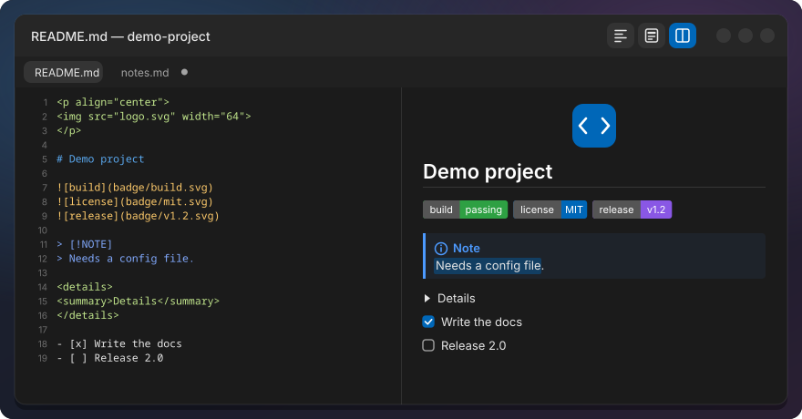
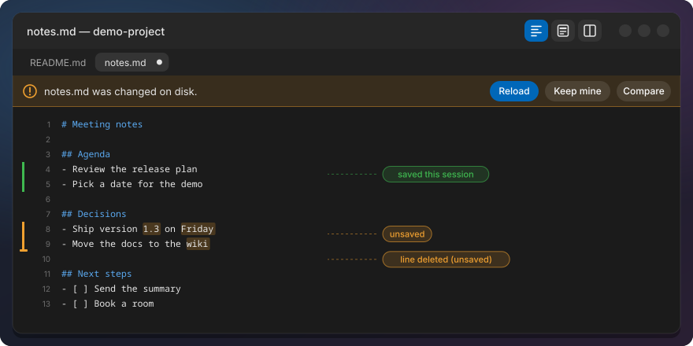
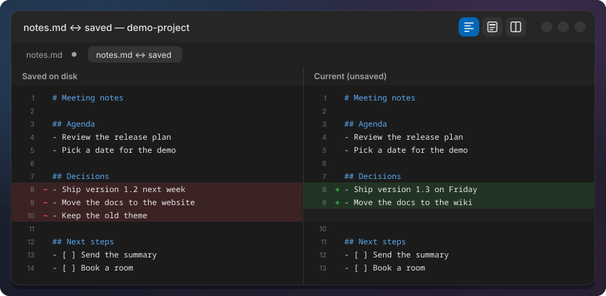
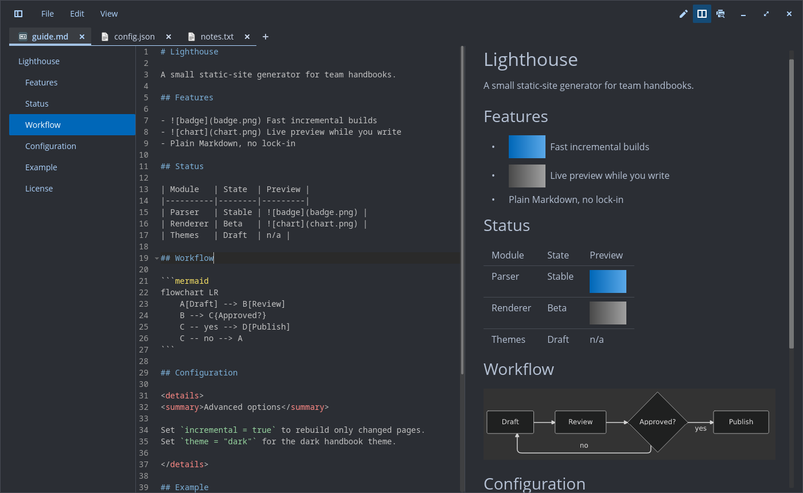
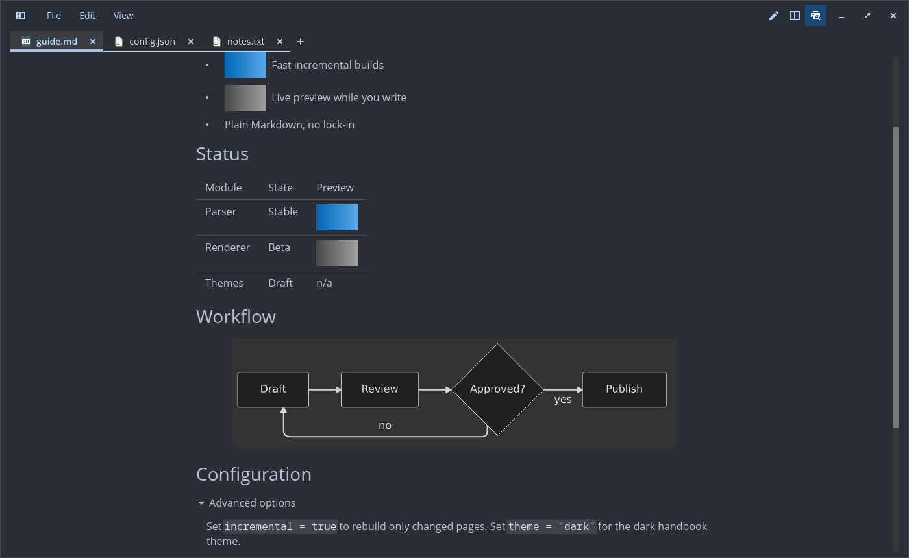
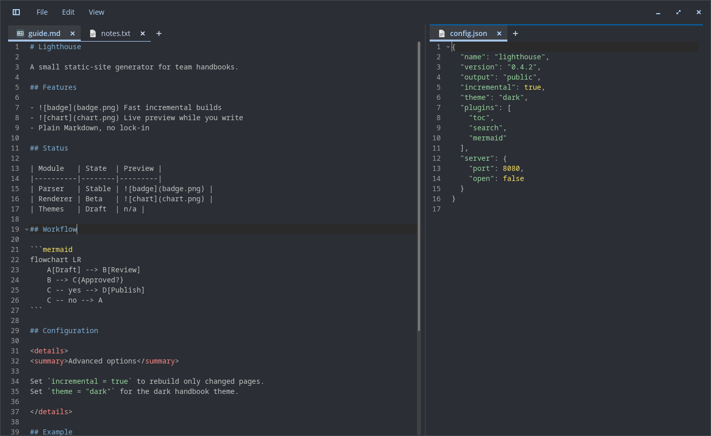
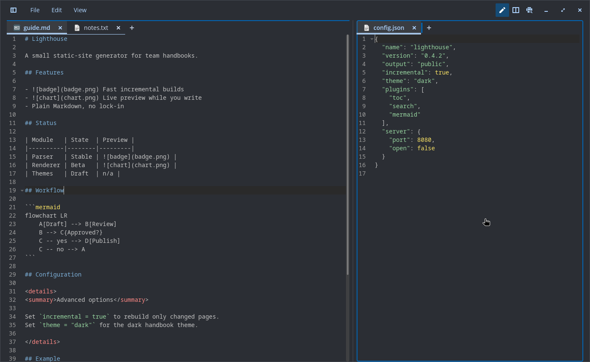

# Text Editor (technical)

A patch series for COSMIC Text Editor (`pop-os/cosmic-edit`). Markdown files open rendered, and
each Markdown tab can switch between three views. Files open as tabs in the running editor, and
the editor brings back every tab of the last session, unsaved changes included. Changed lines
are marked in the gutter, changed words are tinted, and an outside change to a file with unsaved
changes asks before anything is lost. On top: Mermaid diagrams, an outline of Markdown headings, JSON tools,
visible whitespace and line endings, column selection, code folding, closing many tabs at once and
two views side by side. The renderer is libcosmic's native Markdown widget
(pulldown-cmark), not a web engine, so the editor starts as fast as before. User overview:
[text-editor/README.md](../text-editor/README.md).



## Markdown views

| View | What you see |
|---|---|
| Preview | The rendered file, read-only. The default when a Markdown file opens |
| Source | The normal editor |
| Split | Editor left, preview right; the preview follows your typing and your scrolling |

| Action | How |
|---|---|
| Preview and Source | Ctrl+Shift+V (from Split it goes to Preview) |
| Split and Source | Ctrl+Alt+V (from Preview it goes to Split) |
| Source, Split, Preview | Ctrl+Alt+1, Ctrl+Alt+2, Ctrl+Alt+3 |
| Choose a view | The three buttons at the right of the header bar (the active one is highlighted in the accent colour and inert), or the top of the View menu |
| Default view | Settings, section "Markdown", "Open Markdown files in" (config key `markdown_view`: `Source`, `Preview` or `Split`) |

The buttons and menu entries appear only on Markdown tabs (`.md`, `.markdown`, `.mdown`, `.mkd`,
`.mkdn`). An empty file opens in Source. Save As to a Markdown name keeps the current view. Each tab
keeps its own preview scroll position. In Preview, the keys that would change the hidden text
(cut, paste, undo, redo, replace, select all) do nothing, and the find bar closes.

Rendered: headings, emphasis, strikethrough, links, inline code, lists, task lists, quotes, rules,
tables, code blocks (in the editor's font) and local images (scaled down to the text width, never
up). Images inside a paragraph, a heading, a list item or a table cell stay inline, so badge rows
sit side by side; list numbers and task boxes are kept, and a list marker lines up with the first
text line next to a tall image. Common README HTML:
`align="center"` (also on `<h1>`..`<h6>`), `` with width and height, `<br>`, `<details>`/`<summary>` (closed by
default, click to open); other tags are stripped and their text kept, comments hidden. Footnotes
and GitHub alerts (`> [!NOTE]`, TIP, IMPORTANT, WARNING, CAUTION) render. Front matter is hidden.
Colours follow the COSMIC theme; links use the accent colour.

Code blocks with a language tag (`json`, `bash`, `python`, `rust`, ...) get syntax colours from the
editor's own syntax set and syntax theme, so they look as in Source and follow the light/dark
switch. No tag, an unknown tag or a block over 2000 lines stays plain. Highlighted blocks are cached
by theme, language and code, so a re-parse while typing only highlights the blocks that changed.

**Mermaid:** a ` ```mermaid ` block (flowchart, sequence and the other diagram types of
mermaid-rs-renderer) is drawn as a diagram, centred, scaled down to fit, in light or dark colours
with the theme. It is rendered in process, without a browser, and cached per block like the code
colours. Code that does not parse, a block over 50 000 bytes or a renderer failure stays a code
block.

**Images from the web:** Settings, section "Markdown", "Load images from the web in Markdown
previews" (off by default, config key `markdown_remote_images`). Off, nothing is fetched and a
remote image shows as a chip with its alt text. On, `https` images (no other scheme) are fetched in
the background through GVfs (gvfsd-http), up to 10 MB each and 15 s, PNG, JPEG, GIF, WebP, BMP, ICO
and SVG only. Each image is fetched once per session and kept in memory. A failure keeps the chip
and logs one warning naming the host and the reason.

**Scroll sync** (Split) runs both ways. When the editor half scrolls (wheel, keys, cursor moving
off screen), the preview scrolls so the line at the editor's top sits at its top. When you scroll
the preview (wheel, keys, scrollbar), the editor scrolls so the first line in view in the preview
is its top line; the cursor stays. A scroll one side started is not sent back, and a resize of the
preview is not taken for a scroll. Positions are measured: after every parse, resize or
`<details>` toggle the editor reads where each top-level block of the preview was laid out, and a
line inside a block takes its share of that block's height (wrapped lines, heading sizes, table
rows and code by the size they are drawn at). Checked at most every 50 ms after an input event.
View, "Sync preview scrolling" (on by default, config key `markdown_sync_scroll`).

**Outline:** View, "Outline" (Ctrl+Alt+O; off by default, config key `markdown_outline`) shows a
narrow panel left of a Markdown tab with its headings: `#` and underlined headings and the
`<h1>`..`<h6>` of HTML blocks, indented by level, none from code blocks; images in a heading are
left out of its label. In Source and Split the heading above the cursor is highlighted; in Preview,
the first heading whose top is in view, or the heading the top line sits under when none is. A
click puts the cursor on the heading and scrolls it to the top of the editor and, when it shows, of
the preview; in Preview the clicked heading stays highlighted until you scroll. The outline
scrolls just far enough to keep the highlighted heading in view; each tab keeps its own outline
scroll position.

**Open `<details>`** are kept per block across re-parses: by the heading they sit under, their
summary and a hash of their source. So adding a block above does not move the open state, and an
open block stays open while you edit its text. The open state of a removed block is forgotten.

The preview parses only while it is visible. In Split it re-parses after a typing pause of 150 ms
(300 ms for files over 100 KB) and skips the parse when the text is unchanged. Non-Markdown tabs
pay nothing.

## One editor window

Opening a file while the editor runs (double-click, "Open with", `cosmic-edit file.md`) adds a tab
to the running window and brings it forward with keyboard focus (also when minimized); a file that is already open gets its tab focused. A launch
without files only raises the window. File, New window and `COSMIC_SINGLE_INSTANCE=false cosmic-edit`
start a separate editor (it leaves the session to the first one). This uses libcosmic's
`single-instance` feature (D-Bus). libcosmic raises the window only when the launcher passed an
activation token, so the editor also unminimizes and activates its window itself on every launch
that reaches it.

## Session restore

Like Notepad++: when the editor starts, every tab from last time comes back, including unsaved
changes and untitled drafts, with cursor, scroll position, Markdown view and the active tab. The
window opens at its last size (clamped to 360x240..8192x8192) and maximized again if it was;
unmaximizing returns to the size it had before. The position is not kept: a Wayland app cannot
place its own window.

- Closing the window does not ask to save: the drafts are kept. Closing a single tab with unsaved
  changes still asks; Discard deletes its draft.
- Drafts are written 2 s after typing pauses and at least every 15 s while you keep typing, plus
  on tab open, close and switch and on quit. Nothing is written when the text did not change. The
  writes (hash, file, fsync) run in the background, one at a time; an older snapshot never
  overwrites a newer one. A crash loses about the last 2 s, at most 15 s. A failed write is
  retried.
- If a draft or the session file cannot be written (disk full, read-only folder), closing the
  window asks to save as before.
- A file that was deleted comes back from its draft as unsaved; a file changed on disk after the
  draft keeps the draft and shows the "changed on disk" bar (below).
- A session file that cannot be read is never overwritten, and restore stays off for that run. A
  corrupt or newer one is renamed to `.bad`, its drafts move to `backups.bad-<time>/`, and no draft
  is deleted in that run.
- Settings, "Restore previous session" (on by default). Off: the editor behaves as upstream and
  the stored session is deleted.
- Only one editor process owns the session; one started with `COSMIC_SINGLE_INSTANCE=false` leaves
  it alone.

Storage, readable only by you (folders 0700, files 0600, written via temp file and rename):

```text
~/.local/state/cosmic-edit/session/
  session.ron        open tabs, cursor, scroll, view, folds, clones, active tab, views, window size (versioned)
  backups/<id>.txt   the unsaved text, one file per tab
```

Drafts are on disk only; include `~/.local/state` in your backup if you want them there too.

Not yet: window position (Wayland), project folders, per-tab zoom. Upstream: the open PR
[cosmic-edit #497](https://github.com/pop-os/cosmic-edit/pull/497) ("hot exit") and issue
[#94](https://github.com/pop-os/cosmic-edit/issues/94).

## Closing tabs

File, "Close all tabs" (Ctrl+Shift+W), "Close other tabs" and "Close tabs to the right", also in
the tab's right-click menu as Close all, Close others and Close tabs to the right (there they act
on that tab and its view). Clean, compare and git diff
tabs close at once. Tabs with unsaved changes get one prompt that names them, with **Save all**,
**Discard all** and **Cancel**. Cancel closes nothing. Save all asks Save As for each untitled tab
in turn and stops at the first one cancelled. Discard all deletes the drafts like Discard on one
tab. Closing every tab leaves one new empty tab; the editor does not quit.

## Two views

View, "Move to other view" and "Clone to other view" (also in the tab's right-click menu) split
the window into a left and a right view, each with its own tab bar and shown tab. A view left
without tabs closes the split. A click into a view makes it active, marked by an accent line above
its tab bar; menus, shortcuts and Ctrl+Tab act on the active view.

The divider between the views can be dragged (a resize pointer shows near it). Each view keeps at
least 240 px; a window too narrow for that splits evenly. The share is kept in the session; a new
split starts even.

Drag a tab from one view anywhere into the other (its tab bar, the space after the tabs, the editor
or the preview) to move it there, after the last tab. While dragging, the target view gets an
accent outline and its tab bar a marker where the tab lands; a view where a drop would do nothing
is not highlighted. Dragging within one tab bar reorders the tabs, and the session keeps the order.

Clone mirrors the document, like Notepad++: any tab can be cloned, unsaved and untitled ones
included, and the clone starts with the current text and changed state. An edit in one clone is
applied to the other right away; each keeps its own cursor, scroll and undo history, and undo
mirrors like any edit. Saving one marks both saved, Save As gives both the new path, and Reload or
Revert all changes acts on both as one action. An edit mirrored into a fold unfolds it first.
Closing one leaves the other a normal tab. Restored clones come back paired. Two tabs of one file
with different unsaved text (drafts from an older session) are left apart and do not mirror; a
warning in the log names the file.

View, "Synchronize vertical scrolling" (off by default, config key `sync_scroll_views`): scrolling
one view, by wheel or keys, scrolls the other by as many lines; scrolling sideways moves the other
by the same distance, up to its left edge and its widest visible line. Two Markdown previews follow
each other by position in the document. The session keeps each tab's view and the shown tab of
each view; an older session opens in one view.

## File changed on disk

A tab without unsaved changes reloads silently when its file changes on disk (as upstream). A tab
with unsaved changes, or a restored draft, shows a bar above the text instead:

| Bar | Buttons |
|---|---|
| "<name> was changed on disk." | **Reload** (take the disk version; one Undo brings yours back, Redo shows the tab saved again), **Keep mine** (the next Save overwrites; the bar comes back on a further change), Compare |
| "<name> was deleted on disk." | **Keep mine** (Save recreates the file) |

Save checks the file first: if it changed unseen, the bar shows instead of overwriting, and a
second Save writes. The first Save for a disk version never writes, also when the bar was already
up. The check uses the file's time, size and inode (a file replaced by rename can keep time and
size), then a content hash only when those changed. It runs on watcher events, tab switch, Save and session restore; a file replaced by
rename is watched again. An unanswered bar survives a restart (the session keeps what each draft
was based on).



## Changed lines

Like Notepad++ change history: a thin bar left of the line numbers.

| Bar | Meaning |
|---|---|
| Orange | Changed and not saved yet |
| Green | Changed and saved during this session |
| none | Unchanged since the file was opened |

A short tick at the top of a line marks lines deleted above it (orange, green once saved). Undo
back to the saved text removes the orange. A restored draft shows orange against the file on disk;
in an untitled tab every line you type is orange until saved. Reloading a file changed on disk and
"Revert all changes" clear the marks. Settings, "Change history", "Show changed lines" (on by
default; config key `change_history`).

Unsaved changes are also tinted inside the text: the changed words of an orange line get a light
orange background (whole new lines are tinted whole); saved changes are not tinted. Settings,
"Highlight changed text" (on by default, config key `highlight_changed_text`; needs "Show
changed lines"). For about 200 ms after an edit the tint can sit on the old position.

**Compare with saved** (File menu next to "Revert all changes", and the editor's right-click menu;
disabled without unsaved changes) opens a read-only tab "<name> ↔ saved" with the diff between the
file on disk (empty for untitled) and the current text, in the editor's diff view: removed lines
red, added green, with context. It is a snapshot; opening it again refreshes and focuses the same
tab. A click on an orange bar or deletion tick in the gutter opens it too (it does not scroll to
that change yet). Compare tabs are not part of the restored session. Each hunk starts with its git
header line, `@@ -old,count +new,count @@`, in the accent colour.

**Compare with...** (File menu and the tab's right-click menu) lists the other open editor tabs and
opens "a.md ↔ b.md" with the diff from this tab's text to the other's, unsaved text included;
opening it again refreshes and focuses it. With two views, "Compare the two views" at the top of
the list compares the tabs they show.



The marks come from a line diff (the `similar` crate, 50 ms deadline per diff) between the text
when the file was opened, the text at the last save and the current text. It runs in the
background about 200 ms after typing stops (500 ms for files over 1 MB); a 1 MB file takes about
2 ms. Right after inserting lines, the marks below can sit one line off until that run finishes.

## JSON tools

On `.json` tabs (and untitled tabs starting with `{` or `[`) the Edit menu has:

| Action | How |
|---|---|
| Format JSON | Ctrl+Alt+Shift+F; indent = the tab width in spaces |
| Minify JSON | Ctrl+Alt+Shift+M |
| Validate JSON | Edit menu; a bar above the text names line, column and reason, with **Go to** |

A small tokenizer copies strings and numbers byte for byte, so key order and number text stay
exactly as written (no new dependency). Format and Minify are one undo step and keep the cursor on
the same token. Invalid JSON (JSONC comments and trailing commas included) is left alone and the
bar shows the error. Texts over 20 MB are refused.

## Whitespace and line endings

Like Notepad++ "Show symbol", both off by default and kept in the config:

| View menu | What it draws |
|---|---|
| Show whitespace (`show_whitespace`) | A faint dot on each space, an arrow across each tab; trailing whitespace a little stronger |
| Show line endings (`show_line_endings`) | A faint mark after each line end: return arrow for LF, pilcrow for CRLF, left arrow for CR |

The marks are drawn behind the text over the visible rows only, so text, layout and cursor
positions never change; with both off nothing is scanned.

View, "Line endings: LF" (or CRLF, CR, Mixed) shows the file's line endings and offers Convert to
LF and Convert to CRLF, each one undo step. Enter inserts the file's own line ending, and Save
writes each line's own ending.

## Column selection

Like Notepad++: Alt+drag or Alt+Shift+arrows select the same visual columns on every line between
two points. A tab reaches the next tab stop, lines ending left of the block are skipped, and
wrapped lines use their logical line. The highlight follows the visual columns, so only the part
of a tab inside the block is highlighted. A tab cut by an edge of the block becomes spaces of the
same width before an edit (in the same undo step), so text goes in and out at the same column on
every line; a copy gives such a tab's covered columns as spaces and keeps whole tabs.

- Typing, Backspace and Delete act on every line of the block.
- Copy and Cut join the lines with newlines. Paste of multi-line text goes in line by line;
  single-line text goes on every line.
- A copied or cut block pasted at a plain cursor goes in as a block (as in Notepad++): each row at
  the cursor's column on the lines below, short lines padded with spaces, rows past the end of the
  file on new lines, one undo step. Only the last block copied counts; text copied elsewhere since
  pastes normally.
- Each edit is one undo step. A plain click, a navigation key or Ctrl+Backspace/Delete leaves
  block mode.
- Not available with vi bindings.

## Folding

| Action | How |
|---|---|
| Fold / unfold one block | Click the chevron right of the line numbers (▸ folded; ▾ on hover over the gutter or on the cursor line), or View, Fold (Ctrl+Shift+[) and Unfold (Ctrl+Shift+]) at the cursor |
| Whole file | View, Fold all and Unfold all |

Fold ranges: brackets for JSON and C-like files, sections under headings for Markdown, indentation
for everything else. A folded header shows `…` after its text. A chevron click toggles that block
only, without moving the cursor or starting a selection.

Folding never changes the text: a folded line gets a zero line height, so it takes no space and
Save writes the whole file. The fold state lives in the line attributes, so folds move with the
text. The session keeps each fold as its header line and text; on restore a block is folded again
only when that line still holds the same text, so a fold whose header was changed elsewhere is
dropped. Cursor motions step over folds. An edit, undo, redo,
paste, a find or replace hit, or a column selection over a fold unfolds it, so changed text never
stays hidden. Reload unfolds everything. The gutter, change marks, tints, whitespace marks and the
current-line highlight skip hidden lines.

Folding never leaves a selection in hidden text: a fold that a selection reaches into drops the
selection, and a hidden cursor moves to the end of the fold header (as in VS Code). Typing, Enter,
Backspace, Delete, Tab, input method text, paste and cut unfold whatever the selection reaches
into before they edit.

## Links and safety

A Markdown file can come from anywhere, so a click in the preview never runs anything:

- `http`, `https` and `mailto` open with the default app. A `mailto` link may only carry `subject`,
  `body`, `cc` and `bcc`; any other field (for example `attach`) blocks the link.
- Local links are resolved against the file's folder and must point to a regular file. Text and
  Markdown files open in the editor. Images, audio, video and PDF without the exec bit open with
  the default app.
- Everything else is ignored with a warning in the log: other schemes, folders, `.desktop`
  files, executables, archives, missing files. `#anchor` links are ignored.
- Remote images are not fetched unless "Load images from the web" is on (above), and then only
  over `https`; otherwise a small chip with their alt text shows instead.

## Patch contents

| Patch | What |
|---|---|
| `0001-Markdown-preview-…` | New `src/markdown.rs` (views, parsing, theme style, links, images); small hooks in `main.rs`, `tab.rs`, `config.rs`, `key_bind.rs`, `menu.rs`, the English strings and `Cargo.toml` (libcosmic feature `markdown`) |
| `0002-Test-the-Markdown-preview-…` | Unit tests: detection, view switching, link resolution and the safety rules |
| `0003-Open-files-in-the-running-editor-…` | libcosmic `single-instance`: files from a second launch open as tabs in the running editor (`src/single_instance.rs`) |
| `0004-Restore-the-previous-session-…` | New `src/session.rs`: snapshot, drafts, restore plan, storage; hooks in `main.rs`, `tab.rs`, `config.rs` |
| `0005-Test-session-restore-…` | Session tests, named after the behaviours (closing, drafts, restore plan, failures, permissions) |
| `0006-Test-the-editor-behaviours-…` | Behaviour tests for the earlier patches: views on open, Save As, Preview read-only, scroll per tab, debounce, single-instance focus |
| `0007-Change-history-…` | New `src/change_history.rs` (line diff, marks); drawing in `text_box.rs`, hooks in `tab.rs`, `main.rs`, `config.rs`; `Cargo.toml` adds `similar` |
| `0008-Test-the-change-history-marks` | Change history tests, named after the behaviours |
| `0009`–`0011` Change history tint | Word diff of each unsaved changed line against the saved line it replaces, drawn as a tint in `text_box.rs`; tests; pairing fix |
| `0012`–`0013` Compare with saved | New `src/compare.rs` (diff into the existing git diff tab), menu entries, session skips compare tabs; tests |
| `0014` Header | The active view button is highlighted and inert |
| `0015`–`0016` Background snapshots | Snapshot timing (2 s idle, 15 s max) and background writes in `session.rs`; tests |
| `0017`–`0018` README HTML | New `src/markdown_html.rs`: inline images, HTML blocks, details, alerts, footnotes; `Cargo.toml` adds `pulldown-cmark`; tests |
| `0019` Gutter click | Click on an unsaved change bar opens Compare with saved (`text_box.rs`) |
| `0020`–`0021` Changed on disk | New `src/disk_change.rs` (fingerprint, decision table, bar); hooks in `tab.rs`, `main.rs`, `session.rs`; tests |
| `0022` Come forward | A file handed to the running editor (double-click, Open with) brings its window forward with focus, also when the launcher passed no activation token; tests |
| `0023`–`0024` Code block colours | Fenced code blocks in the preview coloured with the editor's syntax set and theme, cached per block; tests |
| `0025` Scroll sync | Split: the preview follows the editor's first visible line; View menu toggle |
| `0026` Outline | Panel with the Markdown headings, current one highlighted, click to jump; View menu and Ctrl+Alt+O |
| `0027` Window size | The session keeps the window size and maximized state |
| `0028`–`0029` JSON tools | New tokenizer: Format, Minify, Validate with the error bar; tests |
| `0030`–`0031` Whitespace and line endings | Show whitespace, show line endings, the line-ending submenu with conversion; tests |
| `0032`–`0034` Column selection | Block selection with Alt+drag and Alt+Shift+arrows, edits on every line; tests; fixes for paste, tab widths and stale blocks |
| `0035`–`0040` Folding | Folded lines get zero height; fold ranges (brackets, headings, indentation); View menu and keys; gutter chevrons, edits and column blocks unfold; tests; review fixes |
| `0041` Closing tabs | Close all, Close others, Close tabs to the right; one prompt for all unsaved tabs; tests |
| `0042`–`0045` Two views | New `src/views.rs`: left and right view over the one tab model, Move and Clone to other view, synchronized scrolling, session keeps the views; tab menu crash fix; Compare with... another tab and the two views; active view marker; tests |
| `0046`–`0052` Fixes | First Save never overwrites an unseen disk change, inode in the stat check; centred HTML headings; restored text no longer shifted left; hunk headers in the diff view; Reload sets a save point; folding drops selections in hidden text; block paste of a copied column block; tests |
| `0053`–`0056` Fixes | Menu actions give the keyboard back to the editor; restored views keep their scroll position; synchronized scrolling of two previews; a gap at the divider so line numbers are never clipped; tests |
| `0057` View shortcuts | Ctrl+Alt+1/2/3 for Source, Split and Preview, shown in the View menu and the header tooltips; tests |
| `0058`–`0061` Fixes | Column block edits and the highlight follow visual columns across tabs (a tab cut by the block edge becomes spaces); the outline scrolls to keep the current heading in view; the session keeps folds; tests |
| `0062`–`0065` Two views | Synchronized scrolling sideways; a draggable divider; drag a tab to the other view; Clone mirrors the document; tests |
| `0066`–`0069` Preview | Images inside headings, lists and tables inline, list markers lined up; Mermaid diagrams (`Cargo.toml` adds `mermaid-rs-renderer`); optional images from the web (`gio` behind the `gvfs` feature); tests |
| `0070`–`0081` Scroll sync and outline | Split scrolls both ways; outline in Preview follows the preview; positions measured from the layout; open `<details>` kept by heading, summary and source; outline labels without images; clones never lose unsaved text; tests |
| `0082`–`0086` Clone and drag | Clone unsaved and untitled tabs (clones that drifted apart keep their own text; Save As onto a file open elsewhere does not pair them); drag a tab anywhere into the other view, with outline and marker; an open `<details>` stays open while edited; tests |
| `patches-cosmic-files/0001-…` | One-line fix so cosmic-files (the editor's file dialogs) builds with `single-instance`. `build.sh` clones cosmic-files at the revision in the editor's `Cargo.lock` to `~/.cache/edit-md/cosmic-files` and applies it; patch 0003 points Cargo there |

## Installed files

`text-editor/build.sh` (run by `./install.sh text-editor`) reads the upstream commit from the
installed package version (the last `~` part), applies `text-editor/patches/` to a clone in
`~/.cache/edit-md/cosmic-edit`, builds it and installs:

| Path | What |
|---|---|
| `~/.local/bin/cosmic-edit-md` | The patched editor |
| `~/.local/bin/cosmic-edit` | Link to it, for launches by name (terminal, scripts) |
| `~/.local/share/applications/com.system76.CosmicEdit.desktop` | Copy of the system entry pointing at the patched editor (launcher, dock, "Open with", double-click on a file) |
| `~/.local/state/edit-md/built-commit` | Upstream commit it was built from |
| `~/.cache/edit-md/cosmic-edit`, `~/.cache/edit-md/cosmic-files` | Upstream source clones |

The editor itself writes the session to `~/.local/state/cosmic-edit/session/` (above). Uninstall
keeps it.

## Commands

```text
./install.sh text-editor               build the installed cosmic-edit version + patches, install per user
./install.sh --uninstall text-editor   back to the system editor
text-editor/build.sh [--uninstall]     the same steps without the installer
text-editor/build.sh --test            apply the patches and run the editor's unit tests, install nothing
```

Needs the same Rust toolchain as the taskbar, see [taskbar](taskbar.md#commands). The build takes a
few minutes. Only editor windows opened afterwards use it: close and reopen the Text Editor.

**Run `./install.sh --update` after apt updates `cosmic-edit`.** The daily update check
(`taskbar/check.sh`) notifies once this editor was built, and says whether the series still
applies. How to move the series to a new version: [patch series](patch-series.md).

## Screenshots

The images above are mockups that show each feature on its own. These are real screenshots of the
current build, taken in a clean test session with demo content.









## Limits

- A dragged tab always lands at the end of the other view's tab bar. Esc does not cancel a drag. A
  very fast drag can pick the neighbouring tab, because libcosmic's tab bar does not report which
  tab was pressed.
- Images from the web need gvfsd-http (GVfs); without it the chip stays.
- Two Markdown previews follow each other by position in the document, not by line.
- Rendering (including code colours, Mermaid diagrams, whitespace marks, chevrons, the outline
  panel and the drag feedback), fonts, IME input (including typing in a clone with an input
  method), the D-Bus hand-off and the timers are tested by hand only.

## Upstream

Feature requests: [cosmic-edit #247](https://github.com/pop-os/cosmic-edit/issues/247) (Markdown
preview), [cosmic-edit #94](https://github.com/pop-os/cosmic-edit/issues/94) (session restore),
[cosmic-edit #495](https://github.com/pop-os/cosmic-edit/issues/495) (file diff). Where this
editor is shown upstream and in the community is tracked in
[#1](https://github.com/jwillmer/cosmic-desktop-extras/issues/1).
