# Text Editor (technical)

A patch series for COSMIC Text Editor (`pop-os/cosmic-edit`). Markdown files open rendered, and
each Markdown tab can switch between three views. Files open as tabs in the running editor, and
the editor brings back every tab of the last session, unsaved changes included. Changed lines
are marked in the gutter, changed words are tinted, and an outside change to a file with unsaved
changes asks before anything is lost. Markdown is quick to write: a "/" menu of blocks, shortcuts
for text styles, links and headings, and list and table editing. On top: Mermaid diagrams, an
outline of Markdown headings, JSON tools, visible whitespace and line endings, find and replace
with count, extended mode and regex groups, a status bar, Go to line, column selection, code
folding, closing many tabs at once, two views side by side, and large
files that open fast.
The renderer is libcosmic's native Markdown widget (pulldown-cmark), not a web engine, so the
editor starts as fast as before. User overview: [text-editor/README.md](../text-editor/README.md).

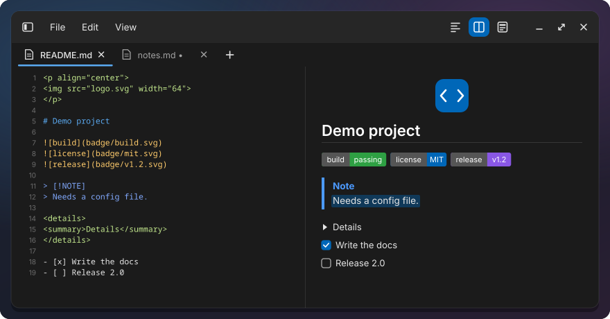

## Markdown views

| View | What you see |
|---|---|
| Preview | The rendered file, read-only. The default when a Markdown file opens |
| Source | The normal editor |
| Split | Editor left, preview right; the preview follows your typing and your scrolling |

| Action | How |
|---|---|
| Preview and Source | Ctrl+Shift+V (from Split it goes to Preview) |
| Split and Source | Ctrl+Alt+V (from Preview it goes to Split) |
| Source, Split, Preview | Ctrl+Alt+1, Ctrl+Alt+2, Ctrl+Alt+3 |
| Choose a view | The three buttons at the right of the header bar (the active one is highlighted in the accent colour and inert), or the top of the View menu |
| Default view | Settings, section "Markdown", "Open Markdown files in" (config key `markdown_view`: `Source`, `Preview` or `Split`) |

The buttons and menu entries appear only on Markdown tabs (`.md`, `.markdown`, `.mdown`, `.mkd`,
`.mkdn`). An empty file opens in Source. Save As to a Markdown name keeps the current view. Each tab
keeps its own preview scroll position. In Preview, the keys that would change the hidden text
(cut, paste, undo, redo, replace) do nothing.

**Typing in Preview.** Preview is read-only, but a typed character is not lost. A key with text
(letters, digits, space, punctuation, also with Shift, AltGr or a dead key) or Enter, typed
without Ctrl, Alt or Super, switches the tab to Source and goes in there. It lands at the end of
the block at the top of the preview, and the editor scrolls to show it. A heading and a list item
are blocks of their own. In a code block the text goes at the end of the code, never on a fence.
Enter continues a list as in the editor. Keys typed before the editor has focus follow at the
cursor. Arrows, Page Up/Down, Home/End and shortcuts work as before. With Vim bindings nothing
changes, because keys are commands there. Keys never edit the document while a menu, a context
menu, a dialog or the settings panel is open: the app tracks the popup surfaces it opens (a
window `Opened` event, closed again by the popup's `Done` event or a window `Closed` event).

### Large files

Big files open fast and stay responsive. The thresholds:

| Size | What changes |
|---|---|
| Over 32 KB of Markdown | The preview parses the text in parts, split where a top-level block starts. iced's Markdown parser copies the rest of its input after every block, so one parse of the whole text grows with the square of its length (5 MB: 7.7 s in one piece, 0.55 s in parts) |
| Over 256 KB of Markdown | The preview is parsed on another thread. A placeholder shows until it is ready |
| Over 1000 top-level blocks | The preview draws only the blocks near the view, at most 300. The space of the others is estimated, then measured. A selection and Copy still span the whole document |
| Over 1000 headings | The outline draws only the rows near its view. Its rows then have one fixed height and do not wrap. 24,000 headings cost 15 ms and more a frame before, under 0.1 ms after |
| Over 1 MB, any file | The file opens without syntax colours. cosmic-text colours the whole file before the first frame (6 s for 5 MB of Markdown, 0.3 s as plain text). A file that grows past 1 MB loses its colours when it is reloaded; one that shrinks keeps the plain view until it is opened again |
| Reload of a large file | The new text goes in 256 lines at a time, still as one undo step. cosmic-text inserts the lines of one insert one by one at the same place, which took 90 s for 1.3 MB |
| Over 1 MB of Markdown | The file opens in Source instead of Preview or Split |

A large file shows a notice above the editor with its size. For Markdown it reads "it opened in
Source and without colours" and has a **Show preview** button, which builds the preview anyway,
and **Dismiss**. Other files read "it opened without colours" and have **Dismiss**. A 5 MB
Markdown file opens its window in about 2 s; before, it had not opened after 40 s.

The upstream causes are reported as [cosmic-text #552](https://github.com/pop-os/cosmic-text/issues/552)
(the whole file is coloured before the first frame) and
[iced #3547](https://github.com/iced-rs/iced/issues/3547) (the Markdown parse grows with the square
of the file); the slow large files in stock cosmic-edit are
[cosmic-edit #182](https://github.com/pop-os/cosmic-edit/issues/182).

The preview text can be selected (new `src/selectable_rich.rs`, a port of iced's `rich_text` with a
selection). One selection spans the whole preview: it is kept as a block index and a grapheme
offset, so it crosses paragraphs, lists, quotes, alerts, code blocks and table cells. Drag selects
(the text run nearest the pointer, within 48 px, takes the drag, so a drag from the margin works);
past the top or bottom edge the preview scrolls along on a 60 Hz timer, and a drag held at the end
selects to the last block. Double-click selects a word, triple-click a block, Shift+click extends
from the anchor, Ctrl+A selects all, Esc or a click elsewhere clears it. Ctrl+C copies from the
current document: list markers as in the source (`- `, `1. `, `- [ ] `), alert titles, table cells
separated by tabs and rows by newlines. The highlight keeps the text colours; its alpha follows
the contrast with the theme (25–60 %). Typing or selecting in the editor of a Split clears it.

Rendered: headings, emphasis, strikethrough, links, inline code, lists, task lists, quotes, rules,
tables, code blocks (in the editor's font) and local images (scaled down to the text width, never
up). Images inside a paragraph, a heading, a list item or a table cell stay inline, so badge rows
sit side by side; list numbers and task boxes are kept, and a list marker lines up with the first
text line next to a tall image. Common README HTML:
`align="center"` (also on `<h1>`..`<h6>`), `` with width and height, `<br>`, `<details>`/`<summary>` (closed by
default, click to open); other tags are stripped and their text kept, comments hidden. Footnotes
and GitHub alerts (`> [!NOTE]`, TIP, IMPORTANT, WARNING, CAUTION) render. Front matter is hidden.
Colours follow the COSMIC theme; links use the accent colour.

Code blocks with a language tag (`json`, `bash`, `python`, `rust`, ...) get syntax colours from the
editor's own syntax set and syntax theme, so they look as in Source and follow the light/dark
switch. No tag, an unknown tag or a block over 2000 lines stays plain. Highlighted blocks are cached
by theme, language and code, so a re-parse while typing only highlights the blocks that changed.

**Mermaid:** a ` ```mermaid ` block (flowchart, sequence and the other diagram types of
mermaid-rs-renderer) is drawn as a diagram, centred, scaled down to fit, in light or dark colours
with the theme. It is rendered in process, without a browser, and cached per block like the code
colours. Code that does not parse, a block over 50 000 bytes or a renderer failure stays a code
block.

**Images from the web:** Settings, section "Markdown", "Load images from the web in Markdown
previews" (off by default, config key `markdown_remote_images`). Off, nothing is fetched and a
remote image shows as a chip with its alt text. On, `https` images (no other scheme) are fetched in
the background through GVfs (gvfsd-http), up to 10 MB each and 15 s, PNG, JPEG, GIF, WebP, BMP, ICO
and SVG only. Each image is fetched once per session and kept in memory. A failure keeps the chip
and logs one warning naming the host and the reason.

**Scroll sync** (Split) runs both ways. When the editor half scrolls (wheel, keys, cursor moving
off screen), the preview scrolls so the line at the editor's top sits at its top. When you scroll
the preview (wheel, keys, scrollbar), the editor scrolls so the first line in view in the preview
is its top line; the cursor stays. A scroll one side started is not sent back, and a resize of the
preview is not taken for a scroll. Positions are measured: after every parse, resize or
`<details>` toggle the editor reads where each top-level block of the preview was laid out, and a
line inside a block takes its share of that block's height (wrapped lines, heading sizes, table
rows and code by the size they are drawn at). Checked at most every 50 ms after an input event.
View, "Sync preview scrolling" (on by default, config key `markdown_sync_scroll`).

**Outline:** View, "Outline" (Ctrl+Alt+O; off by default, config key `markdown_outline`) shows a
narrow panel left of a Markdown tab with its headings: `#` and underlined headings and the
`<h1>`..`<h6>` of HTML blocks, indented by level, none from code blocks; images in a heading are
left out of its label. In Source and Split the heading above the cursor is highlighted; in Preview,
the first heading whose top is in view, or the heading the top line sits under when none is. A
click puts the cursor on the heading and scrolls it to the top of the editor and, when it shows, of
the preview; in Preview the clicked heading stays highlighted until you scroll. The outline
scrolls just far enough to keep the highlighted heading in view; each tab keeps its own outline
scroll position.

**Open `<details>`** are kept per block across re-parses: by the heading they sit under, their
summary and a hash of their source. So adding a block above does not move the open state, and an
open block stays open while you edit its text. The open state of a removed block is forgotten.

The preview parses only while it is visible. In Split it re-parses after a typing pause of 150 ms
(300 ms for files over 100 KB) and skips the parse when the text is unchanged. Non-Markdown tabs
pay nothing.

## "/" command menu

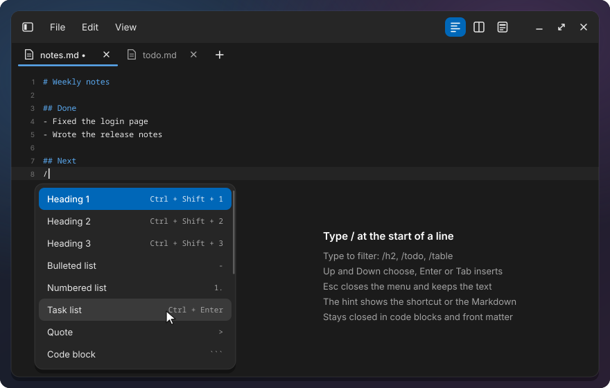

In a Markdown tab, type `/` at the start of a line (only spaces or tabs before it) and a menu of
Markdown blocks opens below the `/`. Above it when there is no room below. Typing after the `/`
filters the list: an item stays when a word of its label, its English label or one of its keywords
starts with what you typed (`/h2`, `/todo`, `/hr`). Items whose label starts with it come first.
The menu shows eight rows at a time and scrolls.

Up and Down move the highlight, Enter or Tab picks, Esc closes the menu and keeps the text. The
mouse highlights the row under it, a click picks, the wheel scrolls the list. The menu closes when
you type a space, when nothing matches, when the cursor leaves the `/query`, on a click elsewhere
or when the text scrolls. Picking replaces the `/query` with plain Markdown, as one undo step.

| Item | Hint | Inserts |
|---|---|---|
| Heading 1, 2, 3 | Ctrl+Shift+1, 2, 3 | `# `, `## `, `### ` |
| Bulleted list | `-` | `- ` |
| Numbered list | `1.` | `1. ` |
| Task list | Ctrl+Enter | `- [ ] ` |
| Quote | `>` | `> ` |
| Code block | ` ``` ` | an empty fenced block, cursor inside |
| Table | `\|` | a two-column table with the first header selected |
| Divider | `---` | `---` (`***` on the first line, so it never starts front matter) |
| Link | Ctrl+K | `[text](url)` with `text` selected |
| Image | `` | `` with `alt` selected |
| Bold | Ctrl+B | `**text**` with `text` selected |
| Italic | Ctrl+I | `*text*` with `text` selected |
| Strikethrough | Ctrl+Shift+X | `~~text~~` with `text` selected |
| Inline code | `` Ctrl+` `` | `` `text` `` with `text` selected |
| Mermaid diagram | ` ```mermaid ` | an empty `mermaid` block, cursor inside |

The hint is shown dimmed at the right of each row: the Markdown syntax, or
the shortcut where an item has one (see [Markdown shortcuts](#markdown-shortcuts)). Labels are translated.
Blocks (code block, table, divider, Mermaid) get a blank line before and after them where text
would run into them. Further lines of a block keep the indentation before the `/`.

The menu does not open in front matter, in fenced or indented code blocks, in HTML blocks or
inside an HTML comment that is still open at the `/` (an escaped `\<!--` is text). It never opens
in non-Markdown files or with Vim bindings, where `/` starts a search. The check reads the file
only up to the cursor and skips the parse when nothing above can hide the `/`.

The highlight looks like the stock COSMIC menus: the accent colour for the row picked with the
keys, the hover colour for the row under the mouse. The popup is a window overlay
(`src/slash_popup.rs`), so the editor's edges never clip it.

Settings, section "Markdown", **"/" command menu** (on by default, config key
`markdown_slash_menu`). Off, `/` types a plain slash.

## Markdown shortcuts

In a Markdown tab these keys write the Markdown for you. Each use is one undo step.

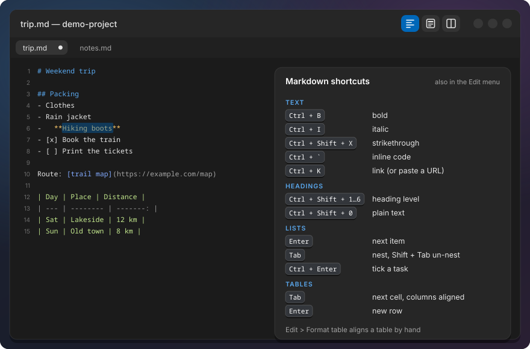

| Action | Shortcut | Behaviour |
|---|---|---|
| Bold | Ctrl+B | Wraps the selection, or the word at the cursor, in `**`. Pressed again, takes them off. |
| Italic | Ctrl+I | The same with `*`. |
| Strikethrough | Ctrl+Shift+X | The same with `~~`. |
| Inline code | `` Ctrl+` `` | The same with backticks. Text that holds backticks gets a longer fence. |
| Link | Ctrl+K | Makes `[text](url)` from the selection or the word at the cursor, with `url` selected. In a link, selects its URL. |
| Paste a URL | Ctrl+V | Pasting a URL over selected text makes `[text](URL)`. |
| Heading 1 to 6 | Ctrl+Shift+1 to 6 | Sets the heading level of the line. Pressed again, the line becomes plain text. |
| Plain text | Ctrl+Shift+0 | Removes the heading marker. |
| Toggle task | Ctrl+Enter | Ticks or unticks the task item. A plain line or list item becomes a task. |

The text styles (bold, italic, strikethrough, inline code) work the same way:

- **A selection:** it is wrapped and stays on the text inside the markers. When the text already
  has the markers, just inside or just outside the selection, they come off. Spaces at the ends of
  the selection stay outside the markers.
- **No selection, in or next to a word:** the word is wrapped (or unwrapped). The cursor stays
  where it was in the word. Right after the closing markers (`**word**|`) or before the opening
  ones counts as at the word.
- **No selection elsewhere:** an empty pair, like `****`, with the cursor in the middle, to type
  into. Pressed again in an empty pair, it removes it. Strikethrough adds no pair at the start of
  an empty line, because `~~~~` there would start a code block.
- **Bold and italic together:** `***x***` is both. Ctrl+B on it leaves `*x*`, Ctrl+I leaves
  `**x**`. Ctrl+I on `**x**` gives `***x***`.
- **`_` markers:** bold and italic are added with `*`, but `__bold__` and `_italic_` come off too.
  A `_` inside a word (`snake_case`) is text.
- **Several lines:** each line's text is wrapped on its own, so a marker never stays open over a
  blank line. Block markers at the start of a line (`- `, `1. `, `## `, `> `, `- [ ] `) stay in
  front: `- item` becomes `- **item**`. When every line already has the style, it comes off
  everywhere, whether a line uses `*` or `_`. Otherwise only the lines without it get it.
- **Inline code with backticks:** `` a`b `` becomes ``` ``a`b`` ```. Text that starts or ends
  with a backtick gets a space inside the fence, as CommonMark asks.

Ctrl+K without a selection and outside a word inserts `[text](url)` with `text` selected. Headings
keep quote and list markers in front (`> ## Title`); task items stay as they are. Front matter,
fenced code blocks and code spans are left alone. Code spans are read as CommonMark reads them: a
lone backtick (`don`t`) is text.

Edit > Markdown lists Bold, Italic, Strikethrough, Inline code, Link, a Heading submenu, Toggle
task and Format table, each with its shortcut. They are disabled, and the keys do nothing, in other files and in the
Preview view. With Vim bindings the keys behave like the editor's other Ctrl shortcuts (Ctrl+Z,
Ctrl+S): the editor handles them, not Vim.

**Markdown shortcuts panel.** F1, **View > Markdown shortcuts…** or **Show** under **Settings >
Markdown** opens a panel on the right of the window with every Markdown key: text styles, headings,
lists, tables and the "/" menu. It stays open while you type, for any tab. F1 again or Close
closes it, and so does Escape in the text when nothing is selected (an open Go to line bar closes first;
with Vim bindings Escape stays with Vim). The key texts come from the editor's own bindings, and a
test checks that every Markdown binding is listed. With Vim bindings the keys the editor handles
itself (Enter, Tab, Backspace, "/") are dimmed, because they type as usual then.

## List editing

In a Markdown tab, Enter, Tab and Shift+Tab help with lists. With Vim bindings they type as usual.

- **Enter in a list item** starts the next item with the same marker and indentation: `- `, `* `,
  `+ `, `1. ` (numbers count up) or `1) `. In a task item the new one starts unticked (`- [ ] `).
  In a quote (`> `) the next line stays in the quote. Text after the cursor moves into the new item.
- **Enter on an empty item** ends the list. A nested item first moves out one level. An empty `>`
  line loses one quote level.
- **Tab** makes the item (or the selected items) a child of the item above it, indented to where
  that item's text starts. **Shift+Tab** moves it back out. Children and their code blocks move
  along. Tab on the first item of a list does nothing.
- **Numbered lists** are renumbered from the changed item down.
- **Ctrl+Enter** ticks or unticks the task at the cursor, or every task in the selection (all
  ticked: all unticked, else all ticked). Without tasks, list items and plain lines become tasks.
  Headings, tables, fences and dividers stay as they are.

Nothing happens in code blocks, front matter or HTML blocks, with one exception: Enter in a fenced
code block that is indented or quoted (in a list item or a quote) starts the new line with the
fence's indentation and quote markers, so the code stays in the item. This also works with
automatic indentation turned off.

- **Backspace right after a list marker** steps back. In a task item it first removes the box
  (`- [ ] ` becomes `- `). A nested item then moves out one level. At the top level the marker
  goes and the line becomes plain text. Elsewhere Backspace deletes a character as usual.
- Helpers that change folded lines unfold them first, so no edit lands in hidden text.

## Tables

In a Markdown table (`src/md_table.rs`), with Vim bindings off:

- **Tab** moves to the next cell and selects its text. In the last cell it adds a row.
  **Shift+Tab** moves to the cell before.
- **Enter** in a cell adds an empty row below and puts the cursor in its first cell. On the header
  row the new row goes below the delimiter row. Enter on an empty last row ends the table and
  leaves an empty line. In front of a row, or after its last pipe, Enter is a plain new line, so a
  table can still be typed row by row.
- Every Tab and Enter also **aligns the table**: leading and trailing pipes, each cell padded to
  the widest cell in its column, the delimiter row as wide as the column, alignment colons kept.
  Width counts East Asian wide characters and emoji as two columns (the `unicode-width` crate).
- **Edit > Markdown > Format table** aligns the table at the cursor without moving anywhere.
- As in GitHub's Markdown, a line without a pipe inside a table is a row with one cell. A blank
  line, a heading, a list item or a rule ends the table.

The "/" menu item **Code block** puts the cursor right after the opening fence, to type the
language; Enter then moves into the block.

## One editor window

Opening a file while the editor runs (double-click, "Open with", `cosmic-edit file.md`) adds a tab
to the running window and brings it forward with keyboard focus (also when minimized); a file that is already open gets its tab focused. A launch
without files only raises the window. File, New window and `COSMIC_SINGLE_INSTANCE=false cosmic-edit`
start a separate editor (it leaves the session to the first one). This uses libcosmic's
`single-instance` feature (D-Bus). libcosmic raises the window only when the launcher passed an
activation token, so the editor also unminimizes and activates its window itself on every launch
that reaches it.

## Session restore

Like Notepad++: when the editor starts, every tab from last time comes back, including unsaved
changes and untitled drafts, with cursor, scroll position, Markdown view and the active tab. The
window opens at its last size (clamped to 360x240..8192x8192) and maximized again if it was;
unmaximizing returns to the size it had before. The position is not kept: a Wayland app cannot
place its own window.

- Closing the window does not ask to save: the drafts are kept. Closing a single tab with unsaved
  changes still asks; Discard deletes its draft.
- Drafts are written 2 s after typing pauses and at least every 15 s while you keep typing, plus
  on tab open, close and switch and on quit. Nothing is written when the text did not change. The
  writes (hash, file, fsync) run in the background, one at a time; an older snapshot never
  overwrites a newer one. A crash loses about the last 2 s, at most 15 s. A failed write is
  retried.
- If a draft or the session file cannot be written (disk full, read-only folder), closing the
  window asks to save as before.
- A file that was deleted comes back from its draft as unsaved; a file changed on disk after the
  draft keeps the draft and shows the "changed on disk" bar (below).
- A session file that cannot be read is never overwritten, and restore stays off for that run. A
  corrupt or newer one is renamed to `.bad`, its drafts move to `backups.bad-<time>/`, and no draft
  is deleted in that run.
- Settings, "Restore previous session" (on by default). Off: the editor behaves as upstream and
  the stored session is deleted.
- Only one editor process owns the session; one started with `COSMIC_SINGLE_INSTANCE=false` leaves
  it alone.

Storage, readable only by you (folders 0700, files 0600, written via temp file and rename):

```text
~/.local/state/cosmic-edit/session/
  session.ron        open tabs, cursor, scroll, view, folds, clones, active tab, views, window size, sidebar width (versioned)
  backups/<id>.txt   the unsaved text, one file per tab
```

Drafts are on disk only; include `~/.local/state` in your backup if you want them there too.

Not yet: window position (Wayland), project folders, per-tab zoom. Upstream: the open PR
[cosmic-edit #497](https://github.com/pop-os/cosmic-edit/pull/497) ("hot exit") and issue
[#94](https://github.com/pop-os/cosmic-edit/issues/94).

## Closing tabs

File > Close > "Close all tabs" (Ctrl+Shift+W), "Close other tabs" and "Close tabs to the right", also in
the tab's right-click menu as Close all, Close others and Close tabs to the right (there they act
on that tab and its view). Clean, compare and git diff
tabs close at once. Tabs with unsaved changes get one prompt that names them, with **Save all**,
**Discard all** and **Cancel**. Cancel closes nothing. Save all asks Save As for each untitled tab
in turn and stops at the first one cancelled. Discard all deletes the drafts like Discard on one
tab. Closing every tab leaves one new empty tab; the editor does not quit.

## Copy file path and Open containing folder

The tab's right-click menu starts with **Copy file path** and **Open containing folder**. Both act
on the tab you right-clicked, not the active one. Copy file path puts the full path on the
clipboard, for example `/home/user/notes/todo.md`. Open containing folder shows the folder in the
file manager with the file selected (`org.freedesktop.FileManager1.ShowItems` over D-Bus). If no
file manager answers, the folder opens with the default app. Both are greyed out on a new document
that has not been saved yet.

## Open a typed path

In the Open dialog (Ctrl+O), click the location bar or press Ctrl+L to edit the path. When it holds
the full path of an existing file and you press Enter, the dialog opens that file, as if you had
selected it and clicked Open. `~` stands for the home folder. A folder path changes to that folder,
as before. A path that does not exist, or a relative path, keeps the upstream behaviour (the first
completion, or nothing). The Save dialog and folder dialogs do not change. The change is in the
cosmic-files dialog code, `patches-cosmic-files/0002-…`.

You do not have to open the location box first. Typing `/` or `~` in the file list of any file
dialog opens it with that character, so `/etc/hosts` or `~/notes/todo.md` followed by Enter opens
the file (`patches-cosmic-files/0003-…`).

## Open a pasted path

Ctrl+V in a file dialog, while no text box has the focus, reads the clipboard
(`patches-cosmic-files/0004-…`, logic in the new `src/paste_path.rs`). Only the first line counts;
surrounding whitespace and quotes go, `~` is the home folder and a `file://` URI is decoded
(`%20` becomes a space). Then:

| Pasted | Open file dialog | Folder dialog | Save dialog |
|---|---|---|---|
| Existing file | Opens it, as if selected and opened | Shows its folder | Shows its folder, the name goes in the file name box |
| Existing folder | Shows it | Shows it | Shows it |
| New file in an existing folder | Location box | Location box | Shows the folder, the name goes in the file name box |
| Anything else (missing or relative path, a pipe or device, other text) | Location box | Location box | Location box |

"Location box" means it opens with the pasted text selected, replacing the old path, so it can be
fixed by hand or replaced by pasting again. The Save dialog never saves by itself; Save still asks
before replacing a file.

Ctrl+L and the edit button open the location box with the current path selected, so typing or
pasting replaces it (as in GTK file choosers and browsers). Typing `/` or `~` (patch 0003) keeps
the cursor at the end instead.

Escape in the location box closes only the box and goes back to the folder path; the next Escape
closes the dialog (`patches-cosmic-files/0005-…`). Upstream, the box closed itself on Escape and the
same key press then also cancelled the dialog.

## Sidebar width

The sidebar with the project files can be made wider or narrower: drag its right edge (a resize
pointer shows there). It keeps at least 160 px and at most half the window; a smaller window
narrows it without losing the chosen width. Until it is dragged, the sidebar keeps the upstream
width (as wide as its items, at most 280 px). The session keeps the width (with "Restore previous
session" on). A narrow window, where the sidebar covers the whole window, has no resize
edge.

## Two views

View > Views > "Move to other view" and "Clone to other view" (also in the tab's right-click menu) split
the window into a left and a right view, each with its own tab bar and shown tab. A view left
without tabs closes the split. A click into a view makes it active, marked by an accent line above
its tab bar; menus, shortcuts and Ctrl+Tab act on the active view.

The divider between the views can be dragged (a resize pointer shows near it). Each view keeps at
least 240 px; a window too narrow for that splits evenly. The share is kept in the session; a new
split starts even.

Drag a tab from one view anywhere into the other (its tab bar, the space after the tabs, the editor
or the preview) to move it there, after the last tab. While dragging, the target view gets an
accent outline and its tab bar a marker where the tab lands; a view where a drop would do nothing
is not highlighted. Dragging within one tab bar reorders the tabs, and the session keeps the order.

Clone mirrors the document, like Notepad++: any tab can be cloned, unsaved and untitled ones
included, and the clone starts with the current text and changed state. An edit in one clone is
applied to the other right away; each keeps its own cursor, scroll and undo history, and undo
mirrors like any edit. Saving one marks both saved, Save As gives both the new path, and Reload or
Revert all changes acts on both as one action. An edit mirrored into a fold unfolds it first.
Closing one leaves the other a normal tab, without the save prompt while its twin holds the same
text (Close all, Close others and Close tabs to the right do not count it as unsaved either).
Like Notepad++, a view shows a document once: Move to other view or a drag into the view that
holds a paired clone with the same text closes the moved tab and shows that clone, and Clone to
other view shows it instead of opening another. Restored clones come back paired. Two tabs of one file
with different unsaved text (drafts from an older session) are left apart and do not mirror; a
warning in the log names the file.

A close that empties a view (the last tab, or Close all in that view) keeps the other view's shown
tab in front; other closes go to the nearest tab of the same view.

View > Views > "Synchronize vertical scrolling" (off by default, config key `sync_scroll_views`): scrolling
one view, by wheel or keys, scrolls the other by as many lines; scrolling sideways moves the other
by the same distance, up to its left edge and its widest visible line. Two Markdown previews follow
each other by position in the document. The session keeps each tab's view and the shown tab of
each view; an older session opens in one view.

## File changed on disk

A tab without unsaved changes reloads silently when its file changes on disk (as upstream). A tab
with unsaved changes, or a restored draft, shows a bar above the text instead:

| Bar | Buttons |
|---|---|
| "<name> was changed on disk." | **Reload** (take the disk version; one Undo brings yours back, Redo shows the tab saved again), **Keep mine** (the next Save overwrites; the bar comes back on a further change), Compare |
| "<name> was deleted on disk." | **Keep mine** (Save recreates the file) |

Save checks the file first: if it changed unseen, the bar shows instead of overwriting, and a
second Save writes. The first Save for a disk version never writes, also when the bar was already
up. The check uses the file's time, size and inode (a file replaced by rename can keep time and
size), then a content hash only when those changed. It runs on watcher events, tab switch, Save, session restore and when the window gets focus
again (the shown tab of each view, for changes the watcher missed); a file replaced by
rename is watched again. An unanswered bar survives a restart (the session keeps what each draft
was based on).

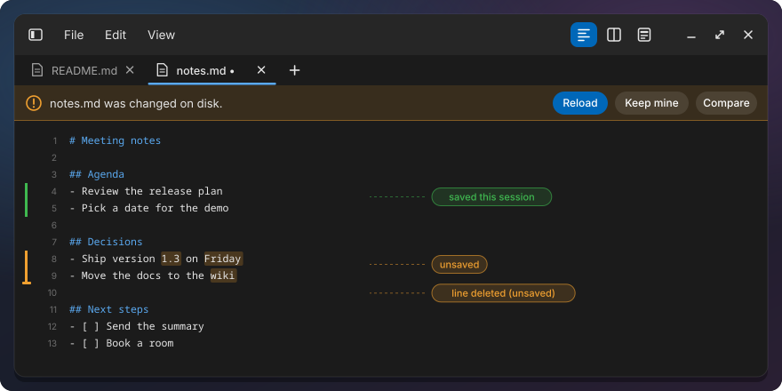

## Changed lines

Like Notepad++ change history: a thin bar left of the line numbers.

| Bar | Meaning |
|---|---|
| Orange | Changed and not saved yet |
| Green | Changed and saved during this session |
| none | Unchanged since the file was opened |

A short tick at the top of a line marks lines deleted above it (orange, green once saved). Undo
back to the saved text removes the orange. A restored draft shows orange against the file on disk.
A new document shows no marks until its first save (every line would be new); after that it
counts changes against the saved text, like an opened file. Reloading a file changed on disk and
"Revert all changes" clear the marks. Settings, "Change history", "Show changed lines" (on by
default; config key `change_history`).

Unsaved changes are also tinted inside the text: the changed words of an orange line get a light
orange background (whole new lines are tinted whole); saved changes are not tinted. Settings,
"Highlight changed text" (on by default, config key `highlight_changed_text`; needs "Show
changed lines"). For about 200 ms after an edit the tint can sit on the old position.

**Compare with saved** (File menu next to "Revert all changes", and the editor's right-click menu;
disabled without unsaved changes) opens a read-only tab "<name> ↔ saved" with the diff between the
file on disk (empty for untitled) and the current text, in the editor's diff view: removed lines
red, added green, with context. It is a snapshot; opening it again refreshes and focuses the same
tab. A click on an orange bar or deletion tick in the gutter opens it too (it does not scroll to
that change yet). Compare tabs are not part of the restored session. Each hunk starts with its git
header line, `@@ -old,count +new,count @@`, in the accent colour.

**Compare with...** (File menu and the tab's right-click menu) lists the other open editor tabs and
opens "a.md ↔ b.md" with the diff from this tab's text to the other's, unsaved text included;
opening it again refreshes and focuses it. With two views, "Compare the two views" at the top of
the list compares the tabs they show.

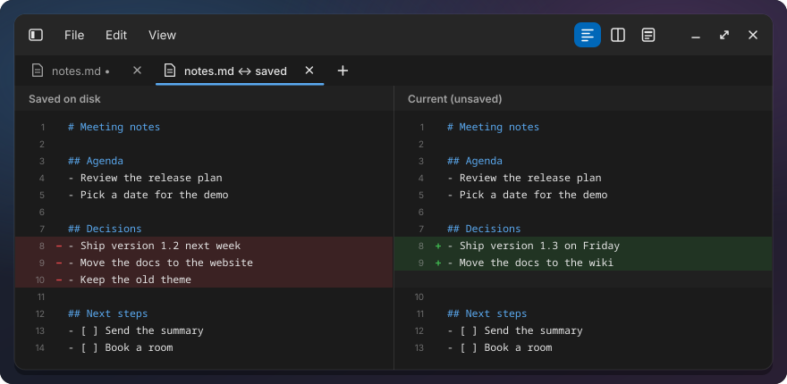

The marks come from a line diff (the `similar` crate, 50 ms deadline per diff) between the text
when the file was opened, the text at the last save and the current text. It runs in the
background about 200 ms after typing stops (500 ms for files over 1 MB); a 1 MB file takes about
2 ms. Right after inserting lines, the marks below can sit one line off until that run finishes.

## JSON tools

On `.json` tabs (and untitled tabs starting with `{` or `[`) Edit > JSON has:

| Action | How |
|---|---|
| Format JSON | Ctrl+Alt+Shift+F; indent = the tab width in spaces |
| Minify JSON | Ctrl+Alt+Shift+M |
| Validate JSON | Edit > JSON; a bar above the text names line, column and reason, with **Go to** |

A small tokenizer copies strings and numbers byte for byte, so key order and number text stay
exactly as written (no new dependency). Format and Minify are one undo step and keep the cursor on
the same token. Invalid JSON (JSONC comments and trailing commas included) is left alone and the
bar shows the error. Texts over 20 MB are refused.

## Whitespace and line endings

Like Notepad++ "Show symbol", both off by default and kept in the config:

| View menu | What it draws |
|---|---|
| Show whitespace (`show_whitespace`) | A faint dot on each space, an arrow across each tab; trailing whitespace a little stronger |
| Show line endings (`show_line_endings`) | A faint mark after each line end: return arrow for LF, pilcrow for CRLF, left arrow for CR |

The marks are drawn behind the text over the visible rows only, so text, layout and cursor
positions never change; with both off nothing is scanned.

Edit > "Line endings: LF" (or CRLF, CR, Mixed) lists LF (Unix) and CRLF (Windows) with the file's
ending checked. Picking the checked one does nothing; picking the other converts every line, as one
undo step, and the status bar shows "Converted to CRLF — Ctrl + Z to undo" for 4 s. A file with
mixed endings first shows how many lines use each (`Mixed: 120 LF, 3 CRLF`) and checks neither. A
file without a line break shows LF checked and CRLF disabled (new lines get LF). Enter inserts the
file's own line ending, and Save writes each line's own ending.

## Find and replace

Find and Replace is a separate window, as in Notepad++, that you can move next to the text.
Ctrl+F and Ctrl+H (Edit > Find, Replace) open it with both fields, "Find what" and "Replace
with". A selection on one line fills "Find what"; a selection over line breaks, or of at least
1024 characters, ticks "In selection" instead and keeps the query. Go to line (Ctrl+G) can be open
at the same time.

On Wayland the compositor places the window. When it sits behind the editor, Ctrl+F may only mark
it as wanting attention (sway does this); a click on it brings it forward.

Under the fields sit the options, all kept in the config:

| Option | What it does |
|---|---|
| Match case (`find_case_sensitive`) | Upper and lower case must match |
| Match whole word only (`find_whole_word`) | A match must not continue a word (letters, digits, `_`) on either side, in normal and regex mode. A pattern that starts or ends with a non-word char needs no boundary on that side: `.foo` matches in `file.foo` but not in `file.food`, `foo-` matches in `foo-bar` but not in `xfoo-bar` |
| Search Mode: Normal | The find text is plain text |
| Search Mode: Regular expression (`find_use_regex`) | The find text is a regular expression (Rust `regex` syntax) |
| . matches newline (`find_dot_matches_newline`) | Regular expression mode only: `.` also matches a line break. `^` and `$` are line anchors with or without it |
| Search Mode: Extended (`find_extended`) | As Notepad++ "Extended (\n, \r, \t, \0, \x...)": the find and replace text read `\n`, `\t`, `\r`, `\0`, `\\`, `\xNN` (two hex digits) and `\uNNNN` (four hex digits). Any other backslash, an incomplete `\x` or `\u` and a surrogate (`\uD800`) are kept as typed, so `C:\data` stays `C:\data` |
| Wrap around (`find_wrap_around`) | Find next and previous continue from the other end of the file |

The buttons: Find next (with an up arrow for Find previous), Find All in Current Document, Find
All in All Opened Documents, Replace, Replace all and Close. Enter in "Find what" is Find next,
Shift+Enter Find previous, Enter in "Replace with" is Replace. Escape in the window closes it;
Escape in the text leaves it open.

The status line under the buttons shows the count once typing pauses (150 ms after a key in the
find field, 300 ms after one in the text): `3 of 17` when the selection is a match (as Find next
and previous leave it), `17 matches` otherwise, `No results`, `Replaced 5 occurrences` after
Replace all, or `Invalid pattern` with the regex error and the field in its error state. The count
stops at 10,000 and then shows `10,000+`. While the window is open, every match in the visible rows
is tinted in the accent colour, behind the selection.

In regex mode `^` and `$` always match at the start and end of each line. A query is searched line
by line unless it can match a line break. As in Notepad++, a regex can when any part of it can
match `\n` or `\r`: `\n`, `\r`, `\s`, `[^x]`, `\x0A`, or `.` with ". matches newline" on (or
`(?s)`). So `\s+$` also takes the blank lines after a line's trailing spaces. In extended mode a
query spans lines when its text holds `\n` or `\r`. Such a query is searched in the lines joined,
for Find next and previous, Replace, Replace all, the count and the highlights. The lines are
joined with `\n` for every line ending, so `foo\nbar` matches in LF, CRLF and CR files alike. A
query that names `\r` gets each line's own ending instead, so `foo\r\nbar` matches a CRLF file.

A line break in the replacement is written as the file's own ending. A query that names `\r` edits
line endings itself, so its replacement's line breaks are kept as written: `\r\n` replaced with
`\n` converts CRLF lines to LF. A match of half a `\r\n` keeps the other half, so `\r` replaced
with nothing leaves the `\n`.

Empty matches count, as in Notepad++: `^` counts once per line, Find next steps from line to line,
and Replace and Replace all insert there, so `^` replaced with `> ` quotes every line and `$` with
`;` ends each one. Matches never overlap, and an empty match right after the previous match is
skipped: `x*` in `axxb` matches before `a`, then `xx`, then at the end.

Replace works as in Notepad++: when the selection is not the match yet, the first press selects
the next match; the next press replaces it and selects the match after it. An empty match at the
cursor counts as selected, so `^` is replaced on the first press.

In regex mode the replace text names capture groups:

| Replace text | Inserts |
|---|---|
| `$1`, `${name}` | Group 1, the group named `name` |
| `$0`, `\0` | The whole match |
| `\1` … `\9` | Groups 1 to 9, as in Notepad++; `\10` is group 1 and a `0`, as is `${1}0` (`$10` is group 10) |
| `$$` | A literal `$` |
| `\n`, `\t`, `\xNN`, ... | The escapes of extended mode |

In normal and extended mode a `$` is literal; in extended mode `\0` is a NUL char, not the match.
Replace, Replace all and the across-lines search all expand the groups. Replace all is one undo
step and leaves the cursor after the last replacement. It stays fast on large files, also when the
replacements add or remove line breaks: about half a second for some 48,000 such replacements in a
5 MB file (release build).

**In selection** works as in Notepad++: only the count, Replace all and the highlights stay inside
the range; Find next, Find previous and Replace work on the whole file, and the match they select
leaves the range as it is. The range is shaded faintly in the accent colour. The box ticks itself
when the window opens on a selection over line breaks or of at least 1024 characters, and is
disabled while there is no range and no selection. A replace from the window moves the range with
its edit; after any other edit, or in another tab, the range gives way to the selection at the time
of the next action, and without a selection the box shows off and the actions take the whole file.
Closing the window ends "In selection".

| Key | What it does |
|---|---|
| F3 | Find next for the last query, also with the window closed; without a query it opens the window |
| Shift+F3 | Find previous for the last query |
| Ctrl+F3 | Puts the selection (on one line) or the word under the cursor into the find field and goes to the next occurrence |
| Ctrl+Shift+F3 | The same, to the previous occurrence |
| Ctrl+Shift+F | Find in Files (below), also Edit > Find in Files... |
| F7 | Shows or hides the Search results panel |
| Escape | In the window it closes the window. With the Go to line bar open (Vim bindings off), Escape in the text closes the bar and keeps the selection; the next Escape clears it |

Find next after Escape cleared the selection of a hit moves on to the next match instead of finding
the same one again; a new query still finds a match right at the cursor.

Limits:

- The highlights search only the visible lines; a line over 64 KiB only 1 KiB around its visible
  part. For a query that spans lines, the visible lines and 200 lines before and after are joined,
  so a match reaching further is highlighted only in part; above 1 MiB of joined text the
  highlights fall back to line by line.
- The count scans the whole text (for a query that spans lines, a full joined copy) once per typing
  pause, and stops at 10,000 matches.
- The highlights skip empty matches (of `^`, say): there is nothing to draw. The count, Find next,
  Replace and Replace all take them.

### Find All and the Search results panel

Find All in Current Document and Find All in All Opened Documents list every matching line in the
Search results panel at the bottom of the editor, as in Notepad++. Each search gets a header,
`Search "todo" (12 hits in 3 files of 5 searched)`, and one row per line, `Line 12: …`, with the
matches highlighted. A single click on a row goes to the line and selects the match. The newest
search is on top and open; older ones are folded, and the last 10 are kept. A search stops at
10,000 hits and says so in its header. F7 shows and hides the panel.

### Find in Files

The second tab of the window, Find in Files (Ctrl+Shift+F, or Edit > Find in Files...), searches a
folder on disk. It replaces upstream's "Find in project" drawer.

| Field | What it does |
|---|---|
| Directory | The folder to search, typed or picked with the browse button. With "Follow current doc." ticked, it follows the folder of the active file |
| Filters | File patterns separated by spaces, such as `*.md *.txt`; `*.*` takes every file. `!name` leaves out matching files and folders, such as `!target` |
| In all sub-folders | Also searches the folders below |
| In hidden folders | Also searches folders whose name starts with `.` |

The search options of the first tab (whole word, case, search mode) apply here too. Find All
lists the hits in the Search results panel; a click on a row opens the file in a tab and selects the
match. Replace in Files asks first, then:

- Writes each file atomically (a new file renamed over the old one) and keeps its line endings.
- Skips binary files, files that are not UTF-8, read-only files, files with other hard links,
  symlinks and files over 50 MB. The status line gives the replaced count and the files skipped
  as not UTF-8 or not written.
- Replaces a file that is open in a tab with unsaved changes in the tab instead of on disk, so Undo
  works there. Replaces on disk cannot be undone.

## Status bar

View, "Status bar" (or the switch in Settings > Appearance; off by default, config key
`show_status_bar`) shows a thin bar at the bottom of the window, under the Go to line
bar. It shows the active editor tab; with two views, the tab of the focused view.

| Item | What it shows | Click |
|---|---|---|
| `Ln 12, Col 5` | Line and column of the cursor, from 1. A column counts characters, a tab is one, and on the first line it starts after a byte order mark | Opens Go to line |
| `Sel 14 chars, 2 lines` | Instead, while text is selected: its characters (line breaks not counted) and every line it touches | Opens Go to line |
| `Block 3 × 12` | Instead, while a column block is active: lines × visual columns | Opens Go to line |
| `123 lines, 4,567 chars, 789 words` | The size of the text. Characters are graphemes, as in Document statistics ("e" with a combining accent or a flag is one), without line breaks and a byte order mark. Words only in Markdown files and not above 2 MB of text: a word is a run of non-whitespace with a letter or digit in it, so a marker on its own (`#`, `-`, `**`, `\|---\|`) is not one | - |
| `LF` | The line endings: LF, CRLF, CR or Mixed; a text without a line break shows LF, the ending a new line gets | Opens the same list as Edit > Line endings: LF and CRLF, the current one checked, counts for a mixed file |
| `UTF-8` | `UTF-8`, or `UTF-8 BOM` when the file starts with a byte order mark (kept on save). The editor opens UTF-8 files only | - |
| `Spaces: 4` | The tab width; Tab always inserts spaces | Tab width 2, 4 or 8, as in Edit > Indentation |

Opening or reloading a file counts the text at once. While typing, the bar keeps the counts from
before and counts again 300 ms after the last edit, so a key in a large file never waits for a
count of the whole text. A selection of more than 2 MB shows only its line count (`Sel 123,456
lines`). The counts and the selection size are kept per tab until the text or the selection
changes.

## Go to line

Ctrl+G or Edit, "Go to line..." opens a one-field bar at the bottom of the editor; the Find and
Replace window can be open at the same time. Type a line, `42`, or a line and column, `42:7`, both counted from 1, and press Enter;
spaces around the numbers are fine.

- A line past the end goes to the last line, a column past the end of the line to its end.
- Input that is no place (zero, a sign, letters, an empty part, a second colon) keeps the bar open
  with the field in red and an example of what to type.
- Escape or the close button closes the bar.
- A fold around the line opens, as for a find hit.
- In a Markdown tab that shows only the Preview, the tab switches to Split and the line comes to
  the top of the source; in Split the preview follows.
- The column counts characters as the status bar does: on the first line of a file with a byte
  order mark it starts after the mark.
- The jump clears the selection and ends an active column block.

## Column selection

Like Notepad++: Alt+drag or Alt+Shift+arrows select the same visual columns on every line between
two points. A tab reaches the next tab stop, lines ending left of the block are skipped, and
wrapped lines use their logical line. The highlight follows the visual columns, so only the part
of a tab inside the block is highlighted. A tab cut by an edge of the block becomes spaces of the
same width before an edit (in the same undo step), so text goes in and out at the same column on
every line; a copy gives such a tab's covered columns as spaces and keeps whole tabs.

- Typing, Backspace and Delete act on every line of the block.
- Copy and Cut join the lines with newlines. Paste of multi-line text goes in line by line;
  single-line text goes on every line.
- A copied or cut block pasted at a plain cursor goes in as a block (as in Notepad++): each row at
  the cursor's column on the lines below, short lines padded with spaces, rows past the end of the
  file on new lines, one undo step. Only the last block copied counts; text copied elsewhere since
  pastes normally.
- Each edit is one undo step. A plain click, a navigation key or Ctrl+Backspace/Delete leaves
  block mode.
- Not available with vi bindings.

## Folding

| Action | How |
|---|---|
| Fold / unfold one block | Click the chevron right of the line numbers (▸ folded; ▾ on hover over the gutter or on the cursor line), or View > Folding > Fold (Ctrl+Shift+[) and Unfold (Ctrl+Shift+]) at the cursor |
| Whole file | View > Folding > Fold all and Unfold all |

Fold ranges: brackets for JSON and C-like files, sections under headings for Markdown, indentation
for everything else. A folded header shows `…` after its text. A chevron click toggles that block
only, without moving the cursor or starting a selection.

Folding never changes the text: a folded line gets a zero line height, so it takes no space and
Save writes the whole file. The fold state lives in the line attributes, so folds move with the
text. The session keeps each fold as its header line and text; on restore a block is folded again
only when that line still holds the same text, so a fold whose header was changed elsewhere is
dropped. Cursor motions step over folds. An edit, undo, redo,
paste, a find or replace hit, or a column selection over a fold unfolds it, so changed text never
stays hidden. Reload unfolds everything. The gutter, change marks, tints, whitespace marks and the
current-line highlight skip hidden lines.

Folding never leaves a selection in hidden text: a fold that a selection reaches into drops the
selection, and a hidden cursor moves to the end of the fold header (as in VS Code). Typing, Enter,
Backspace, Delete, Tab, input method text, paste and cut unfold whatever the selection reaches
into before they edit.

## Links and safety

A Markdown file can come from anywhere, so a click in the preview never runs anything:

- `http`, `https` and `mailto` open with the default app. A `mailto` link may only carry `subject`,
  `body`, `cc` and `bcc`; any other field (for example `attach`) blocks the link.
- Local links are resolved against the file's folder and must point to a regular file. Text and
  Markdown files open in the editor. Images, audio, video and PDF without the exec bit open with
  the default app.
- Everything else is ignored with a warning in the log: other schemes, folders, `.desktop`
  files, executables, archives, missing files. `#anchor` links are ignored.
- Remote images are not fetched unless "Load images from the web" is on (above), and then only
  over `https`; otherwise a small chip with their alt text shows instead.

Bare web addresses in the preview (`https://…`, `www.…`) become links too, but not inside code.

**Links in the text.** In every file, not only Markdown, `http`, `https`, `file` and `mailto`
links in the text are underlined. A double-click opens one through the same rules as the preview.
A press on a link followed by a drag selects text instead of opening it.

## Selection scrolling

Dragging a selection past an edge scrolls the view, and it keeps scrolling while the pointer is held
still outside, faster the further away it is:

- In the text: up and down, sideways with word wrap off, also for an Alt column selection.
- In the preview: up and down, and tables and code blocks sideways.

## Patch contents

The patches 0001–0009 only add our own files under `src/`, one patch per feature, with the
feature's tests; 0010 holds every change to upstream files. Why and how to work with it:
[patch-series.md](patch-series.md#layout-of-the-text-editor-series). The earlier series of 151
patches, one per change, is in git history up to
[b9c3353](https://github.com/jwillmer/cosmic-ext-desktop-extras/tree/b9c3353/text-editor/patches).

| Patch | What |
|---|---|
| `0001-Markdown-preview-…` | `markdown*.rs`, `selectable_rich.rs`: views, parsing, HTML blocks, images, Mermaid, code colours, outline, scroll map, preview selection and its scrolling, bare web addresses as links |
| `0002-Markdown-editing-…` | `md_*.rs`, `slash_menu.rs`, `slash_popup.rs`: "/" menu, Bold and Italic, list, link and code helpers, tables, shortcuts panel |
| `0003-Session-restore-…` | `session.rs`, `single_instance.rs`, `disk_change.rs`: session and drafts, one window, files changed on disk |
| `0004-Change-history-and-compare` | `change_history.rs`, `compare.rs`: change marks and tint, Compare with saved, with another tab and the two views |
| `0005-Two-views-tabs-and-the-sidebar` | `views.rs`, `mirror.rs`, `close_tabs.rs`, `tab_view.rs`, `app_tabs.rs`, `app_focus.rs`, `sidebar.rs` |
| `0006-Editing-tools-…` | `whitespace.rs`, `column_select.rs`, `folding.rs`, `json_tools.rs`, `tab_*.rs`: whitespace and line endings, column selection, folding, JSON, large files, tab file menu |
| `0007-Status-bar-and-Go-to-line` | `status_bar.rs`, `app_status.rs`, `goto_line.rs` |
| `0008-Find-and-replace-like-Notepad` | `find_*.rs`, `tab_find.rs`, `config_ext.rs`: the Find and Replace window, Find All and the Search results panel, Find in Files |
| `0009-Our-text-box-menu-key-and-message-code` | `text_box/`, `menu_ext.rs`, `key_bind_ext.rs` (and its snapshot), `app_update.rs`, `shell.rs`: our drawing, keys, links in the text, selection scrolling, menus, key bindings and update arms |
| `0010-Hook-our-features-into-the-upstream-files` | The only patch that changes upstream files: `Cargo.toml`, the English strings, `main.rs`, `tab.rs`, `text_box.rs`, `menu.rs`, `config.rs`, `key_bind.rs` (`mod` lines, fields, one-line calls, menu entries, keys). An upstream release can conflict only here |
| `patches-cosmic-files/0001-…` | One-line fix so cosmic-files (the editor's file dialogs) builds with `single-instance`. `build.sh` clones cosmic-files at the revision in the editor's `Cargo.lock` to `~/.cache/edit-md/cosmic-files` and applies it; the hooks patch 0010 points Cargo there |
| `patches-cosmic-files/0002-…` | Open dialog: Enter on the typed path of an existing file opens it; test |
| `patches-cosmic-files/0003-…` | File dialogs: typing `/` or `~` in the file list opens the location box with it; test |
| `patches-cosmic-files/0004-…` | File dialogs: Ctrl+V opens, shows or fills in a path from the clipboard (new `src/paste_path.rs`, hook in `dialog.rs`); Ctrl+L and the edit button select the path (`tab.rs`); tests |
| `patches-cosmic-files/0005-…` | File dialogs: Escape in the location box closes only the box, not the dialog (`dialog.rs`); test |

## Installed files

`text-editor/build.sh` (run by `./install.sh text-editor`) reads the upstream commit from the
installed package version (the last `~` part), applies `text-editor/patches/` to a clone in
`~/.cache/edit-md/cosmic-edit`, builds it and installs:

| Path | What |
|---|---|
| `~/.local/bin/cosmic-edit-md` | The patched editor |
| `~/.local/bin/cosmic-edit` | Link to it, for launches by name (terminal, scripts) |
| `~/.local/share/applications/com.system76.CosmicEdit.desktop` | Copy of the system entry pointing at the patched editor (launcher, dock, "Open with", double-click on a file) |
| `~/.local/state/edit-md/built-commit` | Upstream commit it was built from |
| `~/.cache/edit-md/cosmic-edit`, `~/.cache/edit-md/cosmic-files` | Upstream source clones |

The editor itself writes the session to `~/.local/state/cosmic-edit/session/` (above). Uninstall
keeps it.

## Commands

```text
./install.sh text-editor               build the installed cosmic-edit version + patches, install per user
./install.sh --uninstall text-editor   back to the system editor
text-editor/build.sh [--uninstall]     the same steps without the installer
text-editor/build.sh --test            apply the patches and run the editor's unit tests, install nothing
```

Needs the same Rust toolchain as the taskbar, see [taskbar](taskbar.md#commands). The build takes a
few minutes. Only editor windows opened afterwards use it: close and reopen the Text Editor.

Built from the `cosmic-edit` commit the series was tested on (`text-editor/patches/BASE`),
whatever version is installed: it is a self-contained binary (the `cosmic-files` checkout follows
that commit's `Cargo.lock`). A newer `cosmic-edit` from apt gets one notice during the build and
needs no rebuild; `./install.sh --update` moves to a newer base when a release of this repo does,
and the daily update check (`taskbar/check.sh`) reminds you if it was not rebuilt. How to move the
series to a new version: [patch series](patch-series.md).

## Screenshots

The images above are mockups that show each feature on its own. These are real screenshots of the
current build, taken in a clean test session with demo content.

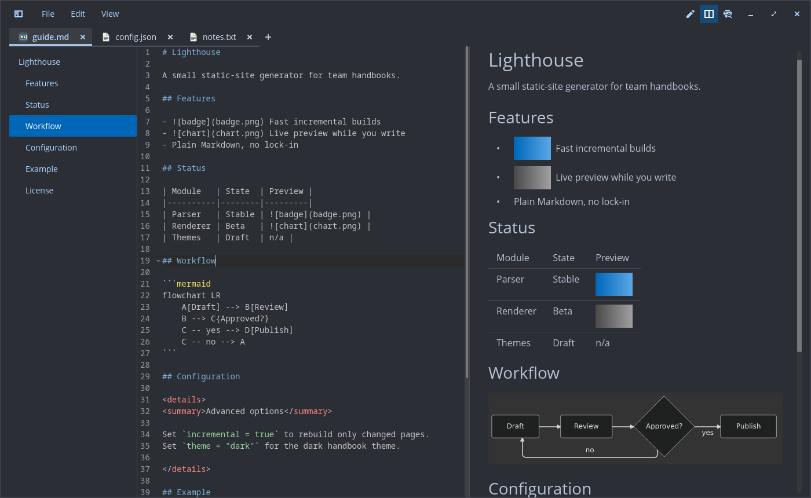

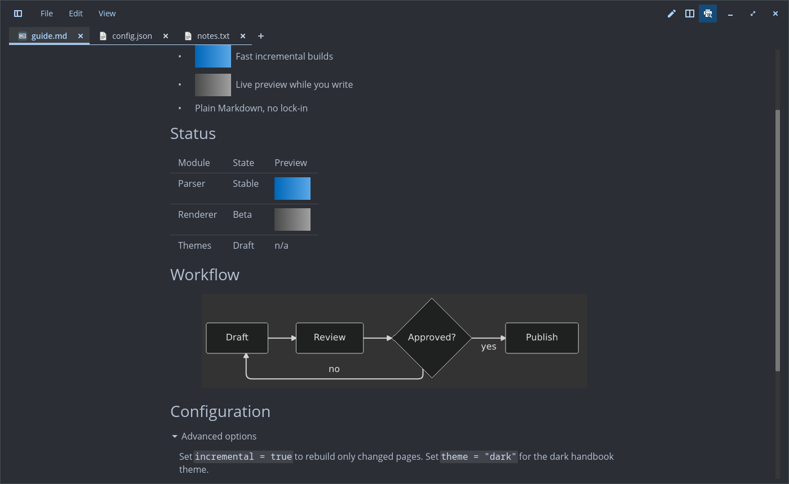

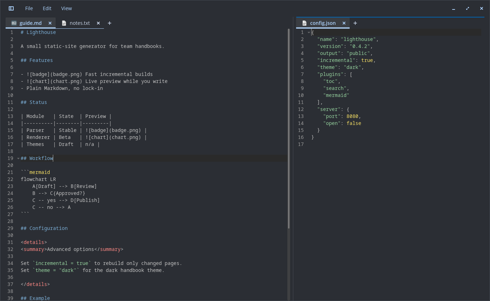

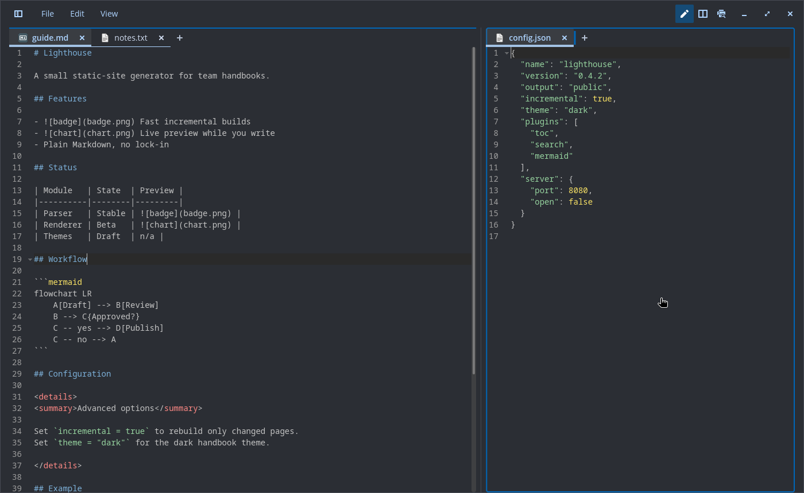

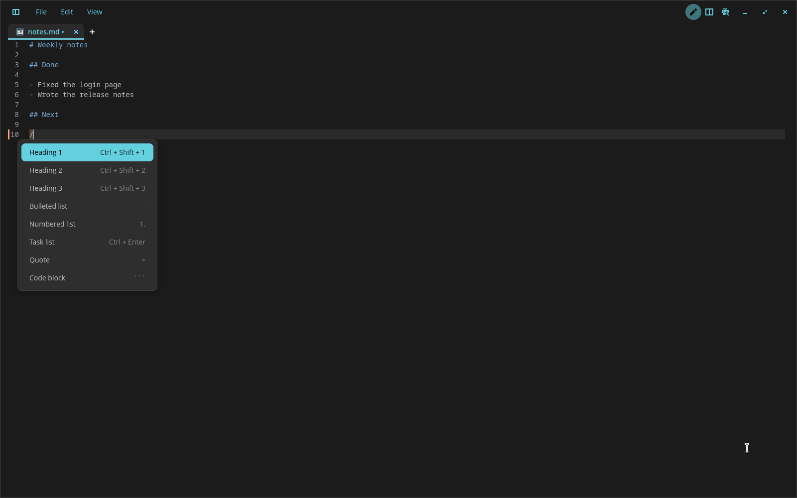

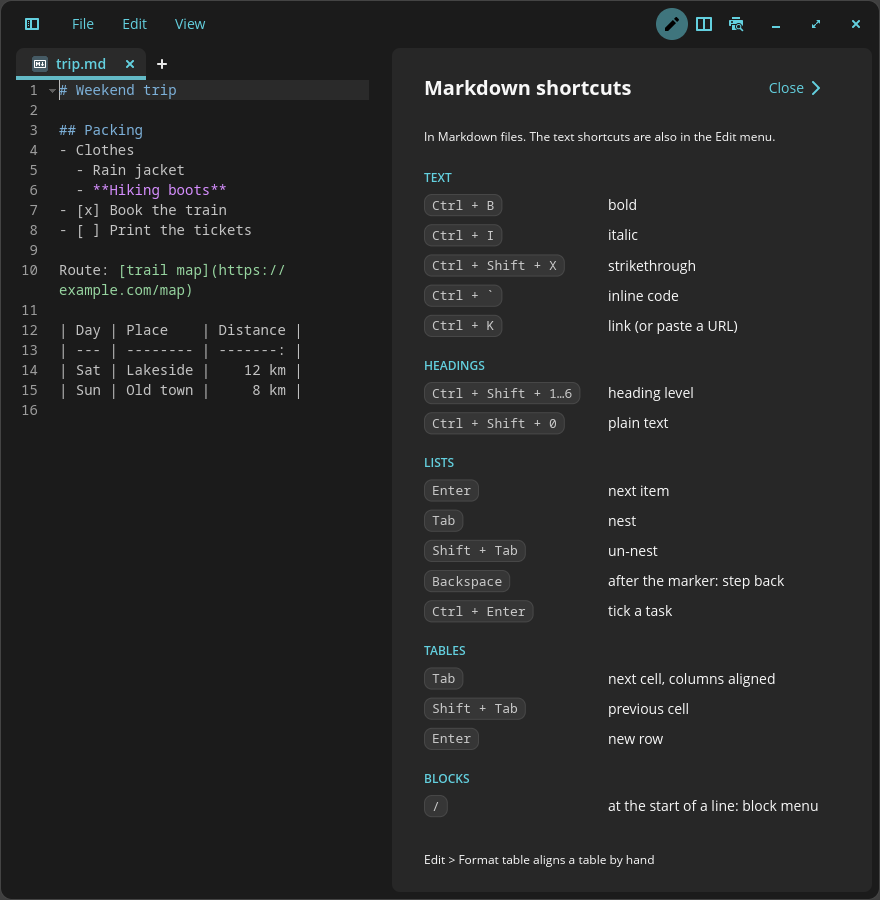

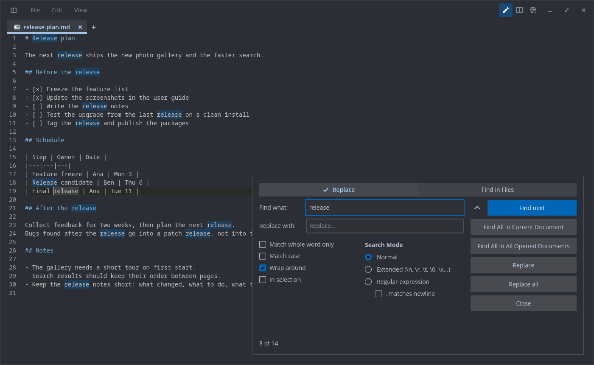

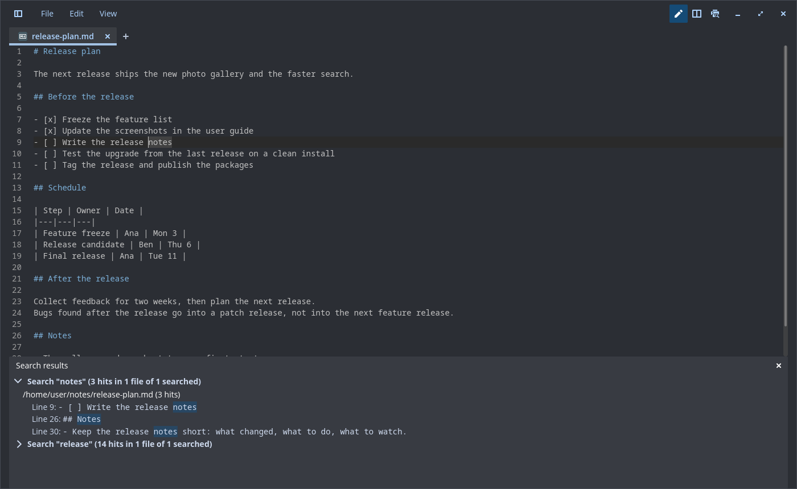

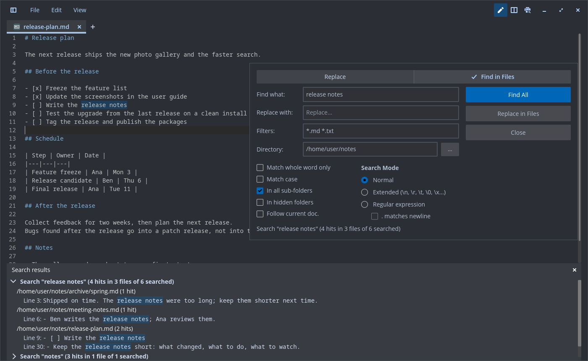

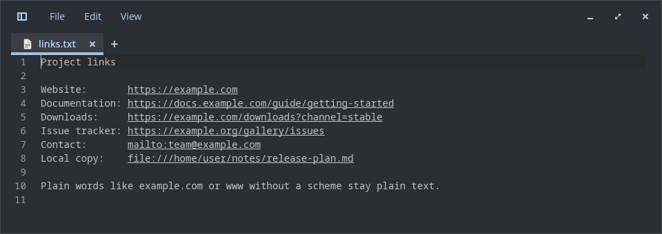

## Limits

- A dragged tab always lands at the end of the other view's tab bar. Esc does not cancel a drag. A
  very fast drag can pick the neighbouring tab, because libcosmic's tab bar does not report which
  tab was pressed.
- Images from the web need gvfsd-http (GVfs); without it the chip stays.
- Preview selection: a double-click on a link opens it; task boxes are copied but not highlighted;
  image chips cannot be selected; a `<br>` in a table cell breaks the tab-separated copy; a reparse
  or a `<details>` toggle clears the selection; auto-scroll costs CPU with software rendering.
- Two Markdown previews follow each other by position in the document, not by line.
- Status bar counts with Vim bindings: an edit away from the cursor that keeps the line count (for
  example `5>>` on other lines) is not noticed until the next edit near the cursor.
- Rendering (including code colours, Mermaid diagrams, whitespace marks, chevrons, the outline
  panel and the drag feedback), fonts, IME input (including typing in a clone with an input
  method), the D-Bus hand-off and the timers are tested by hand only.

## Upstream

Feature requests: [cosmic-edit #247](https://github.com/pop-os/cosmic-edit/issues/247) (Markdown
preview), [cosmic-edit #94](https://github.com/pop-os/cosmic-edit/issues/94) (session restore),
[cosmic-edit #495](https://github.com/pop-os/cosmic-edit/issues/495) (file diff). Where this
editor is shown upstream and in the community is tracked in
[#1](https://github.com/jwillmer/cosmic-ext-desktop-extras/issues/1).
