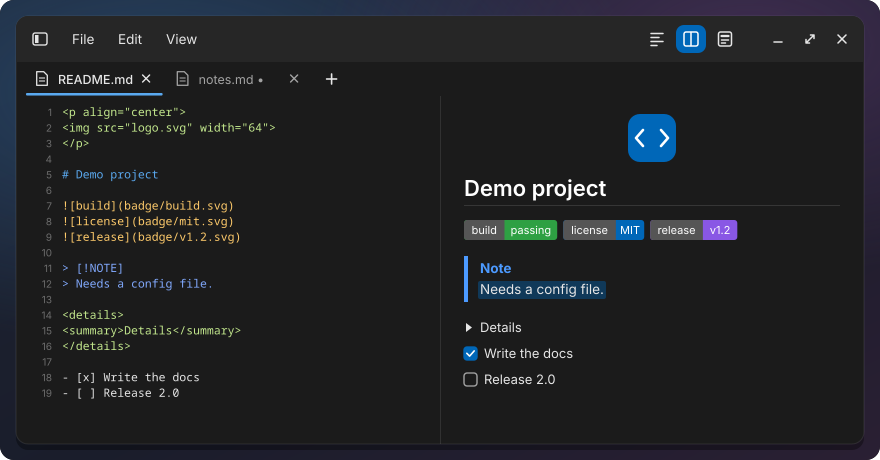

# Text Editor (technical)

A patch series for COSMIC Text Editor (`pop-os/cosmic-edit`). Markdown files open rendered, and
each Markdown tab can switch between three views. Files open as tabs in the running editor, and
the editor brings back every tab of the last session, unsaved changes included. Changed lines
are marked in the gutter, changed words are tinted, and an outside change to a file with unsaved
changes asks before anything is lost. Markdown is quick to write: a "/" menu of blocks, shortcuts
for text styles, links and headings, and list and table editing. On top: Mermaid diagrams, an
outline of Markdown headings, JSON tools, visible whitespace and line endings, find and replace
with count, extended mode and regex groups, a status bar, Go to line, column selection, code
folding, closing many tabs at once, two views side by side, and large
files that open fast.
The renderer is libcosmic's native Markdown widget (pulldown-cmark), not a web engine, so the
editor starts as fast as before. User overview: [text-editor/README.md](../../text-editor/README.md).



## Pages

| Page | What it covers |
|---|---|
| [Markdown](markdown.md) | [Markdown views](markdown.md#markdown-views) and [large files](markdown.md#large-files), the ["/" command menu](markdown.md#-command-menu), [Markdown shortcuts](markdown.md#markdown-shortcuts), [list editing](markdown.md#list-editing), [tables](markdown.md#tables), [links and safety](markdown.md#links-and-safety) |
| [Search](search.md) | [Find and replace](search.md#find-and-replace), [Find All and the Search results panel](search.md#find-all-and-the-search-results-panel), [Find in Files](search.md#find-in-files), [Go to line](search.md#go-to-line) |
| [Tabs and views](tabs-and-views.md) | [One editor window](tabs-and-views.md#one-editor-window), [session restore](tabs-and-views.md#session-restore), [closing tabs](tabs-and-views.md#closing-tabs), [copy file path and open containing folder](tabs-and-views.md#copy-file-path-and-open-containing-folder), [typed](tabs-and-views.md#open-a-typed-path) and [pasted paths](tabs-and-views.md#open-a-pasted-path), [sidebar width](tabs-and-views.md#sidebar-width), [two views](tabs-and-views.md#two-views), [file changed on disk](tabs-and-views.md#file-changed-on-disk) |
| [Editing](editing.md) | [Changed lines](editing.md#changed-lines) and Compare, [whitespace and line endings](editing.md#whitespace-and-line-endings), [JSON tools](editing.md#json-tools), [column selection](editing.md#column-selection), [folding](editing.md#folding), [selection scrolling](editing.md#selection-scrolling), [status bar](editing.md#status-bar) |
| [Development](development.md) | [Patch contents](development.md#patch-contents): what each patch of the series holds |

## Installed files

`text-editor/build.sh` (run by `./install.sh text-editor`) reads the upstream commit from the
installed package version (the last `~` part), applies `text-editor/patches/` to a clone in
`~/.cache/edit-md/cosmic-edit`, builds it and installs:

| Path | What |
|---|---|
| `~/.local/bin/cosmic-edit-md` | The patched editor |
| `~/.local/bin/cosmic-edit` | Link to it, for launches by name (terminal, scripts) |
| `~/.local/share/applications/com.system76.CosmicEdit.desktop` | Copy of the system entry pointing at the patched editor (launcher, dock, "Open with", double-click on a file) |
| `~/.local/state/edit-md/built-commit` | Upstream commit it was built from |
| `~/.cache/edit-md/cosmic-edit`, `~/.cache/edit-md/cosmic-files` | Upstream source clones |

The editor itself writes the session to `~/.local/state/cosmic-edit/session/` ([Session restore](tabs-and-views.md#session-restore)). Uninstall
keeps it.

## Commands

```text
./install.sh text-editor               build the installed cosmic-edit version + patches, install per user
./install.sh --uninstall text-editor   back to the system editor
text-editor/build.sh [--uninstall]     the same steps without the installer
text-editor/build.sh --test            apply the patches and run the editor's unit tests, install nothing
```

Needs the same Rust toolchain as the taskbar, see [taskbar](../taskbar.md#commands). The build takes a
few minutes. Only editor windows opened afterwards use it: close and reopen the Text Editor.

Built from the `cosmic-edit` commit the series was tested on (`text-editor/patches/BASE`),
whatever version is installed: it is a self-contained binary (the `cosmic-files` checkout follows
that commit's `Cargo.lock`). A newer `cosmic-edit` from apt gets one notice during the build and
needs no rebuild; `./install.sh --update` moves to a newer base when a release of this repo does,
and the daily update check (`taskbar/check.sh`) reminds you if it was not rebuilt. How to move the
series to a new version: [patch series](../patch-series.md).

## Limits

- A dragged tab always lands at the end of the other view's tab bar. Esc does not cancel a drag. A
  very fast drag can pick the neighbouring tab, because libcosmic's tab bar does not report which
  tab was pressed.
- Images from the web need gvfsd-http (GVfs); without it the chip stays.
- Preview selection: a double-click on a link opens it; task boxes are copied but not highlighted;
  image chips cannot be selected; a `<br>` in a table cell breaks the tab-separated copy; a reparse
  or a `<details>` toggle clears the selection; auto-scroll costs CPU with software rendering.
- Two Markdown previews follow each other by position in the document, not by line.
- Status bar counts with Vim bindings: an edit away from the cursor that keeps the line count (for
  example `5>>` on other lines) is not noticed until the next edit near the cursor.
- Rendering (including code colours, Mermaid diagrams, whitespace marks, chevrons, the outline
  panel and the drag feedback), fonts, IME input (including typing in a clone with an input
  method), the D-Bus hand-off and the timers are tested by hand only.

## Upstream

Feature requests: [cosmic-edit #247](https://github.com/pop-os/cosmic-edit/issues/247) (Markdown
preview), [cosmic-edit #94](https://github.com/pop-os/cosmic-edit/issues/94) (session restore),
[cosmic-edit #495](https://github.com/pop-os/cosmic-edit/issues/495) (file diff). Where this
editor is shown upstream and in the community is tracked in
[#1](https://github.com/jwillmer/cosmic-ext-desktop-extras/issues/1).
