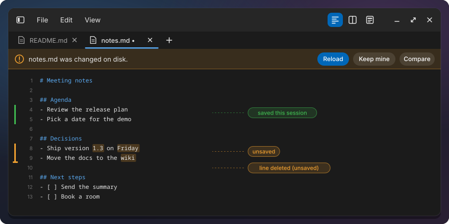
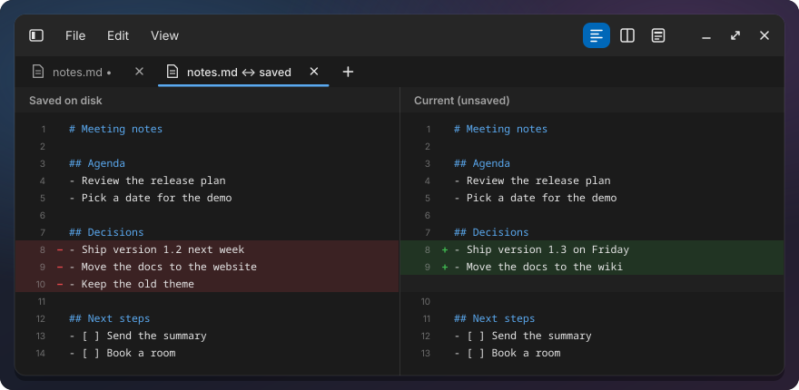

# Text Editor: editing (technical)

Part of the [Text Editor technical docs](README.md). Changed lines and Compare, whitespace and line endings, the language of a tab, JSON tools, column selection, folding, selection scrolling and the status bar.

## Changed lines

Like Notepad++ change history: a thin bar left of the line numbers.

| Bar | Meaning |
|---|---|
| Orange | Changed and not saved yet |
| Green | Changed and saved during this session |
| none | Unchanged since the file was opened |

A short tick at the top of a line marks lines deleted above it (orange, green once saved). Undo
back to the saved text removes the orange. A restored draft shows orange against the file on disk.
A new document shows no marks until its first save (every line would be new); after that it
counts changes against the saved text, like an opened file. Reloading a file changed on disk and
"Revert all changes" clear the marks. Settings, "Change history", "Show changed lines" (on by
default; config key `change_history`).

Unsaved changes are also tinted inside the text: the changed words of an orange line get a light
orange background (whole new lines are tinted whole); saved changes are not tinted. Settings,
"Highlight changed text" (on by default, config key `highlight_changed_text`; needs "Show
changed lines"). For about 200 ms after an edit the tint can sit on the old position.

**Compare with saved** (File menu next to "Revert all changes", and the editor's right-click menu;
disabled without unsaved changes) opens a read-only tab "<name> ↔ saved" with the diff between the
file on disk (empty for untitled) and the current text, in the editor's diff view: removed lines
red, added green, with context. It is a snapshot; opening it again refreshes and focuses the same
tab. A click on an orange bar or deletion tick in the gutter opens it too (it does not scroll to
that change yet). Compare tabs are not part of the restored session. Each hunk starts with its git
header line, `@@ -old,count +new,count @@`, in the accent colour.

**Compare with...** (File menu and the tab's right-click menu) lists the other open editor tabs and
opens "a.md ↔ b.md" with the diff from this tab's text to the other's, unsaved text included;
opening it again refreshes and focuses it. With two views, "Compare the two views" at the top of
the list compares the tabs they show.

The marks come from a line diff (the `similar` crate, 50 ms deadline per diff) between the text
when the file was opened, the text at the last save and the current text. It runs in the
background about 200 ms after typing stops (500 ms for files over 1 MB); a 1 MB file takes about
2 ms. Right after inserting lines, the marks below can sit one line off until that run finishes.
Large texts first try a plain line diff, which is fast for a few edits, and fall back to the full
diff when that runs out of time, so two far-apart edits in a 10 MB file mark only those two lines.

## Whitespace and line endings

Like Notepad++ "Show symbol", both off by default and kept in the config:

| View menu | What it draws |
|---|---|
| Show whitespace (`show_whitespace`) | A faint dot on each space, an arrow across each tab; trailing whitespace a little stronger |
| Show line endings (`show_line_endings`) | A faint mark after each line end: return arrow for LF, pilcrow for CRLF, left arrow for CR |

The marks are drawn behind the text over the visible rows only, so text, layout and cursor
positions never change; with both off nothing is scanned.

Edit > "Line endings: LF" (or CRLF, CR, Mixed) lists LF (Unix) and CRLF (Windows) with the file's
ending checked. Picking the checked one does nothing; picking the other converts every line, as one
undo step, and the status bar shows "Converted to CRLF — Ctrl + Z to undo" for 4 s. A file with
mixed endings first shows how many lines use each (`Mixed: 120 LF, 3 CRLF`) and checks neither. A
file without a line break shows LF checked and CRLF disabled (new lines get LF). Enter inserts the
file's own line ending, and Save writes each line's own ending.

## Language

Like Notepad++'s Language menu: any tab, an untitled draft too, can be set to a language. Pick it
from View > Language or click the language at the right end of the status bar; both open the same
list.

| Entry | What it does |
|---|---|
| Auto-detect | The default: the language comes from the file name, its extension, then the first line, as before. An untitled tab goes by its first line (`#!/bin/bash`, `<?xml`), else it is JSON when its whole text is a valid JSON object or array (checked up to 256 KB, again as you type), else Plain Text. Once JSON, it stays JSON while the text still starts with `{` or `[`, so half-typed JSON keeps its colours |
| 16 common languages | Plain Text, Markdown, JSON, YAML, XML, HTML, CSS, JavaScript, TypeScript, Python, Rust, C#, Shell, SQL, TOML, INI |
| More languages | Every other language of the editor's syntax set, in submenus by first letter (A–Z) |

The tab's language is checked; Auto-detect is checked while no language is chosen. The syntax
colours follow the choice, and so do the Markdown views and helpers and the JSON tools: a draft set
to Markdown gets Preview and Split, and leaving Markdown returns to the plain source view.
Changing the language keeps the text, the cursor and the undo history. Notepad++ calls the plain
entry "Normal text"; here it is "Plain Text", the name in the editor's syntax set.

The choice is kept per tab in the session, so it survives a restart (sessions from before still
load), and a clone of the tab takes it along. Save As on an untitled tab with a chosen language
suggests the language's extension (`notes.md`). A file name whose extension selects the same
language makes the choice unnecessary, and the tab goes back to Auto-detect; another extension
keeps the choice. A draft over 1 MB gets no colours, like a [large file](markdown.md#large-files).

## JSON tools

On `.json` tabs (and untitled tabs starting with `{` or `[`) Edit > JSON has:

| Action | How |
|---|---|
| Format JSON | Ctrl+Alt+Shift+F; indent = the tab width in spaces |
| Minify JSON | Ctrl+Alt+Shift+M |
| Validate JSON | Edit > JSON; a bar above the text names line, column and reason, with **Go to** |

A small tokenizer copies strings and numbers byte for byte, so key order and number text stay
exactly as written (no new dependency). Format and Minify are one undo step and keep the cursor on
the same token. Invalid JSON (JSONC comments and trailing commas included) is left alone and the
bar shows the error. Texts over 20 MB are refused.

## Column selection

Like Notepad++: Alt+drag or Alt+Shift+arrows select the same visual columns on every line between
two points. A tab reaches the next tab stop, lines ending left of the block are skipped, and
wrapped lines use their logical line. The highlight follows the visual columns, so only the part
of a tab inside the block is highlighted. A tab cut by an edge of the block becomes spaces of the
same width before an edit (in the same undo step), so text goes in and out at the same column on
every line; a copy gives such a tab's covered columns as spaces and keeps whole tabs.

- Typing, Backspace and Delete act on every line of the block.
- Copy and Cut join the lines with newlines. Paste of multi-line text goes in line by line;
  single-line text goes on every line.
- A copied or cut block pasted at a plain cursor goes in as a block (as in Notepad++): each row at
  the cursor's column on the lines below, short lines padded with spaces, rows past the end of the
  file on new lines, one undo step. Only the last block copied counts; text copied elsewhere since
  pastes normally.
- Each edit is one undo step. A plain click, a navigation key or Ctrl+Backspace/Delete leaves
  block mode.
- Not available with vi bindings.

## Folding

| Action | How |
|---|---|
| Fold / unfold one block | Click the chevron right of the line numbers (▸ folded; ▾ on hover over the gutter or on the cursor line), or View > Folding > Fold (Ctrl+Shift+[) and Unfold (Ctrl+Shift+]) at the cursor |
| Whole file | View > Folding > Fold all and Unfold all |

Fold ranges: brackets for JSON and C-like files, sections under headings for Markdown, indentation
for everything else. A folded header shows `…` after its text. A chevron click toggles that block
only, without moving the cursor or starting a selection.

Folding never changes the text: a folded line gets a zero line height, so it takes no space and
Save writes the whole file. The fold state lives in the line attributes, so folds move with the
text. The session keeps each fold as its header line and text; on restore a block is folded again
only when that line still holds the same text, so a fold whose header was changed elsewhere is
dropped. Cursor motions step over folds. An edit, undo, redo,
paste, a find or replace hit, or a column selection over a fold unfolds it, so changed text never
stays hidden. Reload unfolds everything. The gutter, change marks, tints, whitespace marks and the
current-line highlight skip hidden lines.

Folding never leaves a selection in hidden text: a fold that a selection reaches into drops the
selection, and a hidden cursor moves to the end of the fold header (as in VS Code). Typing, Enter,
Backspace, Delete, Tab, input method text, paste and cut unfold whatever the selection reaches
into before they edit.

## Selection scrolling

Dragging a selection past an edge scrolls the view, and it keeps scrolling while the pointer is held
still outside, faster the further away it is:

- In the text: up and down, sideways with word wrap off, also for an Alt column selection.
- In the preview: up and down, and tables and code blocks sideways.

## Status bar

View, "Status bar" (or the switch in Settings > Appearance; off by default, config key
`show_status_bar`) shows a thin bar at the bottom of the window, under the Go to line
bar. It shows the active editor tab; with two views, the tab of the focused view.

| Item | What it shows | Click |
|---|---|---|
| `Ln 12, Col 5` | Line and column of the cursor, from 1. A column counts characters, a tab is one, and on the first line it starts after a byte order mark | Opens Go to line |
| `Sel 14 chars, 2 lines` | Instead, while text is selected: its characters (line breaks not counted) and every line it touches | Opens Go to line |
| `Block 3 × 12` | Instead, while a column block is active: lines × visual columns | Opens Go to line |
| `123 lines, 4,567 chars, 789 words` | The size of the text. Characters are graphemes, as in Document statistics ("e" with a combining accent or a flag is one), without line breaks and a byte order mark. Words only in Markdown files and not above 2 MB of text: a word is a run of non-whitespace with a letter or digit in it, so a marker on its own (`#`, `-`, `**`, `\|---\|`) is not one | - |
| `LF` | The line endings: LF, CRLF, CR or Mixed; a text without a line break shows LF, the ending a new line gets | Opens the same list as Edit > Line endings: LF and CRLF, the current one checked, counts for a mixed file |
| `UTF-8` | `UTF-8`, or `UTF-8 BOM` when the file starts with a byte order mark (kept on save). The editor opens UTF-8 files only | - |
| `Spaces: 4` | The tab width; Tab always inserts spaces | Tab width 2, 4 or 8, as in Edit > Indentation |
| `Markdown` | The tab's [language](#language), chosen or detected | The Language list, as in View > Language |

Opening or reloading a file counts the text at once. While typing, the bar keeps the counts from
before and counts again 300 ms after the last edit, so a key in a large file never waits for a
count of the whole text. A selection of more than 2 MB shows only its line count (`Sel 123,456
lines`). The counts and the selection size are kept per tab until the text or the selection
changes.
