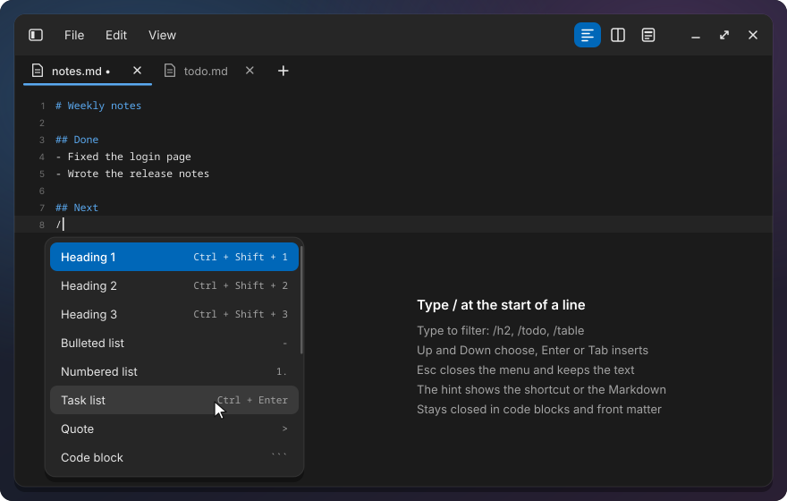
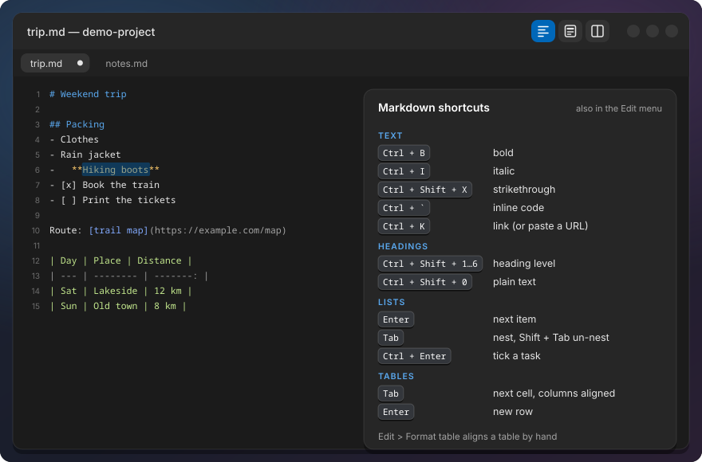
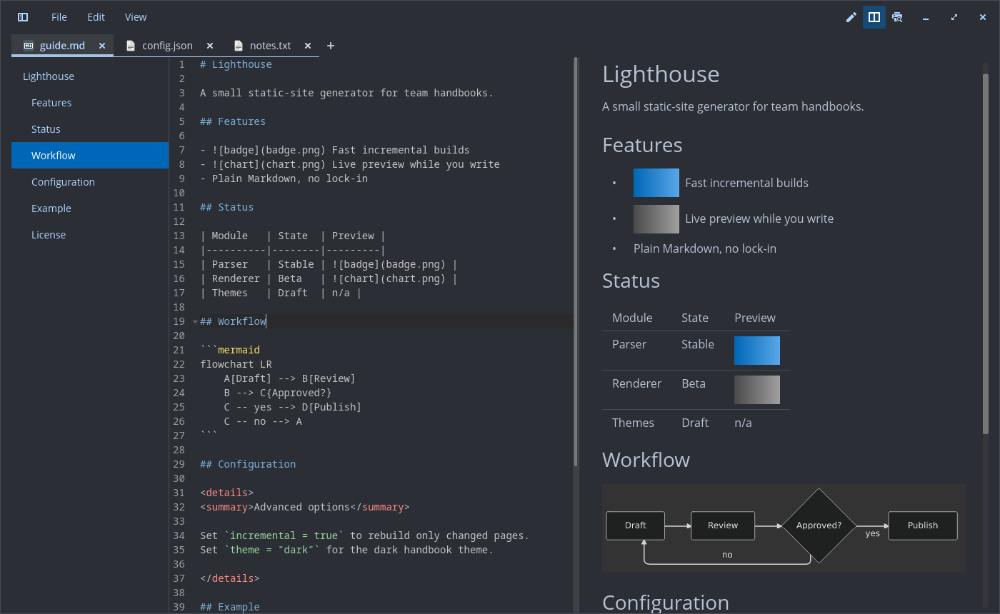
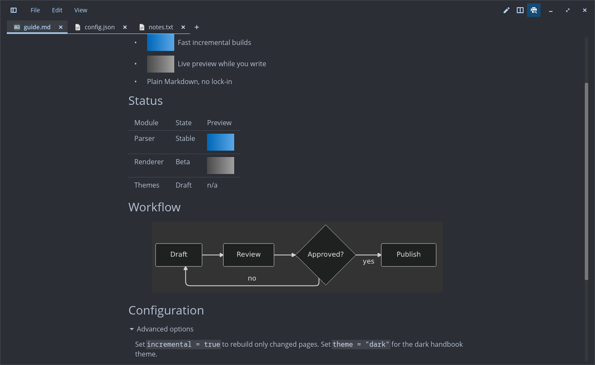
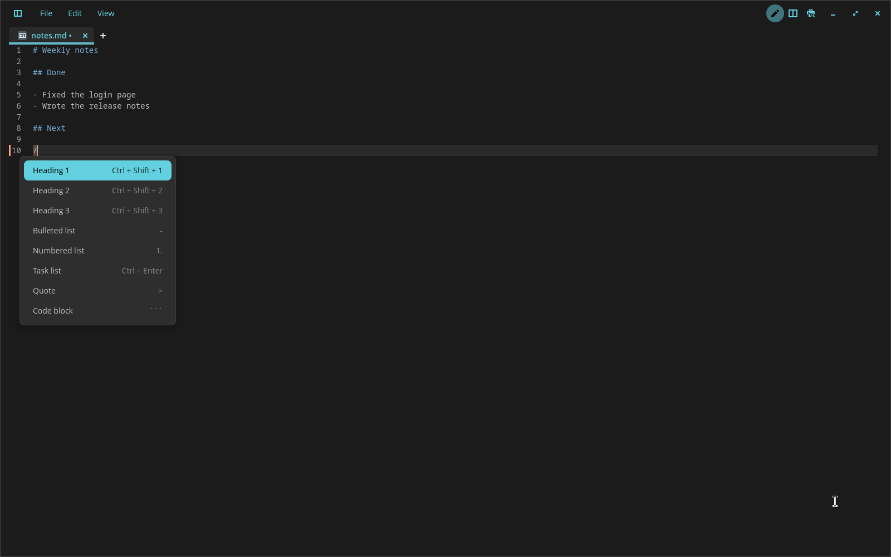
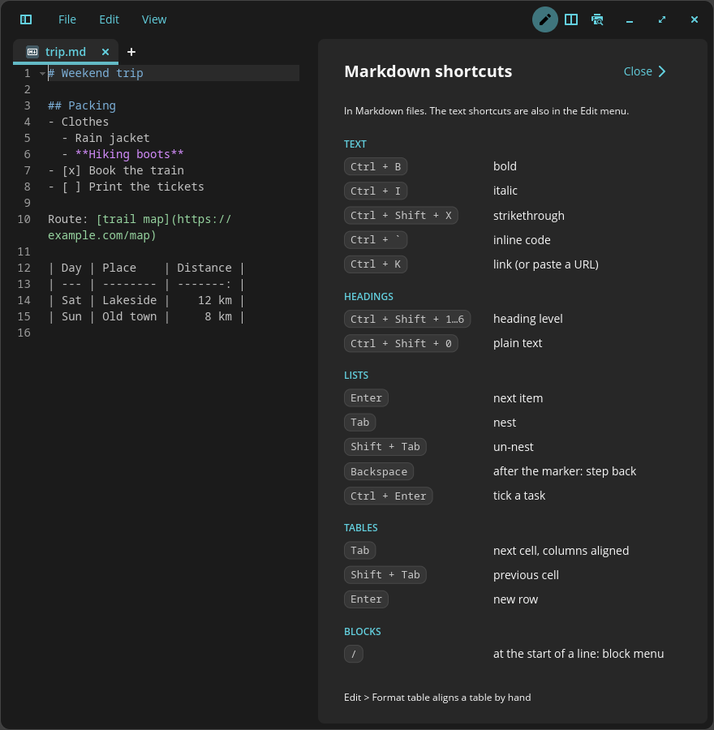
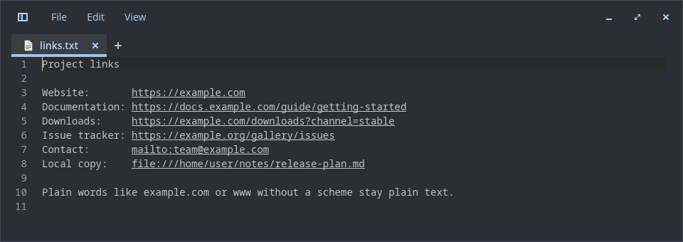

# Text Editor: Markdown (technical)

Part of the [Text Editor technical docs](README.md). Markdown views and large files, the "/" menu, Markdown shortcuts, list and table editing, links and link safety.

## Markdown views

| View | What you see |
|---|---|
| Preview | The rendered file, read-only. The default when a Markdown file opens |
| Source | The normal editor |
| Split | Editor left, preview right; the preview follows your typing and your scrolling |

| Action | How |
|---|---|
| Preview and Source | Ctrl+Shift+V (from Split it goes to Preview) |
| Split and Source | Ctrl+Alt+V (from Preview it goes to Split) |
| Source, Split, Preview | Ctrl+Alt+1, Ctrl+Alt+2, Ctrl+Alt+3 |
| Choose a view | The three buttons at the right of the header bar (the active one is highlighted in the accent colour and inert), or the top of the View menu |
| Default view | Settings, section "Markdown", "Open Markdown files in" (config key `markdown_view`: `Source`, `Preview` or `Split`) |

The buttons and menu entries appear only on Markdown tabs (`.md`, `.markdown`, `.mdown`, `.mkd`,
`.mkdn`). An empty file opens in Source. Save As to a Markdown name keeps the current view. Each tab
keeps its own preview scroll position. In Preview, the keys that would change the hidden text
(cut, paste, undo, redo, replace) do nothing.

**Typing in Preview.** Preview is read-only, but a typed character is not lost. A key with text
(letters, digits, space, punctuation, also with Shift, AltGr or a dead key) or Enter, typed
without Ctrl, Alt or Super, switches the tab to Source and goes in there. It lands at the end of
the block at the top of the preview, and the editor scrolls to show it. A heading and a list item
are blocks of their own. In a code block the text goes at the end of the code, never on a fence.
Enter continues a list as in the editor. Keys typed before the editor has focus follow at the
cursor. Arrows, Page Up/Down, Home/End and shortcuts work as before. With Vim bindings nothing
changes, because keys are commands there. Keys never edit the document while a menu, a context
menu, a dialog or the settings panel is open: the app tracks the popup surfaces it opens (a
window `Opened` event, closed again by the popup's `Done` event or a window `Closed` event).

### Large files

Big files open fast and stay responsive. The thresholds:

| Size | What changes |
|---|---|
| Over 32 KB of Markdown | The preview parses the text in parts, split where a top-level block starts. iced's Markdown parser copies the rest of its input after every block, so one parse of the whole text grows with the square of its length (5 MB: 7.7 s in one piece, 0.55 s in parts) |
| Over 256 KB of Markdown | The preview is parsed on another thread. A placeholder shows until it is ready |
| Over 1000 top-level blocks | The preview draws only the blocks near the view, at most 300. The space of the others is estimated, then measured. A selection and Copy still span the whole document |
| Over 1000 headings | The outline draws only the rows near its view. Its rows then have one fixed height and do not wrap. 24,000 headings cost 15 ms and more a frame before, under 0.1 ms after |
| Over 1 MB, any file | The file opens without syntax colours. cosmic-text colours the whole file before the first frame (6 s for 5 MB of Markdown, 0.3 s as plain text). A file that grows past 1 MB loses its colours when it is reloaded; one that shrinks keeps the plain view until it is opened again |
| Reload of a large file | The new text goes in 256 lines at a time, still as one undo step. cosmic-text inserts the lines of one insert one by one at the same place, which took 90 s for 1.3 MB |
| Over 1 MB of Markdown | The file opens in Source instead of Preview or Split |

A large file shows a notice above the editor with its size. For Markdown it reads "it opened in
Source and without colours" and has a **Show preview** button, which builds the preview anyway,
and **Dismiss**. Other files read "it opened without colours" and have **Dismiss**. A 5 MB
Markdown file opens its window in about 2 s; before, it had not opened after 40 s.
Reading the file again to notice later changes on disk runs in the background while the window
shows, so a 20 MB file opens about 7 ms slower than upstream (53 ms before); a write to the file
while it loads counts as an unseen change.

The upstream causes are reported as [cosmic-text #552](https://github.com/pop-os/cosmic-text/issues/552)
(the whole file is coloured before the first frame) and
[iced #3547](https://github.com/iced-rs/iced/issues/3547) (the Markdown parse grows with the square
of the file); the slow large files in stock cosmic-edit are
[cosmic-edit #182](https://github.com/pop-os/cosmic-edit/issues/182).

The preview text can be selected (new `src/selectable_rich.rs`, a port of iced's `rich_text` with a
selection). One selection spans the whole preview: it is kept as a block index and a grapheme
offset, so it crosses paragraphs, lists, quotes, alerts, code blocks and table cells. Drag selects
(the text run nearest the pointer, within 48 px, takes the drag, so a drag from the margin works);
past the top or bottom edge the preview scrolls along on a 60 Hz timer, and a drag held at the end
selects to the last block. Double-click selects a word, triple-click a block, Shift+click extends
from the anchor, Ctrl+A selects all, Esc or a click elsewhere clears it. Ctrl+C copies from the
current document: list markers as in the source (`- `, `1. `, `- [ ] `), alert titles, table cells
separated by tabs and rows by newlines. The highlight keeps the text colours; its alpha follows
the contrast with the theme (25–60 %). Typing or selecting in the editor of a Split clears it.

Rendered: headings, emphasis, strikethrough, links, inline code, lists, task lists, quotes, rules,
tables, code blocks (in the editor's font) and local images (scaled down to the text width, never
up). Images inside a paragraph, a heading, a list item or a table cell stay inline, so badge rows
sit side by side; list numbers and task boxes are kept, and a list marker lines up with the first
text line next to a tall image. Common README HTML:
`align="center"` (also on `<h1>`..`<h6>`), `` with width and height, `<br>`, `<details>`/`<summary>` (closed by
default, click to open); other tags are stripped and their text kept, comments hidden. Footnotes
and GitHub alerts (`> [!NOTE]`, TIP, IMPORTANT, WARNING, CAUTION) render. Front matter is hidden.
Colours follow the COSMIC theme; links use the accent colour.

Code blocks with a language tag (`json`, `bash`, `python`, `rust`, ...) get syntax colours from the
editor's own syntax set and syntax theme, so they look as in Source and follow the light/dark
switch. No tag, an unknown tag or a block over 2000 lines stays plain. Highlighted blocks are cached
by theme, language and code, so a re-parse while typing only highlights the blocks that changed.

**Mermaid:** a ` ```mermaid ` block (flowchart, sequence and the other diagram types of
mermaid-rs-renderer) is drawn as a diagram, centred, scaled down to fit, in light or dark colours
with the theme. It is rendered in process, without a browser, and cached per block like the code
colours. Code that does not parse, a block over 50 000 bytes or a renderer failure stays a code
block.

**Images from the web:** Settings, section "Markdown", "Load images from the web in Markdown
previews" (off by default, config key `markdown_remote_images`). Off, nothing is fetched and a
remote image shows as a chip with its alt text. On, `https` images (no other scheme) are fetched in
the background through GVfs (gvfsd-http), up to 10 MB each and 15 s, PNG, JPEG, GIF, WebP, BMP, ICO
and SVG only. Each image is fetched once per session and kept in memory. A failure keeps the chip
and logs one warning naming the host and the reason.

**Scroll sync** (Split) runs both ways. When the editor half scrolls (wheel, keys, cursor moving
off screen), the preview scrolls so the line at the editor's top sits at its top. When you scroll
the preview (wheel, keys, scrollbar), the editor scrolls so the first line in view in the preview
is its top line; the cursor stays. A scroll one side started is not sent back, and a resize of the
preview is not taken for a scroll. Positions are measured: after every parse, resize or
`<details>` toggle the editor reads where each top-level block of the preview was laid out, and a
line inside a block takes its share of that block's height (wrapped lines, heading sizes, table
rows and code by the size they are drawn at). Checked at most every 50 ms after an input event.
View, "Sync preview scrolling" (on by default, config key `markdown_sync_scroll`).

**Outline:** View, "Outline" (Ctrl+Alt+O; off by default, config key `markdown_outline`) shows a
narrow panel left of a Markdown tab with its headings: `#` and underlined headings and the
`<h1>`..`<h6>` of HTML blocks, indented by level, none from code blocks; images in a heading are
left out of its label. In Source and Split the heading above the cursor is highlighted; in Preview,
the first heading whose top is in view, or the heading the top line sits under when none is. A
click puts the cursor on the heading and scrolls it to the top of the editor and, when it shows, of
the preview; in Preview the clicked heading stays highlighted until you scroll. The outline
scrolls just far enough to keep the highlighted heading in view; each tab keeps its own outline
scroll position.

**Open `<details>`** are kept per block across re-parses: by the heading they sit under, their
summary and a hash of their source. So adding a block above does not move the open state, and an
open block stays open while you edit its text. The open state of a removed block is forgotten.

The preview parses only while it is visible. In Split it re-parses after a typing pause of 150 ms
(300 ms for files over 100 KB) and skips the parse when the text is unchanged. Non-Markdown tabs
pay nothing.

## "/" command menu



In a Markdown tab, type `/` at the start of a line (only spaces or tabs before it) and a menu of
Markdown blocks opens below the `/`. Above it when there is no room below. Typing after the `/`
filters the list: an item stays when a word of its label, its English label or one of its keywords
starts with what you typed (`/h2`, `/todo`, `/hr`). Items whose label starts with it come first.
The menu shows eight rows at a time and scrolls.

Up and Down move the highlight, Enter or Tab picks, Esc closes the menu and keeps the text. The
mouse highlights the row under it, a click picks, the wheel scrolls the list. The menu closes when
you type a space, when nothing matches, when the cursor leaves the `/query`, on a click elsewhere
or when the text scrolls. Picking replaces the `/query` with plain Markdown, as one undo step.

| Item | Hint | Inserts |
|---|---|---|
| Heading 1, 2, 3 | Ctrl+Shift+1, 2, 3 | `# `, `## `, `### ` |
| Bulleted list | `-` | `- ` |
| Numbered list | `1.` | `1. ` |
| Task list | Ctrl+Enter | `- [ ] ` |
| Quote | `>` | `> ` |
| Code block | ` ``` ` | an empty fenced block, cursor inside |
| Table | `\|` | a two-column table with the first header selected |
| Divider | `---` | `---` (`***` on the first line, so it never starts front matter) |
| Link | Ctrl+K | `[text](url)` with `text` selected |
| Image | `` | `` with `alt` selected |
| Bold | Ctrl+B | `**text**` with `text` selected |
| Italic | Ctrl+I | `*text*` with `text` selected |
| Strikethrough | Ctrl+Shift+X | `~~text~~` with `text` selected |
| Inline code | `` Ctrl+` `` | `` `text` `` with `text` selected |
| Mermaid diagram | ` ```mermaid ` | an empty `mermaid` block, cursor inside |

The hint is shown dimmed at the right of each row: the Markdown syntax, or
the shortcut where an item has one (see [Markdown shortcuts](#markdown-shortcuts)). Labels are translated.
Blocks (code block, table, divider, Mermaid) get a blank line before and after them where text
would run into them. Further lines of a block keep the indentation before the `/`.

The menu does not open in front matter, in fenced or indented code blocks, in HTML blocks or
inside an HTML comment that is still open at the `/` (an escaped `\<!--` is text). It never opens
in non-Markdown files or with Vim bindings, where `/` starts a search. The check reads the file
only up to the cursor and skips the parse when nothing above can hide the `/`.

The highlight looks like the stock COSMIC menus: the accent colour for the row picked with the
keys, the hover colour for the row under the mouse. The popup is a window overlay
(`src/slash_popup.rs`), so the editor's edges never clip it.

Settings, section "Markdown", **"/" command menu** (on by default, config key
`markdown_slash_menu`). Off, `/` types a plain slash.

## Markdown shortcuts

In a Markdown tab these keys write the Markdown for you. Each use is one undo step.



| Action | Shortcut | Behaviour |
|---|---|---|
| Bold | Ctrl+B | Wraps the selection, or the word at the cursor, in `**`. Pressed again, takes them off. |
| Italic | Ctrl+I | The same with `*`. |
| Strikethrough | Ctrl+Shift+X | The same with `~~`. |
| Inline code | `` Ctrl+` `` | The same with backticks. Text that holds backticks gets a longer fence. |
| Link | Ctrl+K | Makes `[text](url)` from the selection or the word at the cursor, with `url` selected. In a link, selects its URL. |
| Paste a URL | Ctrl+V | Pasting a URL over selected text makes `[text](URL)`. |
| Heading 1 to 6 | Ctrl+Shift+1 to 6 | Sets the heading level of the line. Pressed again, the line becomes plain text. |
| Plain text | Ctrl+Shift+0 | Removes the heading marker. |
| Toggle task | Ctrl+Enter | Ticks or unticks the task item. A plain line or list item becomes a task. |

The text styles (bold, italic, strikethrough, inline code) work the same way:

- **A selection:** it is wrapped and stays on the text inside the markers. When the text already
  has the markers, just inside or just outside the selection, they come off. Spaces at the ends of
  the selection stay outside the markers.
- **No selection, in or next to a word:** the word is wrapped (or unwrapped). The cursor stays
  where it was in the word. Right after the closing markers (`**word**|`) or before the opening
  ones counts as at the word.
- **No selection elsewhere:** an empty pair, like `****`, with the cursor in the middle, to type
  into. Pressed again in an empty pair, it removes it. Strikethrough adds no pair at the start of
  an empty line, because `~~~~` there would start a code block.
- **Bold and italic together:** `***x***` is both. Ctrl+B on it leaves `*x*`, Ctrl+I leaves
  `**x**`. Ctrl+I on `**x**` gives `***x***`.
- **`_` markers:** bold and italic are added with `*`, but `__bold__` and `_italic_` come off too.
  A `_` inside a word (`snake_case`) is text.
- **Several lines:** each line's text is wrapped on its own, so a marker never stays open over a
  blank line. Block markers at the start of a line (`- `, `1. `, `## `, `> `, `- [ ] `) stay in
  front: `- item` becomes `- **item**`. When every line already has the style, it comes off
  everywhere, whether a line uses `*` or `_`. Otherwise only the lines without it get it.
- **Inline code with backticks:** `` a`b `` becomes ``` ``a`b`` ```. Text that starts or ends
  with a backtick gets a space inside the fence, as CommonMark asks.

Ctrl+K without a selection and outside a word inserts `[text](url)` with `text` selected. Headings
keep quote and list markers in front (`> ## Title`); task items stay as they are. Front matter,
fenced code blocks and code spans are left alone. Code spans are read as CommonMark reads them: a
lone backtick (`don`t`) is text.

Edit > Markdown lists Bold, Italic, Strikethrough, Inline code, Link, a Heading submenu, Toggle
task and Format table, each with its shortcut. They are disabled, and the keys do nothing, in other files and in the
Preview view. With Vim bindings the keys behave like the editor's other Ctrl shortcuts (Ctrl+Z,
Ctrl+S): the editor handles them, not Vim.

**Markdown shortcuts panel.** F1, **View > Markdown shortcuts…** or **Show** under **Settings >
Markdown** opens a panel on the right of the window with every Markdown key: text styles, headings,
lists, tables and the "/" menu. It stays open while you type, for any tab. F1 again or Close
closes it, and so does Escape in the text when nothing is selected (an open Go to line bar closes first;
with Vim bindings Escape stays with Vim). The key texts come from the editor's own bindings, and a
test checks that every Markdown binding is listed. With Vim bindings the keys the editor handles
itself (Enter, Tab, Backspace, "/") are dimmed, because they type as usual then.

## List editing

In a Markdown tab, Enter, Tab and Shift+Tab help with lists. With Vim bindings they type as usual.

- **Enter in a list item** starts the next item with the same marker and indentation: `- `, `* `,
  `+ `, `1. ` (numbers count up) or `1) `. In a task item the new one starts unticked (`- [ ] `).
  In a quote (`> `) the next line stays in the quote. Text after the cursor moves into the new item.
- **Enter on an empty item** ends the list. A nested item first moves out one level. An empty `>`
  line loses one quote level.
- **Tab** makes the item (or the selected items) a child of the item above it, indented to where
  that item's text starts. **Shift+Tab** moves it back out. Children and their code blocks move
  along. Tab on the first item of a list does nothing.
- **Numbered lists** are renumbered from the changed item down.
- **Ctrl+Enter** ticks or unticks the task at the cursor, or every task in the selection (all
  ticked: all unticked, else all ticked). Without tasks, list items and plain lines become tasks.
  Headings, tables, fences and dividers stay as they are.

Nothing happens in code blocks, front matter or HTML blocks, with one exception: Enter in a fenced
code block that is indented or quoted (in a list item or a quote) starts the new line with the
fence's indentation and quote markers, so the code stays in the item. This also works with
automatic indentation turned off.

- **Backspace right after a list marker** steps back. In a task item it first removes the box
  (`- [ ] ` becomes `- `). A nested item then moves out one level. At the top level the marker
  goes and the line becomes plain text. Elsewhere Backspace deletes a character as usual.
- Helpers that change folded lines unfold them first, so no edit lands in hidden text.

## Tables

In a Markdown table (`src/md_table.rs`), with Vim bindings off:

- **Tab** moves to the next cell and selects its text. In the last cell it adds a row.
  **Shift+Tab** moves to the cell before.
- **Enter** in a cell adds an empty row below and puts the cursor in its first cell. On the header
  row the new row goes below the delimiter row. Enter on an empty last row ends the table and
  leaves an empty line. In front of a row, or after its last pipe, Enter is a plain new line, so a
  table can still be typed row by row.
- Every Tab and Enter also **aligns the table**: leading and trailing pipes, each cell padded to
  the widest cell in its column, the delimiter row as wide as the column, alignment colons kept.
  Width counts East Asian wide characters and emoji as two columns (the `unicode-width` crate).
- **Edit > Markdown > Format table** aligns the table at the cursor without moving anywhere.
- As in GitHub's Markdown, a line without a pipe inside a table is a row with one cell. A blank
  line, a heading, a list item or a rule ends the table.

The "/" menu item **Code block** puts the cursor right after the opening fence, to type the
language; Enter then moves into the block.

## Links and safety

A Markdown file can come from anywhere, so a click in the preview never runs anything:

- `http`, `https` and `mailto` open with the default app. A `mailto` link may only carry `subject`,
  `body`, `cc` and `bcc`; any other field (for example `attach`) blocks the link.
- Local links are resolved against the file's folder and must point to a regular file. Text and
  Markdown files open in the editor. Images, audio, video and PDF without the exec bit open with
  the default app.
- Everything else is ignored with a warning in the log: other schemes, folders, `.desktop`
  files, executables, archives, missing files. `#anchor` links are ignored.
- Remote images are not fetched unless "Load images from the web" is on (above), and then only
  over `https`; otherwise a small chip with their alt text shows instead.

Bare web addresses in the preview (`https://…`, `www.…`) become links too, but not inside code.

**Links in the text.** In every file, not only Markdown, `http`, `https`, `file` and `mailto`
links in the text are underlined. A double-click opens one through the same rules as the preview.
A press on a link followed by a drag selects text instead of opening it.

## Screenshots

The images above are mockups that show each feature on its own. These are real screenshots of the
current build, taken in a clean test session with demo content.










