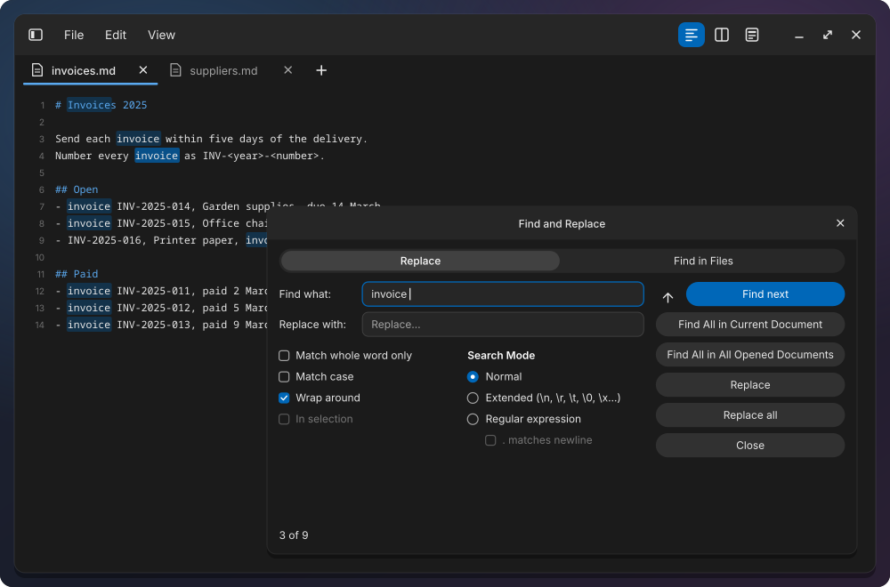
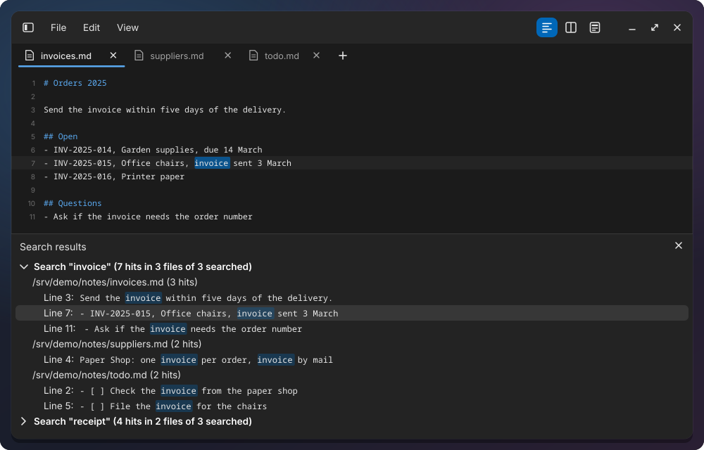
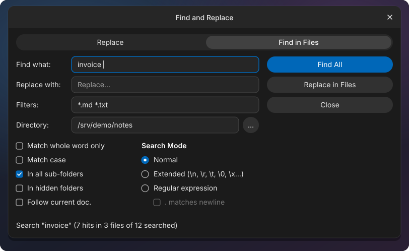
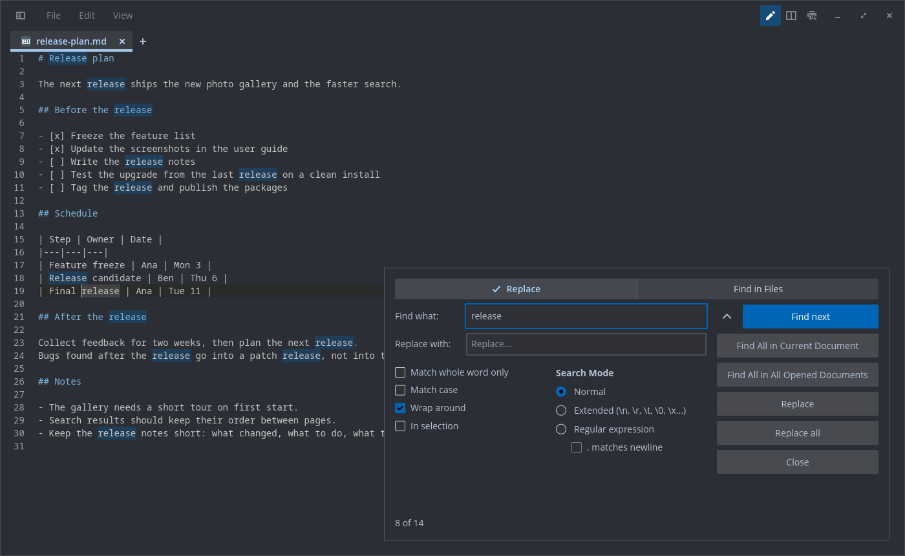
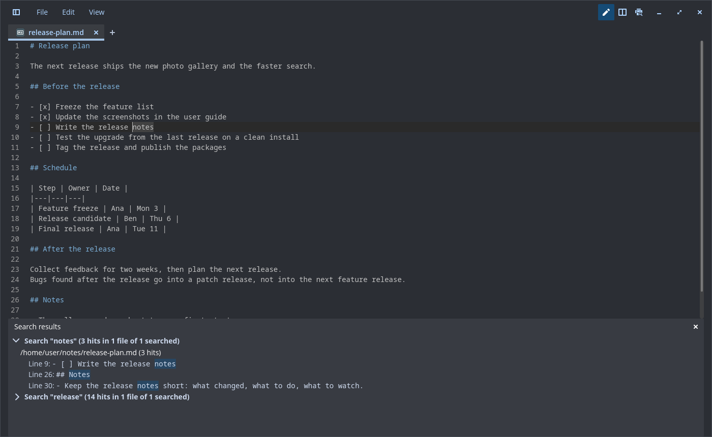
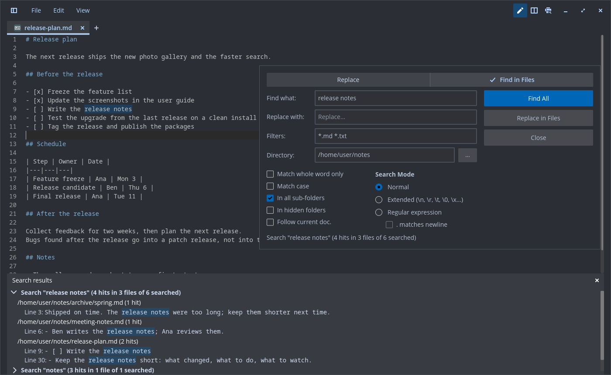

# Text Editor: search (technical)

Part of the [Text Editor technical docs](README.md). The Find and Replace window, Find All and the Search results panel, Find in Files, Go to line.

## Find and replace

Find and Replace is a separate window, as in Notepad++, that you can move next to the text.
Ctrl+F and Ctrl+H (Edit > Find, Replace) open it with both fields, "Find what" and "Replace
with". A selection on one line fills "Find what"; a selection over line breaks, or of at least
1024 characters, ticks "In selection" instead and keeps the query. Go to line (Ctrl+G) can be open
at the same time.

On Wayland the compositor places the window. When it sits behind the editor, Ctrl+F may only mark
it as wanting attention (sway does this); a click on it brings it forward.

Under the fields sit the options, all kept in the config:

| Option | What it does |
|---|---|
| Match case (`find_case_sensitive`) | Upper and lower case must match |
| Match whole word only (`find_whole_word`) | A match must not continue a word (letters, digits, `_`) on either side, in normal and regex mode. A pattern that starts or ends with a non-word char needs no boundary on that side: `.foo` matches in `file.foo` but not in `file.food`, `foo-` matches in `foo-bar` but not in `xfoo-bar` |
| Search Mode: Normal | The find text is plain text |
| Search Mode: Regular expression (`find_use_regex`) | The find text is a regular expression (Rust `regex` syntax) |
| . matches newline (`find_dot_matches_newline`) | Regular expression mode only: `.` also matches a line break. `^` and `$` are line anchors with or without it |
| Search Mode: Extended (`find_extended`) | As Notepad++ "Extended (\n, \r, \t, \0, \x...)": the find and replace text read `\n`, `\t`, `\r`, `\0`, `\\`, `\xNN` (two hex digits) and `\uNNNN` (four hex digits). Any other backslash, an incomplete `\x` or `\u` and a surrogate (`\uD800`) are kept as typed, so `C:\data` stays `C:\data` |
| Wrap around (`find_wrap_around`) | Find next and previous continue from the other end of the file |

The buttons: Find next (with an up arrow for Find previous), Find All in Current Document, Find
All in All Opened Documents, Replace, Replace all and Close. Enter in "Find what" is Find next,
Shift+Enter Find previous, Enter in "Replace with" is Replace. Escape in the window closes it;
Escape in the text leaves it open.

The status line under the buttons shows the count once typing pauses (150 ms after a key in the
find field, 300 ms after one in the text): `3 of 17` when the selection is a match (as Find next
and previous leave it), `17 matches` otherwise, `No results`, `Replaced 5 occurrences` after
Replace all, or `Invalid pattern` with the regex error and the field in its error state. The count
stops at 10,000 and then shows `10,000+`. While the window is open, every match in the visible rows
is tinted in the accent colour, behind the selection.

In regex mode `^` and `$` always match at the start and end of each line. A query is searched line
by line unless it can match a line break. As in Notepad++, a regex can when any part of it can
match `\n` or `\r`: `\n`, `\r`, `\s`, `[^x]`, `\x0A`, or `.` with ". matches newline" on (or
`(?s)`). So `\s+$` also takes the blank lines after a line's trailing spaces. In extended mode a
query spans lines when its text holds `\n` or `\r`. Such a query is searched in the lines joined,
for Find next and previous, Replace, Replace all, the count and the highlights. The lines are
joined with `\n` for every line ending, so `foo\nbar` matches in LF, CRLF and CR files alike. A
query that names `\r` gets each line's own ending instead, so `foo\r\nbar` matches a CRLF file.

A line break in the replacement is written as the file's own ending. A query that names `\r` edits
line endings itself, so its replacement's line breaks are kept as written: `\r\n` replaced with
`\n` converts CRLF lines to LF. A match of half a `\r\n` keeps the other half, so `\r` replaced
with nothing leaves the `\n`.

Empty matches count, as in Notepad++: `^` counts once per line, Find next steps from line to line,
and Replace and Replace all insert there, so `^` replaced with `> ` quotes every line and `$` with
`;` ends each one. Matches never overlap, and an empty match right after the previous match is
skipped: `x*` in `axxb` matches before `a`, then `xx`, then at the end.

Replace works as in Notepad++: when the selection is not the match yet, the first press selects
the next match; the next press replaces it and selects the match after it. An empty match at the
cursor counts as selected, so `^` is replaced on the first press.

In regex mode the replace text names capture groups:

| Replace text | Inserts |
|---|---|
| `$1`, `${name}` | Group 1, the group named `name` |
| `$0`, `\0` | The whole match |
| `\1` … `\9` | Groups 1 to 9, as in Notepad++; `\10` is group 1 and a `0`, as is `${1}0` (`$10` is group 10) |
| `$$` | A literal `$` |
| `\n`, `\t`, `\xNN`, ... | The escapes of extended mode |

In normal and extended mode a `$` is literal; in extended mode `\0` is a NUL char, not the match.
Replace, Replace all and the across-lines search all expand the groups. Replace all is one undo
step and leaves the cursor after the last replacement. It stays fast on large files, also when the
replacements add or remove line breaks: about half a second for some 48,000 such replacements in a
5 MB file (release build).

**In selection** works as in Notepad++: only the count, Replace all and the highlights stay inside
the range; Find next, Find previous and Replace work on the whole file, and the match they select
leaves the range as it is. The range is shaded faintly in the accent colour. The box ticks itself
when the window opens on a selection over line breaks or of at least 1024 characters, and is
disabled while there is no range and no selection. A replace from the window moves the range with
its edit; after any other edit, or in another tab, the range gives way to the selection at the time
of the next action, and without a selection the box shows off and the actions take the whole file.
Closing the window ends "In selection".

| Key | What it does |
|---|---|
| F3 | Find next for the last query, also with the window closed; without a query it opens the window |
| Shift+F3 | Find previous for the last query |
| Ctrl+F3 | Puts the selection (on one line) or the word under the cursor into the find field and goes to the next occurrence |
| Ctrl+Shift+F3 | The same, to the previous occurrence |
| Ctrl+Shift+F | Find in Files (below), also Edit > Find in Files... |
| F7 | Shows or hides the Search results panel |
| Escape | In the window it closes the window. With the Go to line bar open (Vim bindings off), Escape in the text closes the bar and keeps the selection; the next Escape clears it |

Find next after Escape cleared the selection of a hit moves on to the next match instead of finding
the same one again; a new query still finds a match right at the cursor.

Limits:

- The highlights search only the visible lines; a line over 64 KiB only 1 KiB around its visible
  part. For a query that spans lines, the visible lines and 200 lines before and after are joined,
  so a match reaching further is highlighted only in part; above 1 MiB of joined text the
  highlights fall back to line by line.
- The count scans the whole text (for a query that spans lines, a full joined copy) once per typing
  pause, and stops at 10,000 matches.
- The highlights skip empty matches (of `^`, say): there is nothing to draw. The count, Find next,
  Replace and Replace all take them.

### Find All and the Search results panel

Find All in Current Document and Find All in All Opened Documents list every matching line in the
Search results panel at the bottom of the editor, as in Notepad++. Each search gets a header,
`Search "todo" (12 hits in 3 files of 5 searched)`, and one row per line, `Line 12: …`, with the
matches highlighted. A single click on a row goes to the line and selects the match. The newest
search is on top and open; older ones are folded, and the last 10 are kept. A search stops at
10,000 hits and says so in its header. F7 shows and hides the panel.

### Find in Files

The second tab of the window, Find in Files (Ctrl+Shift+F, or Edit > Find in Files...), searches a
folder on disk. It replaces upstream's "Find in project" drawer.

| Field | What it does |
|---|---|
| Directory | The folder to search, typed or picked with the browse button. With "Follow current doc." ticked, it follows the folder of the active file |
| Filters | File patterns separated by spaces, such as `*.md *.txt`; `*.*` takes every file. `!name` leaves out matching files and folders, such as `!target` |
| In all sub-folders | Also searches the folders below |
| In hidden folders | Also searches folders whose name starts with `.` |

The search options of the first tab (whole word, case, search mode) apply here too. Find All
lists the hits in the Search results panel; a click on a row opens the file in a tab and selects the
match. Replace in Files asks first, then:

- Writes each file atomically (a new file renamed over the old one) and keeps its line endings.
- Skips binary files, files that are not UTF-8, read-only files, files with other hard links,
  symlinks and files over 50 MB. The status line gives the replaced count and the files skipped
  as not UTF-8 or not written.
- Replaces a file that is open in a tab with unsaved changes in the tab instead of on disk, so Undo
  works there. Replaces on disk cannot be undone.

## Go to line

Ctrl+G or Edit, "Go to line..." opens a one-field bar at the bottom of the editor; the Find and
Replace window can be open at the same time. Type a line, `42`, or a line and column, `42:7`, both counted from 1, and press Enter;
spaces around the numbers are fine.

- A line past the end goes to the last line, a column past the end of the line to its end.
- Input that is no place (zero, a sign, letters, an empty part, a second colon) keeps the bar open
  with the field in red and an example of what to type.
- Escape or the close button closes the bar.
- A fold around the line opens, as for a find hit.
- In a Markdown tab that shows only the Preview, the tab switches to Split and the line comes to
  the top of the source; in Split the preview follows.
- The column counts characters as the status bar does: on the first line of a file with a byte
  order mark it starts after the mark.
- The jump clears the selection and ends an active column block.

## Screenshots

The images above are mockups that show each feature on its own. These are real screenshots of the
current build, taken in a clean test session with demo content.

