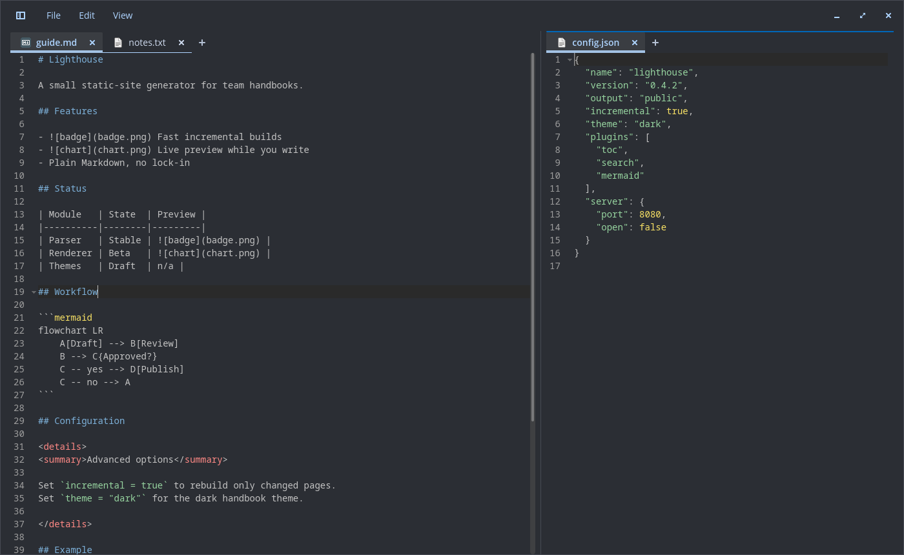
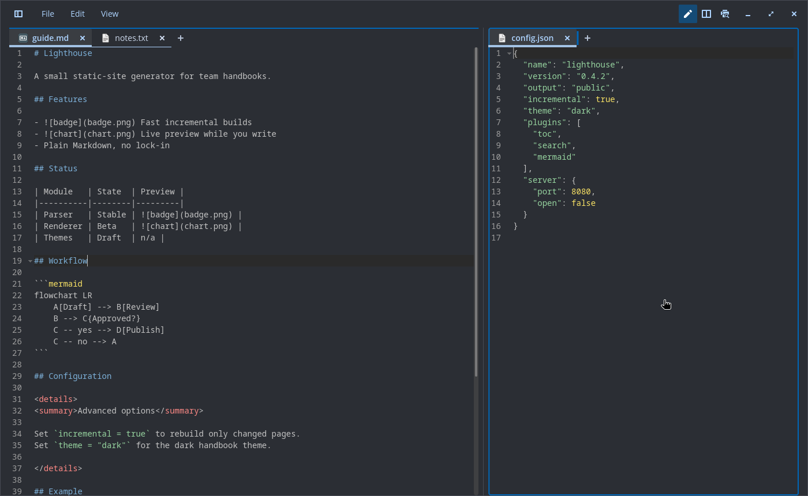

# Text Editor: tabs and views (technical)

Part of the [Text Editor technical docs](README.md). One window, session restore, closing tabs, file paths, the file dialogs, the sidebar, two views and files changed on disk.

## One editor window

Opening a file while the editor runs (double-click, "Open with", `cosmic-edit file.md`) adds a tab
to the running window and brings it forward with keyboard focus (also when minimized); a file that is already open gets its tab focused. A launch
without files only raises the window. File, New window and `COSMIC_SINGLE_INSTANCE=false cosmic-edit`
start a separate editor (it leaves the session to the first one). This uses libcosmic's
`single-instance` feature (D-Bus). libcosmic raises the window only when the launcher passed an
activation token, so the editor also unminimizes and activates its window itself on every launch
that reaches it.

## Session restore

Like Notepad++: when the editor starts, every tab from last time comes back, including unsaved
changes and untitled drafts, with cursor, scroll position, Markdown view and the active tab. The
window opens at its last size (clamped to 360x240..8192x8192) and maximized again if it was;
unmaximizing returns to the size it had before. The position is not kept: a Wayland app cannot
place its own window.

- Closing the window does not ask to save: the drafts are kept. Closing a single tab with unsaved
  changes still asks; Discard deletes its draft.
- Drafts are written 2 s after typing pauses and at least every 15 s while you keep typing, plus
  on tab open, close and switch and on quit. Nothing is written when the text did not change. The
  writes (hash, file, fsync) run in the background, one at a time; an older snapshot never
  overwrites a newer one. A crash loses about the last 2 s, at most 15 s. A failed write is
  retried.
- If a draft or the session file cannot be written (disk full, read-only folder), closing the
  window asks to save as before.
- A file that was deleted comes back from its draft as unsaved; a file changed on disk after the
  draft keeps the draft and shows the "changed on disk" bar (below).
- A session file that cannot be read is never overwritten, and restore stays off for that run. A
  corrupt or newer one is renamed to `.bad`, its drafts move to `backups.bad-<time>/`, and no draft
  is deleted in that run.
- Settings, "Restore previous session" (on by default). Off: the editor behaves as upstream and
  the stored session is deleted.
- Only one editor process owns the session; one started with `COSMIC_SINGLE_INSTANCE=false` leaves
  it alone.

Storage, readable only by you (folders 0700, files 0600, written via temp file and rename):

```text
~/.local/state/cosmic-edit/session/
  session.ron        open tabs, cursor, scroll, view, folds, clones, active tab, views, window size, sidebar width (versioned)
  backups/<id>.txt   the unsaved text, one file per tab
```

Drafts are on disk only; include `~/.local/state` in your backup if you want them there too.

Not yet: window position (Wayland), project folders, per-tab zoom. Upstream: the open PR
[cosmic-edit #497](https://github.com/pop-os/cosmic-edit/pull/497) ("hot exit") and issue
[#94](https://github.com/pop-os/cosmic-edit/issues/94).

## Closing tabs

File > Close > "Close all tabs" (Ctrl+Shift+W), "Close other tabs" and "Close tabs to the right", also in
the tab's right-click menu as Close all, Close others and Close tabs to the right (there they act
on that tab and its view). Clean, compare and git diff
tabs close at once. Tabs with unsaved changes get one prompt that names them, with **Save all**,
**Discard all** and **Cancel**. Cancel closes nothing. Save all asks Save As for each untitled tab
in turn and stops at the first one cancelled. Discard all deletes the drafts like Discard on one
tab. Closing every tab leaves one new empty tab; the editor does not quit.

## Copy file path and Open containing folder

The tab's right-click menu starts with **Copy file path** and **Open containing folder**. Both act
on the tab you right-clicked, not the active one. Copy file path puts the full path on the
clipboard, for example `/home/user/notes/todo.md`. Open containing folder shows the folder in the
file manager with the file selected (`org.freedesktop.FileManager1.ShowItems` over D-Bus). If no
file manager answers, the folder opens with the default app. Both are greyed out on a new document
that has not been saved yet.

## Open a typed path

In the Open dialog (Ctrl+O), click the location bar or press Ctrl+L to edit the path. When it holds
the full path of an existing file and you press Enter, the dialog opens that file, as if you had
selected it and clicked Open. `~` stands for the home folder. A folder path changes to that folder,
as before. A path that does not exist, or a relative path, keeps the upstream behaviour (the first
completion, or nothing). The Save dialog and folder dialogs do not change. The change is in the
cosmic-files dialog code, `patches-cosmic-files/0002-…`.

You do not have to open the location box first. Typing `/` or `~` in the file list of any file
dialog opens it with that character, so `/etc/hosts` or `~/notes/todo.md` followed by Enter opens
the file (`patches-cosmic-files/0003-…`).

## Open a pasted path

Ctrl+V in a file dialog, while no text box has the focus, reads the clipboard
(`patches-cosmic-files/0004-…`, logic in the new `src/paste_path.rs`). Only the first line counts;
surrounding whitespace and quotes go, `~` is the home folder and a `file://` URI is decoded
(`%20` becomes a space). Then:

| Pasted | Open file dialog | Folder dialog | Save dialog |
|---|---|---|---|
| Existing file | Opens it, as if selected and opened | Shows its folder | Shows its folder, the name goes in the file name box |
| Existing folder | Shows it | Shows it | Shows it |
| New file in an existing folder | Location box | Location box | Shows the folder, the name goes in the file name box |
| Anything else (missing or relative path, a pipe or device, other text) | Location box | Location box | Location box |

"Location box" means it opens with the pasted text selected, replacing the old path, so it can be
fixed by hand or replaced by pasting again. The Save dialog never saves by itself; Save still asks
before replacing a file.

Ctrl+L and the edit button open the location box with the current path selected, so typing or
pasting replaces it (as in GTK file choosers and browsers). Typing `/` or `~` (patch 0003) keeps
the cursor at the end instead.

Escape in the location box closes only the box and goes back to the folder path; the next Escape
closes the dialog (`patches-cosmic-files/0005-…`). Upstream, the box closed itself on Escape and the
same key press then also cancelled the dialog.

## Sidebar width

The sidebar with the project files can be made wider or narrower: drag its right edge (a resize
pointer shows there). It keeps at least 160 px and at most half the window; a smaller window
narrows it without losing the chosen width. Until it is dragged, the sidebar keeps the upstream
width (as wide as its items, at most 280 px). The session keeps the width (with "Restore previous
session" on). A narrow window, where the sidebar covers the whole window, has no resize
edge.

## Two views

View > Views > "Move to other view" and "Clone to other view" (also in the tab's right-click menu) split
the window into a left and a right view, each with its own tab bar and shown tab. A view left
without tabs closes the split. A click into a view makes it active, marked by an accent line above
its tab bar; menus, shortcuts and Ctrl+Tab act on the active view.

The divider between the views can be dragged (a resize pointer shows near it). Each view keeps at
least 240 px; a window too narrow for that splits evenly. The share is kept in the session; a new
split starts even.

Drag a tab from one view anywhere into the other (its tab bar, the space after the tabs, the editor
or the preview) to move it there, after the last tab. While dragging, the target view gets an
accent outline and its tab bar a marker where the tab lands; a view where a drop would do nothing
is not highlighted. Dragging within one tab bar reorders the tabs, and the session keeps the order.

Clone mirrors the document, like Notepad++: any tab can be cloned, unsaved and untitled ones
included, and the clone starts with the current text and changed state. An edit in one clone is
applied to the other right away; each keeps its own cursor, scroll and undo history, and undo
mirrors like any edit. Saving one marks both saved, Save As gives both the new path, and Reload or
Revert all changes acts on both as one action. An edit mirrored into a fold unfolds it first.
Closing one leaves the other a normal tab, without the save prompt while its twin holds the same
text (Close all, Close others and Close tabs to the right do not count it as unsaved either).
Like Notepad++, a view shows a document once: Move to other view or a drag into the view that
holds a paired clone with the same text closes the moved tab and shows that clone, and Clone to
other view shows it instead of opening another. Restored clones come back paired. Two tabs of one file
with different unsaved text (drafts from an older session) are left apart and do not mirror; a
warning in the log names the file.

A close that empties a view (the last tab, or Close all in that view) keeps the other view's shown
tab in front; other closes go to the nearest tab of the same view.

View > Views > "Synchronize vertical scrolling" (off by default, config key `sync_scroll_views`): scrolling
one view, by wheel or keys, scrolls the other by as many lines; scrolling sideways moves the other
by the same distance, up to its left edge and its widest visible line. Two Markdown previews follow
each other by position in the document. The session keeps each tab's view and the shown tab of
each view; an older session opens in one view.

## File changed on disk

A tab without unsaved changes reloads silently when its file changes on disk (as upstream). A tab
with unsaved changes, or a restored draft, shows a bar above the text instead:

| Bar | Buttons |
|---|---|
| "<name> was changed on disk." | **Reload** (take the disk version; one Undo brings yours back, Redo shows the tab saved again), **Keep mine** (the next Save overwrites; the bar comes back on a further change), Compare |
| "<name> was deleted on disk." | **Keep mine** (Save recreates the file) |

Save checks the file first: if it changed unseen, the bar shows instead of overwriting, and a
second Save writes. The first Save for a disk version never writes, also when the bar was already
up. The check uses the file's time, size and inode (a file replaced by rename can keep time and
size), then a content hash only when those changed. It runs on watcher events, tab switch, Save, session restore and when the window gets focus
again (the shown tab of each view, for changes the watcher missed); a file replaced by
rename is watched again. An unanswered bar survives a restart (the session keeps what each draft
was based on).

## Screenshots

These are real screenshots of the current build, taken in a clean test session with demo content.




