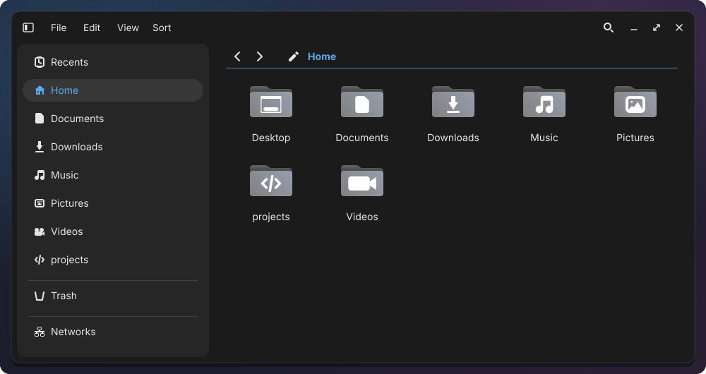

# Files tab counts (taskbar add-on)

Lets the [Taskbar](../taskbar/README.md) show what each COSMIC Files window holds: "2 tabs" when
it has several tabs, or "14 items" for the folder you are looking at when it has one.

COSMIC Files does not tell other programs about its tabs. This add-on installs a COSMIC Files with
one small addition: it writes its window title, tab count and item count to a file the taskbar
reads. Everything else is the normal COSMIC Files, built from System76's source at the version the
patches were tested on.

The counts are only useful together with the Taskbar. The patched Files also gives folders
their own icon (see [Folder icons](#folder-icons)).

## What the count means

- "N tabs" when the window has more than one tab.
- "M items" with one tab: the files and folders the window shows, hidden files only while "Show
  hidden files" is on, and the search results while a search runs.

## Folder icons

A folder can show its own icon, the way Music shows the music icon. The patched Files reads the
icon from a small `.directory` file inside the folder, the same file KDE's Dolphin uses.



To give your projects folder the code folder icon:

1. Create the file `~/projects/.directory` with these two lines:

   ```ini
   [Desktop Entry]
   Icon=folder-development
   ```

2. In Files, open the folder that lists `projects` (here your home folder) and press F5 to reload it.

`folder-development` is a COSMIC-style folder with `</>` that this tool installs (see
[icons/](icons/README.md)). `Icon=` takes any icon name from your icon theme, or an absolute path
to an image of up to 1 MB. An icon name the theme does not have shows the plain folder. If the
folder is in the sidebar, it shows the matching small icon there too.

Stock COSMIC Files has no custom folder icons yet; see the requests
[cosmic-files #591](https://github.com/pop-os/cosmic-files/issues/591) and
[cosmic-files #1427](https://github.com/pop-os/cosmic-files/issues/1427). This approach is described
there in [a comment](https://github.com/pop-os/cosmic-files/issues/1427#issuecomment-7047608235); add a 👍 to the request if you want it in COSMIC too.

## Install

```sh
./install.sh files-tabs
```

Needs Rust and a few build packages (the installer offers to install them). File manager windows
that are already open keep running the old version until you close them.

## Uninstall

```sh
./install.sh --uninstall files-tabs
```

The launcher, the dock and "Show in folder" open COSMIC's own file manager again. The desktop
icons are not affected either way.

## Settings

None.

## Known limits

- Two file manager windows with exactly the same title get no count.
- Folder icons from `.directory` show in the file manager windows and their sidebar, not in the
  desktop icons (those are COSMIC's own). Folders on network shares (smb, sftp, nfs) keep the
  plain icon. After you add or edit a `.directory` file, reload the folder that lists it (F5).
- While a large folder is still loading, the count starts at 0 and climbs until the folder is loaded.
- A COSMIC update needs no rebuild: it is always built from the tested version. `./install.sh --update`
  brings new releases, which move the patches to newer COSMIC versions.

Technical details: [docs/files-tabs.md](../docs/files-tabs.md).
