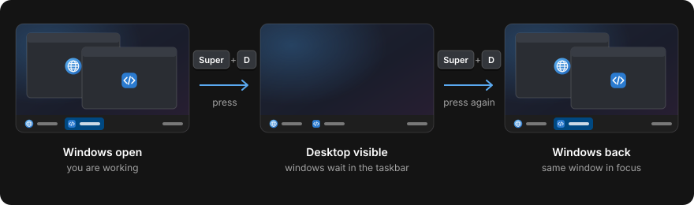

# Show Desktop

Super+D shows the desktop, like on Windows. Press it again and your windows come back.



## What it does

- **Super+D** minimizes every open window on the current workspace. Windows on other workspaces
  are left alone.
- **Super+D again** brings them back, and the window you were working in is on top and focused.
- Windows you had minimized yourself before the first press stay minimized.
- If you open a window in between, the next press minimizes again instead of restoring.
- With several monitors it works on the active workspace of each monitor.

## Install

```sh
./install.sh show-desktop
```

Needs only Python 3, which Pop!_OS ships. No build step. The installer adds the Super+D shortcut
to COSMIC's custom shortcuts, unless you already have a shortcut for `show-desktop`.

## Change the key

Edit the custom shortcut in COSMIC Settings (keyboard shortcuts). The command is `show-desktop`.

## Uninstall

```sh
./install.sh --uninstall show-desktop
```

This also removes the Super+D shortcut it added. Your other shortcuts are kept.

## Settings

None.

Technical details: [docs/show-desktop.md](../docs/show-desktop.md).
