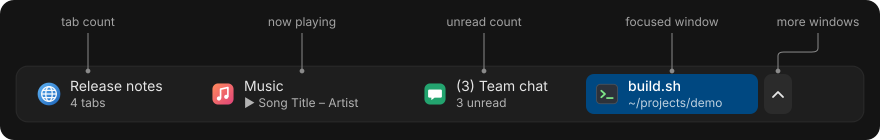
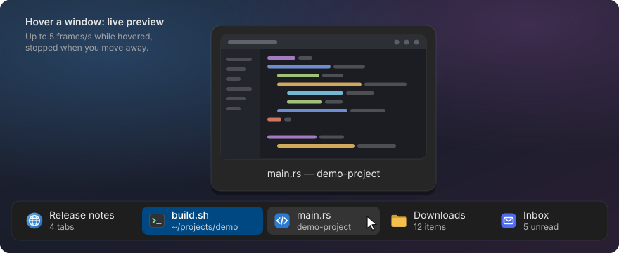
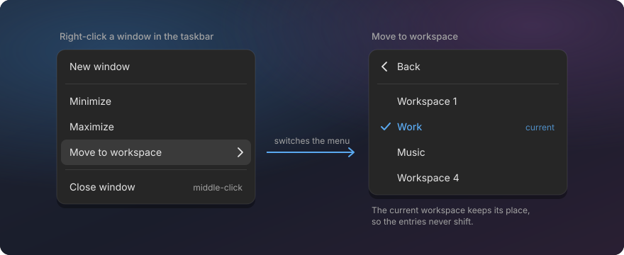

# Taskbar

A Windows-style taskbar for COSMIC: one button per open window on the current workspace, with the
app icon, the window title and a useful second line.



## What you get

- **One item per window** on the workspace you are on, open or minimized. Switch workspace and the
  taskbar shows that workspace's windows.
- **A second line that tells you something**, for example:
  - "3 tabs" for Firefox and COSMIC Terminal, "2 tabs" or "14 items" for COSMIC Files
    (the terminal and Files counts need the add-ons below);
  - the song that is playing ("▶ Title – Artist") for music and video players;
  - "3 unread" when a chat or mail window has `(3)` in its title;
  - progress or status that an app reports to the dock (the same signal KDE and Dash-to-Dock use);
  - otherwise the second half of a long title, for example the project name in VS Code.
- **The focused window is highlighted** with a solid background in your accent colour.
- **Live preview on hover**: rest the pointer on an item and a small live picture of the window
  appears. Minimized windows show their last picture.

  

- **Click** raises a window; click the focused one to minimize it. **Middle-click** closes it.
- **Right-click menu** with the app's own actions (Firefox: New Window, New Private Window),
  Minimize/Restore, Maximize, Close, and **Move to workspace** to send the window to another
  workspace by name or number.

  

- **No clutter when there are many windows**: items shrink first, then the rest go into a popup
  behind an arrow, with the same previews.
- **No doubled icons**: the App List and the dock hide an app while its window is already in the
  taskbar, and show it again when the window closes. Your pinned apps and their order stay as they
  are.

## Install

```sh
./install.sh taskbar
```

Or without cloning first:

```sh
curl -fsSL https://raw.githubusercontent.com/jwillmer/cosmic-desktop-extras/main/install.sh | bash -s -- taskbar
```

The taskbar is compiled from System76's source for the COSMIC version you have installed. The
installer offers to install Rust and a few build packages, and the first build takes several
minutes. The panel keeps running; only the taskbar and App List applets reload.

The taskbar replaces COSMIC's **Minimized Windows** applet. Stock COSMIC has that applet in the
dock, not in the top panel. To get the taskbar in the panel, open the panel applet settings
(`cosmic-settings panel-applet`, or COSMIC Settings → Desktop → Panel → Applets), add
"Minimized Windows" to the panel and remove it from the dock if you don't want it twice.

Optional add-ons for more second lines: [Terminal tab counts](../terminal-tabs/README.md) and
[Files tab counts](../files-tabs/README.md).

## Uninstall

```sh
./install.sh --uninstall taskbar
```

The panel goes back to COSMIC's own Minimized Windows and App List applets. Your settings files
are kept.

## Settings

All optional. Plain text files in `~/.config/minimize-ws/`; changes apply as soon as you save.

| File | What it does | Example line |
|---|---|---|
| `ignore` | Apps that never show in the taskbar, one app id per line | `org.example.MusicPlayer` |
| `sizes` | Item widths in pixels | `item_width = 220` |
| `colors` | Colour of the focused item (`system` or `#RRGGBB`) | `focused_bg = #3584e4` |
| `detail` | Turn off second-line rules for one app | `firefox -media` |

All keys and defaults: [docs/taskbar.md](../docs/taskbar.md#configuration). Apps can also put
their own text on the second line: [docs/launcher-entry.md](../docs/launcher-entry.md).

Workspace names in the Move to workspace menu come from COSMIC's pinned workspaces:
[how to name them](../docs/taskbar.md#workspace-names).

## After a COSMIC update

The taskbar checks once a day and shows a notification when COSMIC was updated and the taskbar
needs a rebuild. Then run:

```sh
./install.sh --update
```

## Known limits

- Works on top and bottom panels. On a side panel the items stay as small thumbnails.
- No "peek" at the real window on the desktop: COSMIC has no way for an applet to do that yet.
- Firefox's tab count can lag up to 15 seconds, because Firefox saves its tab list that often.
- Two Firefox windows showing the same page title (for example two "New Tab" windows) get no tab
  count.

Technical details: [docs/taskbar.md](../docs/taskbar.md).
