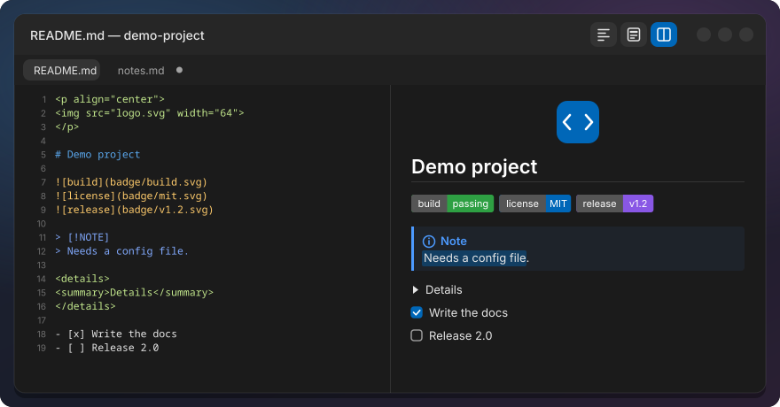
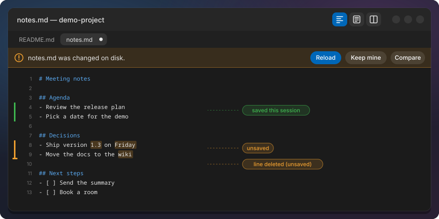
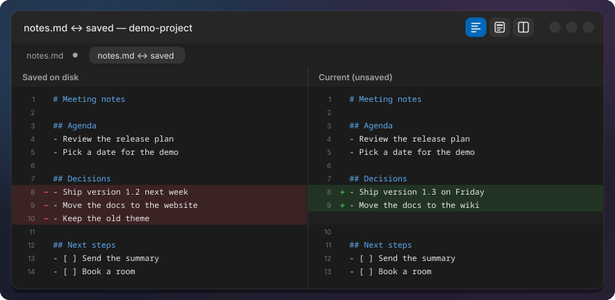
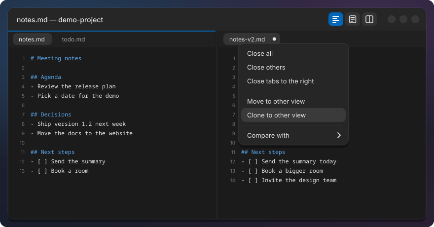

# Text Editor

Blog post: [a Notepad++-style Text Editor for COSMIC](https://jwillmer.de/blog/projects/cosmic-text-editor.html)

COSMIC Text Editor with the comforts of Notepad++: Markdown files open rendered, every file opens
as a tab in one window, the tabs of your last session come back with their unsaved changes, and
changed lines are marked until you save. It also has Mermaid diagrams and a heading outline for
Markdown, JSON formatting, visible whitespace, column selection, code folding, closing all tabs at once and two
views side by side. Everything else is the normal COSMIC Text Editor, built
from System76's source for the version you have installed.



Real screenshots of the current build: [Screenshots](../docs/text-editor.md#screenshots).

## Markdown views

Every Markdown tab has three views. Pick one with the three buttons at the right of the header bar
(the active one is highlighted) or at the top of the View menu; both show only for Markdown files.

- **Preview:** the rendered page, read-only. Markdown files open here.
- **Source:** the plain text, as before.
- **Split:** the editor on the left and a live preview on the right.

| Keys | What it does |
|---|---|
| Ctrl+Shift+V | Switch between Preview and Source |
| Ctrl+Alt+V | Switch between Split and Source |
| Ctrl+Alt+1 / 2 / 3 | Source / Split / Preview |

The preview shows headings, lists, task lists, tables, code blocks and local images, and the HTML
that READMEs use: centred logos, badge rows, fold-out `<details>` sections, GitHub alerts
(`> [!NOTE]`) and footnotes. Images also sit inline in headings, lists and tables. Code blocks
with a language tag (`json`, `bash`, `python`, ...) get the same syntax colours as in the editor,
and ` ```mermaid ` blocks are drawn as diagrams (flowchart, sequence and more; code that is not
valid stays a code block). It is drawn by the editor itself, without a built-in browser, so the
editor still opens instantly.

In Split view the editor and the preview scroll together, whichever one you scroll (View, **Sync
preview scrolling**). View, **Outline** (Ctrl+Alt+O) shows the file's headings in a panel at the
left: the one you are in is highlighted (in Preview, the one at the top of the page), a click jumps
to it. Fold-out `<details>` you opened stay open while you edit.

Text in the preview can be selected and copied as on a web page: drag across paragraphs, lists,
code blocks and tables (past the top or bottom edge the page scrolls along), double-click a word,
triple-click a paragraph, Shift+click to extend, Ctrl+A for everything. Ctrl+C copies the text as
you see it, with list markers (`- `, `1. `, `- [ ] `) and table cells separated by tabs.

Images from the web are not loaded unless you turn on Settings, **Load images from the web in
Markdown previews** (off by default; `https` only, up to 10 MB each). Until then a small label with
their description shows instead.

Links are safe to click: web and `mailto` links open in your browser or mail app, links to text and
Markdown files open in the editor, images and PDFs open in their viewer. Anything that could run a
program (scripts, `.desktop` files, other link types) is ignored.

## One window

Opening a file while the editor runs (double-click, "Open with", `cosmic-edit file.md`) adds a tab
to the running window, which comes forward with focus, instead of opening a new one. A file that is already open gets its tab
focused. File, New window still opens a second window.

## Session restore

Like Notepad++: the editor brings back every tab from last time, including unsaved changes and
untitled drafts, with cursor, scroll position and Markdown view. The window opens at its last size,
maximized if it was; where it sits on screen is up to COSMIC (Wayland apps cannot place windows).

- Closing the window does not ask to save: your drafts are kept. Closing a single tab with unsaved
  changes still asks.
- Drafts are saved a few seconds after you stop typing, at least every 15 seconds while you type,
  and when you quit. A crash loses only the last seconds.
- If a draft cannot be written (disk full), closing the window asks to save as before.

## Changes

Like Notepad++ change history, a thin bar left of the line numbers shows what you changed:
**orange** for unsaved changes, **green** for changes saved in this session. Inside an orange line
the changed words are tinted, so you see what you typed without reading the whole line. A new
document stays unmarked until its first save.

When another program changes a file you have unsaved changes in, the editor does not throw your
work away. A bar above the text asks: **Reload** (take the version on disk; Undo brings yours
back), **Keep mine** (your next Save overwrites it) or **Compare**. Save never silently overwrites a
change it has not shown you. A tab without unsaved changes simply reloads, as before. The check
also runs when you switch to a tab and when you come back to the editor window, so a change the
file watcher missed (network or Windows drives) shows up too.



**Compare with saved** (File menu or right-click, or a click on an orange bar) opens a tab with your
unsaved changes against the file on disk: removed lines red, added lines green. **Compare with...**
compares the tab with another open tab, unsaved text included.



## Tabs and views

**Close all tabs** (Ctrl+Shift+W), Close others and Close tabs to the right are in the File menu and
the tab's right-click menu. Tabs with unsaved changes get one question: Save all, Discard all or
Cancel. Closing every tab leaves one empty tab open.

**Two views:** View, Move to other view or Clone to other view shows two tabs side by side, each
view with its own tab bar; an accent line marks the active one. Drag the divider to resize them, or
drag a tab anywhere into the other view to move it there. A clone shows the same document: what you
type in one appears in the other, unsaved and untitled tabs included, and saving one saves both.
Like Notepad++, a view shows a document once: moving or dragging a clone into the view that holds
its twin closes the moved one, and Clone to other view shows the clone that is already there.
Closing a clone while its twin is open does not ask to save, because nothing is lost; closing the
last one asks as usual. When closing empties a view, the other view keeps the tab it showed.
View, Synchronize vertical scrolling scrolls both together (also sideways), and Compare with...,
Compare the two views shows their differences. The session brings both views back.



## Editing tools

**JSON** (on `.json` tabs, Edit menu):

| Keys | What it does |
|---|---|
| Ctrl+Alt+Shift+F | Format JSON (indented with the tab width) |
| Ctrl+Alt+Shift+M | Minify JSON |
| Edit, Validate JSON | Shows line, column and reason of the first error, with Go to |

Key order and numbers stay exactly as written, and Undo brings the old text back in one step.
Files over 20 MB are not touched.

**Whitespace and line endings** (View menu): Show whitespace marks spaces with dots and tabs with
arrows, Show line endings marks each line end. The Line endings submenu shows whether the file uses
LF, CRLF, CR or a mix, and converts to LF or CRLF in one undo step. Enter uses the file's own line
ending.

**Column selection:** hold Alt and drag, or press Alt+Shift+arrows, to select a block of columns
over several lines. Typing, Backspace, Delete, Copy, Cut and Paste then work on every line, in one
undo step. Not available with vi key bindings.

**Folding:** click the arrow right of a line number (▸ folded, ▾ shows on hover or on the cursor
line), or use View, Fold (Ctrl+Shift+[) and Unfold (Ctrl+Shift+]), Fold all and Unfold all. It
folds JSON and code blocks, indented blocks and Markdown sections; a folded line ends in `…`.
Folding only hides lines, the text is never changed, and folds come back after a restart.
Editing, Undo, a search hit or a column selection inside a fold opens it again.

## Upstream request

Markdown preview is requested for COSMIC itself in
[cosmic-edit #247](https://github.com/pop-os/cosmic-edit/issues/247), session restore in
[cosmic-edit #94](https://github.com/pop-os/cosmic-edit/issues/94). Add a 👍 if you want them too.

## Install

```sh
./install.sh text-editor
```

Built from System76's source for the COSMIC version you have installed: needs Rust and a few build
packages (the installer offers to install them). Afterwards, close and reopen the Text Editor:
only editor windows opened after the install use it.

## Uninstall

```sh
./install.sh --uninstall text-editor
```

The launcher, the dock and double-clicking a file start COSMIC's own Text Editor again. Your
session and drafts stay on disk.

## Settings

In the Text Editor's Settings:

- **Open Markdown files in:** Source, Preview or Split. The default is Preview. An empty file always
  opens in Source, so you can start typing straight away.
- **Restore previous session:** on by default. Off: the editor behaves as before and the stored
  session is deleted.
- **Show changed lines** and **Highlight changed text:** on by default.
- **Load images from the web in Markdown previews:** off by default.

## Known limits

- A tab dragged to the other view always lands at the end of its tab bar, and Esc does not
  cancel the drag.
- Images from the web need GVfs (gvfsd-http); without it the label stays.
- Preview selection: a double-click on a link opens it (as in a browser); task boxes and image
  labels are copied but not highlighted, or not selectable; a line break inside a table cell
  splits the copied row; editing, opening a `<details>` or a reload clears the selection.
- The window position is not restored, only its size.
- After a COSMIC update, run `./install.sh --update`. The daily update check reminds you.

Technical details: [docs/text-editor.md](../docs/text-editor.md).
