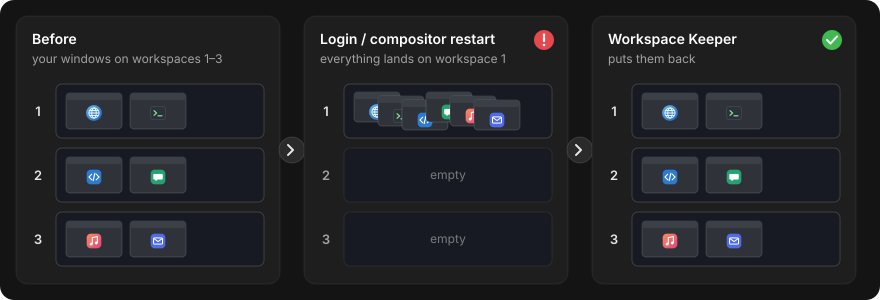

# Workspace Keeper

Your windows go back to their workspaces after you log in again or after the desktop restarts.

When you log back in, or when the compositor crashes and restarts, the windows that come back
(apps that start with the session, a browser restoring its windows) do not land on the workspaces
they were on. Workspace Keeper remembers which workspace each window was on and moves the windows
back for you.



## How it works for you

- It runs in the background and saves a snapshot whenever you open, close or move windows
  (a few seconds after things settle down, not on every change).
- After a login it waits a moment, then for three minutes moves each window that appears back to
  its old workspace. Apps that start slowly are caught too.
- Windows are recognised by app and title, so the match is good but not perfect.
- The last 300 snapshots are kept in `~/.local/state/ws-keeper/`.

## Install

```sh
./install.sh ws-keeper
```

Needs only Python 3, which Pop!_OS ships. No build step.

**Pin your workspaces.** COSMIC removes empty workspaces in between and renumbers the rest, so the
saved workspace numbers can point to the wrong place. A pinned workspace stays even when empty:
press Super+W, right-click a workspace and choose Pin.

## Commands

You rarely need them, but they are there:

```text
ws-keeper list                windows and their workspace now
ws-keeper restore             move windows back from the snapshot before this login
ws-keeper restore --latest    move windows back from the newest snapshot (undo a mistake)
ws-keeper restore --dry-run   show what would move, move nothing
ws-keeper snapshots           list the saved snapshots
```

## Uninstall

```sh
./install.sh --uninstall ws-keeper
```

## Settings

None.

## Known limits

- Two windows of the same app with the same title can swap places (for example two Firefox
  windows showing the same page).
- A window you moved or closed in the last minute before a crash may not be in the snapshot yet.
- Only windows that exist again after the login can be moved: it does not start apps for you.

Technical details: [docs/ws-keeper.md](../docs/ws-keeper.md).
